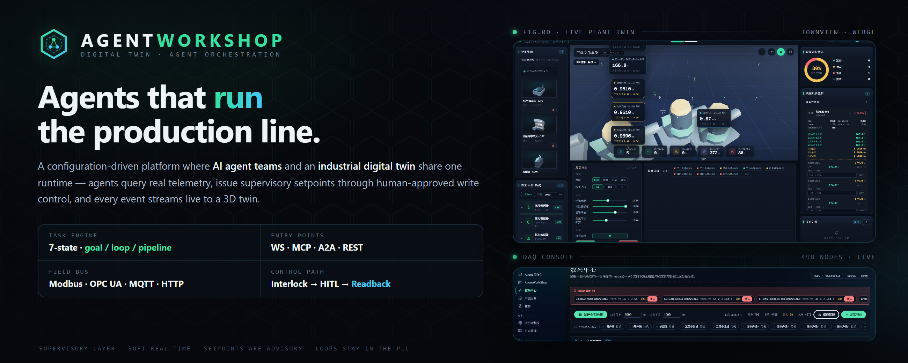
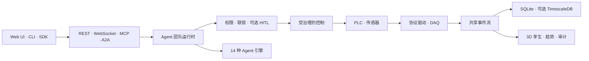

<div align="center">



# AgentWorkShop

**让 Agent 团队、工业数据与受治理的控制流程运行在同一平台。**

[](https://www.npmjs.com/package/agentworkshop)
[](https://github.com/kingdol666/AgentWorkShop/releases)
[](./LICENSE)
[](https://nodejs.org)
[](https://kingdol666.github.io/AgentWorkShop)

[English](./README.md) · [在线文档](https://kingdol666.github.io/AgentWorkShop) · [版本发布](https://github.com/kingdol666/AgentWorkShop/releases) · [参与贡献](#参与贡献)

</div>

> [!IMPORTANT]
> **这是监督层，不是安全控制器。** AgentWorkShop 面向秒级软实时的产线监控与协同。联锁、安全功能、伺服环路和所有硬实时控制逻辑必须留在 PLC 或专用安全系统中。Agent 提议的设定值会按配置边界校验；仅当节点绑定启用 `manual` 模式时，才会等待人工审批。现场侧逻辑始终拥有最终否决权。

## AgentWorkShop 是什么？

AgentWorkShop 是一个开源工业 Agent 运行时。它把多 Agent 团队接入产线数据与作业流程，并在同一套可配置平台中管理遥测、权限、控制和审计记录。

适用于：

- **产线与工艺工程师：**集中查看设备、配方、批次、报警和趋势。
- **工业 AI 团队：**让 Agent 分析真实遥测，并在人工复核下提出有边界的操作建议。
- **平台开发者与研究人员：**获得可扩展的运行时、模拟器友好的工作流和清晰的集成接口。

## FIG.06 — 产品演示

https://github.com/user-attachments/assets/241ad4e4-2645-4bef-8eb1-499739dc9ce1

<p align="center">
  <a href="https://github.com/kingdol666/AgentWorkShop/blob/c73a509c6e515d02d1290e54cab901ea9aff430b/docs/site/public/demo/agentworkshop-core-demo.mp4">在 GitHub 打开 MP4</a>
  · <a href="https://raw.githubusercontent.com/kingdol666/AgentWorkShop/c73a509c6e515d02d1290e54cab901ea9aff430b/docs/site/public/demo/agentworkshop-core-demo.en.vtt">English subtitles</a>
  · <a href="https://raw.githubusercontent.com/kingdol666/AgentWorkShop/c73a509c6e515d02d1290e54cab901ea9aff430b/docs/site/public/demo/agentworkshop-core-demo.zh-Hans.vtt">简体中文字幕</a>
</p>

<sub>67 秒实机界面演示，英文配音。视频使用隔离的 Mock PLC 场景；演示产线保持停止，未连接真实 PLC，也未发送控制写入。</sub>

## 核心能力

| 领域 | 能力说明 |
|---|---|
| **Agent 团队** | 14 种引擎适配器共用一套运行契约；支持主从团队、目标/循环/流水线任务、定时作业和持久记忆。 |
| **工业数据** | 支持 Modbus TCP/RTU、OPC UA、MQTT、HTTP 与串口插件；采集实时遥测，并按产线、配方和批次查询历史数据。 |
| **受治理的控制** | 产线级权限、安全量程与配方窗口校验、`manual` 模式下的 HITL 审批、PLC 回读以及可追溯审计。 |
| **孪生与建模** | 事件驱动的 3D 产线视图、自动建模实验室（AML）、本体建模和受治理的工艺优化流程。 |
| **集成与扩展** | 提供 REST、WebSocket、MCP、A2A 接入；包含 TypeScript SDK、CLI/TUI 和支持热重载的插件系统。 |

## 系统如何协同



系统将观察与动作分开：DAQ 读取并发布遥测；控制请求先通过产线权限和工艺边界校验，节点绑定启用 `manual` 模式时还需人工审批；PLC 回读与审计记录用于闭合操作链路。

## 快速开始

### 安装已发布版本

**要求：**Node.js 23.4.0 或更高版本。

```bash
npm install -g agentworkshop
aw start
# 浏览器打开 http://localhost:3001
```

全局安装会把配置与运行数据保存在 `~/.AgentWorkShop`。Agent 引擎按需从 `PATH` 探测；只需安装计划使用的引擎。

### 从源码运行

```bash
git clone https://github.com/kingdol666/AgentWorkShop.git
cd AgentWorkShop
pnpm install
pnpm dev
```

源码开发模式会在配置指定的本地端口启动界面。配置说明和首次 Agent 工作流见[快速上手指南](https://kingdol666.github.io/AgentWorkShop/guide/getting-started)。

> 初次使用请先连接模拟器或非生产环境。接入真实产线前，先检查节点绑定、产线权限、安全量程、配方窗口和 HITL 模式设置。

## 文档导航

| 从这里开始 | 了解更多 |
|---|---|
| [快速上手](https://kingdol666.github.io/AgentWorkShop/guide/getting-started) | 安装、配置与第一次运行 |
| [DAQ 协议](https://kingdol666.github.io/AgentWorkShop/guide/daq-protocols) | 协议驱动、遥测和节点配置 |
| [写控制与 HITL](https://kingdol666.github.io/AgentWorkShop/guide/dcw-read-write) · [HITL 审批](https://kingdol666.github.io/AgentWorkShop/guide/hitl) | 权限校验、可选审批、写入和回读 |
| [插件开发](https://kingdol666.github.io/AgentWorkShop/plugins/) · [SDK](https://kingdol666.github.io/AgentWorkShop/sdk/) · [CLI](https://kingdol666.github.io/AgentWorkShop/cli/) | 扩展或自动化平台 |
| [多引擎架构](./docs/multi-harness-architecture.md) · [TUI](./docs/tui.md) | 运行契约与终端工作流 |
| [审计与基准记录](./docs/audit/) | 验收证据与可复现报告 |

## 开发

```bash
pnpm dev
pnpm lint
pnpm typecheck
pnpm docs:build
pnpm test:unit
```

修改功能时，请同步更新对应文档。文档构建会检查链接与站点页面。

## 参与贡献

欢迎提交 Issue 和 Pull Request。建议在贡献中：

1. 说明用户问题和期望行为。
2. 指明相关指南或运行契约。
3. 为行为变更提供聚焦测试或可复现示例。
4. 运行相关检查，并记录所需环境条件。

## 安全

漏洞请通过 [GitHub Security Advisories](https://github.com/kingdol666/AgentWorkShop/security/advisories/new) 私下报告，不要发布公开 Issue。连接真实设备前先用模拟器验证，并将安全关键逻辑留在 PLC。

## 许可证

AgentWorkShop 使用 [Apache License 2.0](./LICENSE) 开源。它是独立项目，并非任何大语言模型或模型厂商的官方产品。
