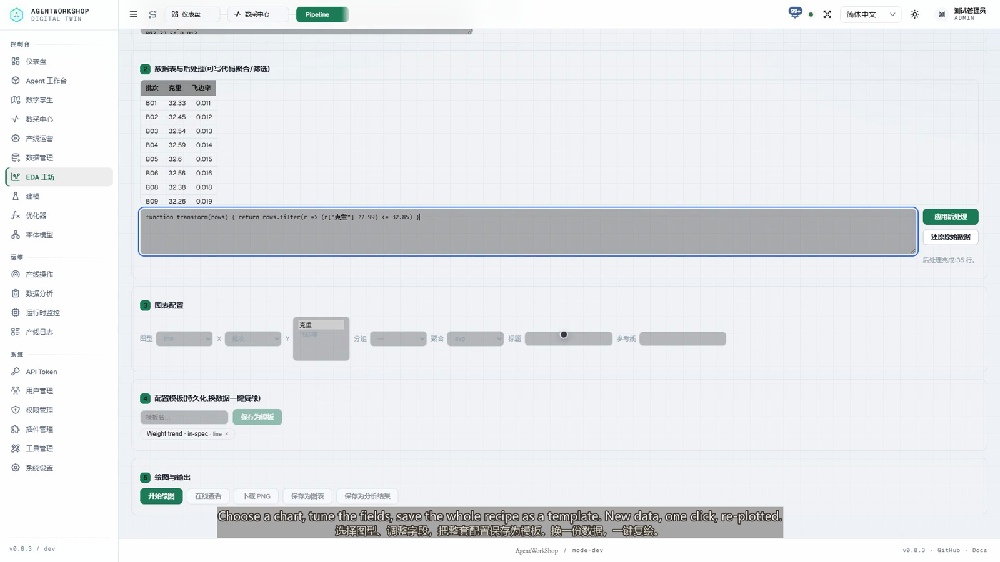
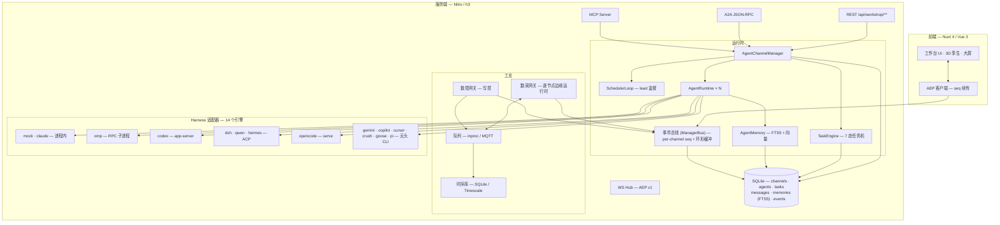

<div align="center">


<br />

# AgentWorkShop

**AI Agent 团队与产线在此交汇。**

[](https://github.com/kingdol666/AgentWorkShop)
[](https://github.com/kingdol666/AgentWorkShop)
[](https://github.com/kingdol666/AgentWorkShop/releases)
[](https://github.com/kingdol666/AgentWorkShop/stargazers)
[](https://github.com/kingdol666/AgentWorkShop/commits)
[](https://github.com/kingdol666/AgentWorkShop/issues)
[](./LICENSE)

[](https://nuxt.com)
[](https://vuejs.org)
[](https://www.typescriptlang.org)
[](https://nodejs.org)
[](https://nodejs.org/api/sqlite.html)
[](./docs/site/guide/daq-protocols.md)
[](./docs/plugins.md)
[](https://kingdol666.github.io/AgentWorkShop)
**[English](./README.md)** · **[在线文档](https://kingdol666.github.io/AgentWorkShop)** · **[版本发布](https://github.com/kingdol666/AgentWorkShop/releases)** · **[更新日志](./changelog.md)** · **[插件 API](./docs/plugins.md)** · **[SDK](./docs/sdk.md)**

<sub><b>v0.8.7</b> · 14 个执行引擎 · 6 种现场协议（5 内置 + 串口插件）+ MES REST 集成（镜像与直连双路径）· 数据分析台账（产线级权限隔离）· 工艺参数优化器（过程模型 → AML → OSQP 求解 → 治理下发）· **本体服务 + AI 先行模型闭环**（本体 · 孪生 · 求解器 · AML 采纳）· 104 个宿主工具 · 128 个运行时设置项 · 双语文档（简体中文 / English）</sub>

<br />

*一个配置驱动的平台：**AI Agent 团队**与**工业数字孪生**共享同一运行时——Agent 查询真实遥测、经人工审批的写控回路下发监督设定值，每个事件实时推送到 3D 孪生。*

</div>

[快速开始](#快速开始) · [实机演示](#实机演示) · [核心能力](#核心能力) · [设计架构](#设计架构) · [插件与扩展](#插件与扩展) · [验证与验收](#验证与验收) · [文档站](https://kingdol666.github.io/AgentWorkShop)

---

## 这是什么？

一个配置驱动的平台：**AI Agent 团队**与**工业产线**共享同一运行时——Agent 查询真实遥测、经人工审批的写控回路下发监督设定值，每个事件实时推送到 3D 孪生。

- **监督层定位**（SCADA 同位，秒级软实时）：数采、写控、产线/配方/批次、权限、审计一体；
- **Agent 不是聊天装饰**：14 个执行引擎可混编（omp / codex / opencode / claude / gemini / …），7 态任务机 + 根任务队列 + HITL 审批，Agent 与节点绑定后按授权读写真实设备；
- **闭环是真的**：读数 → 分析 → 提案 → 审批 → 写穿 → 回读证实 → 台账留痕，全链有实机验收。

## 实机演示

<p align="center">
  
  <br/>
  <sub><b>闭环全流程</b> —— 录制自运行中的实例:真实数采历史、真实写控、真实 HITL 审批</sub>
</p>

<p align="center">
  
</p>

<p align="center">
  
</p>

> [!NOTE]
> 本 README 中的每一张图都是**运行中实例**的截图（v0.8.7 生产构建），没有一张是效果图。

<p align="center">
  <a href="https://kingdol666.github.io/AgentWorkShop/demo/player.html">
    
    <br/>
    <sub><b>🎬 3 分钟产品演示</b>（点击封面打开播放页 · 英文界面/配音 · 汉英字幕）</sub>
  </a>
</p>

## 核心能力

| 能力域 | 一句话 | 深入 |
|---|---|---|
| **Agent 团队运行时** | lead 编排 + worker 交付，7 态任务机、根任务 FIFO 队列、执行租约、过程记忆（FTS5+向量）、群聊与定时任务 | [设计架构](#设计架构) |
| **工业栈** | 五族现场协议（Modbus TCP/RTU · OPC UA · MQTT · HTTP）+ 串口插件 + MES REST（镜像/直连双路径）；数采三节拍、写控四层限界、逐参数 ACK | [协议指南](./docs/site/guide/daq-protocols.md) |
| **Agent × 设备绑定** | 节点级授权三轨（dcw 点位收窄 / recipe 单配方 / line-recipe 产线管理权），语义卡注入提示词，直写恒拒、全部写入过联锁+HITL | [HITL 指南](./docs/site/guide/hitl.md) |
| **模型闭环** | AML 自动建模（物理先验+残差+conformal UQ）→ 晋级门禁 → HITL 采纳 → production 投用 → 模型驱动试验 | [AML 手册](./docs/aml.md) |
| **优化器** | 过程模型 → OSQP 求解 → recipe_trial 试验 → 进步才固化 → 统一回退（PLC 整批恢复） | [配方版本](./docs/site/guide/recipe-versions.md) |
| **治理与可观测** | 产线三态权限、结构化审计与错误台账、/operations 操作流水、系统监控指标 | [产线权限](./docs/site/guide/line-permissions.md) |
| **插件生态** | 热重载插件：自定义驱动/处理器/节点模板/Agent 工具/HTTP 路由/浏览器面板/Twin Provider，`aw plugin` CLI + MCP `list_changed` | [插件与扩展](#插件与扩展) |

## 设计架构



**Agent × 机器之桥**（值得读源码的部分）：

```
agent ──绑定──▶ 节点 (daq: auto / dcw: manual)
  │                    │
  │  my_industrial_nodes  ◀── 语义卡：物理含义 · 单位 · 安全量程 · 配方窗口
  │  daq_query             ◀── 时序库历史，统计 + 物理语义
  │  dcw_control           ──▶ 联锁（安全量程 ∩ 配方窗口）
  │                           ──▶ HITL 审批（manual 模式，180s 超时）
  │                           ──▶ PLC 写入 → 回读校验 → ACK + 写历史
  ◀── Agent 可引用数值的结果文本
```

## 快速开始

```bash
node -v                            # ≥ 23.4.0（需要内置 node:sqlite）
npm install -g agentworkshop       # → `aw` / `agentworkshop` 进入 PATH（含预构建产物，无需构建）
aw start                           # → http://localhost:3001，一切初始化进 ~/.AgentWorkShop
```

不想全局安装：`npx agentworkshop start`。源码运行：`git clone … && pnpm install && pnpm dev`（→ 3000）；生产：`pnpm build && pnpm start`。更新：`aw update`。

> 真实 Agent harness 需要对应 CLI 在 PATH 中（`omp` / `codex` / `opencode` / … 任选子集，同 Channel 可混用；`mock` 与 `claude` 进程内运行无需 CLI）。可选数采基础设施（MQTT broker + TimescaleDB）在 Docker 可达时自动拉起。

**第一次「Agent × 产线」会话（约 2 分钟）：**

1. **登录** —— 侧边栏注册（或 `POST /api/users/register`）。
2. **搭产线** —— 「产线运营」→ 建产线，加数采节点（如 `daq-temp-tc`）与数控节点（如 `dcw-temp-sp`），建产品 + 配方，点**开跑**。
3. **建团队** —— 「Agent 工作台」→ 选 lead + workers 后**部署**进 Channel。
4. **绑定节点** —— Agent 详情面板 → 绑数采（*auto*）与数控（*manual* = 需您的批准）。
5. **提交目标** —— 「分析最近 5 分钟熔体温度；若与 182 °C 偏差超过 1 °C，修正设定值（等我的批准）。」
6. **审批** —— Agent 读真实历史、发起写请求 → HITL 面板批准 → 设定值变化，目标收口并给出数值报告。

<details>
<summary><b>配置驱动 · 认证 · 产线权限 · 执行模式 · 定时任务（点开）</b></summary>

一个运行时，一个事实来源：**`config.yml`**（默认）< **`runtime-settings.json`**（运行时）< 环境变量 / CLI；每个键在 `shared/config/schema.json` 声明一次，前端设置页与 CLI 消费同一份描述符。

**认证**：邮箱+密码签发 bearer token（多 token、可单独吊销）；`POST /api/users/register` → `authorization: Bearer <token>` 调 `/api/workshop/**`。

**产线三态权限**（管理员在 `/permissions` 维护）：无权（默认，后端不返回数据）/ 仅查看（只读）/ 可操控（读+写）。Agent 写授权三轨：`dcw` 点位绑定=写授权兼下发收窄；`recipe`=单配方操作权；`line-recipe`=产线全部配方管理权。直写恒拒，全部写入仍经四层限界/运行门/HITL/逐参数 ACK。

**执行模式**：`goal`（lead 分解→判定→补发至满意）/ `loop`（固定间隔重放）/ `pipeline`（有序阶段）。

**定时任务**：`interval`（60s 下限）/ `daily` 双模式；忙等守卫、逐次历史、连续失败熔断；`/workshop/schedules` 页面或 REST 管理。

**四个入口**：WS（AEP v1，seq 续传）· MCP（进程内服务）· A2A（JSON-RPC 2.0 + AgentCard）· REST（完整管理面）。

**任务状态机**：`SUBMITTED → ASSIGNED → WORKING → WAITING → COMPLETED`（任一态可 `CANCELED / FAILED`，重试 ≤ 3）。

</details>

<details>
<summary><b>部署 · 项目结构 · 开发指南（点开）</b></summary>

**部署**：TLS 终结在前置反代；可选基础设施 `docker compose up -d`（MQTT + Timescale + MinIO）；`pnpm build && pnpm start`（端口取 `config.yml` → `server.prod.port`）。数据全部落配置根，跨版本迁移在启动时自动执行。

**项目结构**：`app/`（Nuxt 前端）· `server/`（API 与服务：agents/daq/dcw/aml/plugins）· `shared/`（前后端共享契约：配置 schema、协议目录）· `scripts/`（验收与工具脚本）· `bench/`（工业基准管线）· `docs/`（文档与验收证据）· `plugins-builtin/`（内置插件）。

**开发**：`pnpm dev` 热更；`pnpm typecheck && pnpm lint` 门禁；`npm run test:unit`（自带 server tsconfig 与 force-exit）；文档站 `npm run docs:dev`（VitePress，中/英）。

</details>

## 插件与扩展

插件是平台的一等扩展面：一个目录 + `index.mjs` 即可获得 **Agent 工具注册（`ctx.tools`）、自定义数采驱动（`ctx.daq.registerDriver`）、处理器与节点模板、HTTP 路由、浏览器面板、设置项与 i18n、Twin Provider（`ctx.twin`）、产线权限钩子（`ctx.permissions`）**；启停即时热重载，单插件失败隔离不影响主服务。内置示例覆盖全家桶：自定义驱动+降额处理器（`aw-matrix-plugin`）、向量帧（`daq-vector-demo`）、知识库桥（`rag-bridge`）、诊断桥（`diag-bridge`）、串口（`serial-bridge`）、孪生 Provider（`twin-injection-default`）。外部仿真程序（如 MATLAB/Simulink）可经「Twin Provider 注册」或「插件工具 spawn」接入，仿真输出直接作为优化依据。→ [插件 API](./docs/plugins.md) · [SDK](./docs/sdk.md) · [MCP](./docs/mcp.md)

## 验证与验收

每一层论断背后都有可复跑的套件。验收按 **aw-system-acceptance 五层流程**（静态门禁 → 单元契约 → 实机核心闭环 → 回归面 → 插件工具面）执行，2026-10-29 全量轮：**24 项套件/核查、约 1100+ 断言全绿**；真实设备联动矩阵（`e2e-golive-matrix`）**21/21**——五族真实协议栈接通、平台样本=设备侧真值、四协议写穿、Agent 令牌批量落穿、断链如实失败与自愈；安全加固 **29/29**；对抗性错误处理 **26/26**。

| 验收层 | 代表套件（本轮结果） |
|---|---|
| 实机核心闭环 | 产线治理 44/44 · 本体 87/87 · 模型闭环 53/53 · 优化器 105/105 · 注塑闭环 6/6 · 设备联动矩阵 21/21 |
| 回归面 | api-live 61/61 · auth-matrix 29/29 · 模板隔离 38/38 · 鲁棒性 ALL · agent-team 25/25 · 错误处理 26/26 |
| 专项 | 安全加固 S1-S16 29/29 · 生产硬门 8/8 · 节点授权 52/52 · 三模式真机 42/42 |

证据与复现命令见 [`docs/audit/evidence/`](./docs/audit/evidence) 与 [`docs/full-test-plan.md`](./docs/full-test-plan.md)；历史基线（约 1100+ 条，2026-09-24）见 [验收波次归档](./docs/audit/e2e-2026-09-24-full-coverage.md)。

## 路线图

已交付：Channel 运行时与四入口、工业五族协议数采/写控、节点绑定与 HITL、配方版本化与回退、AML 建模闭环与优化器、本体服务、插件系统 v2、3D 孪生、定时任务、多 Harness（14 引擎）、双语文档——完整清单见 [更新日志](./changelog.md)。

进行中/规划：**报警外送**（邮件/webhook）+ 确认工作流 · **边缘部署形态**（edge-agent + 中心 broker） · **CI 流水线**（typecheck + lint + e2e） · 生产硬化补全（TLS/MQTT 鉴权/OPC UA 签名加密） · 更多场景模板与基准。

## 研究论文

治理机制已写成投稿级论文——**《Grading Machine-Originated Plant Writes: Separately Inspectable Evidence for Industrial Agent Teams》**（IEEE TII 匿名评审稿）。源文件与评审记录见 [`paper/tii/SUBMISSION-IEEE-TII/`](./paper/tii/SUBMISSION-IEEE-TII/)；每条机制主张由仓库证据支撑（[`docs/benchmarks/`](./docs/benchmarks) · [`docs/experiments/`](./docs/experiments) · [`docs/audit/`](./docs/audit)）。

## 参与贡献

欢迎 Issue 与 PR。提 PR 前：① 先读要改的契约（[插件](./docs/plugins.md) / [SDK](./docs/sdk.md) / [CLI](./docs/cli.md)）；② 本地过门禁（`pnpm typecheck && pnpm lint`，行为改动补真实 E2E）；③ 提交信息走约定式（`commitlint` 钩子强制）；④ 报 bug 前先跑 `aw doctor`。

## 安全

发现漏洞请**不要**开公开 Issue，通过 [GitHub Security Advisories](https://github.com/kingdol666/AgentWorkShop/security/advisories/new) 私下报告。把系统指向真实设备前，先复核 `config.yml` 的联锁、安全量程与 HITL 设置——默认姿态是建议性的，产线侧逻辑始终拥有最终否决权。

## 许可证

[Apache 2.0](./LICENSE)（宽松许可，允许商用与生产部署）。

---

<div align="center">

**如果这个项目对你有用，点一个 ⭐ 能让更多人找到它。**

当前版本：**v0.8.7** —— [版本发布](https://github.com/kingdol666/AgentWorkShop/releases) · [更新日志](./changelog.md) · [在线文档](https://kingdol666.github.io/AgentWorkShop)

</div>
