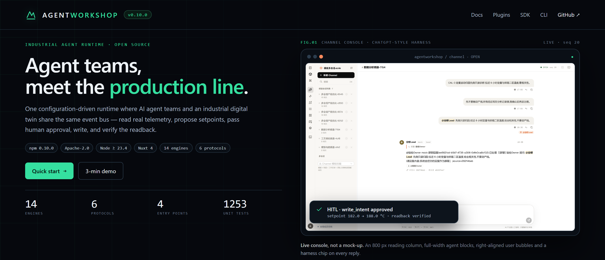
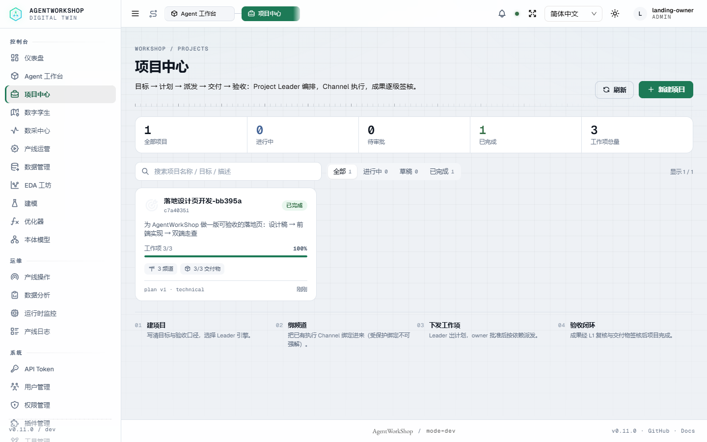
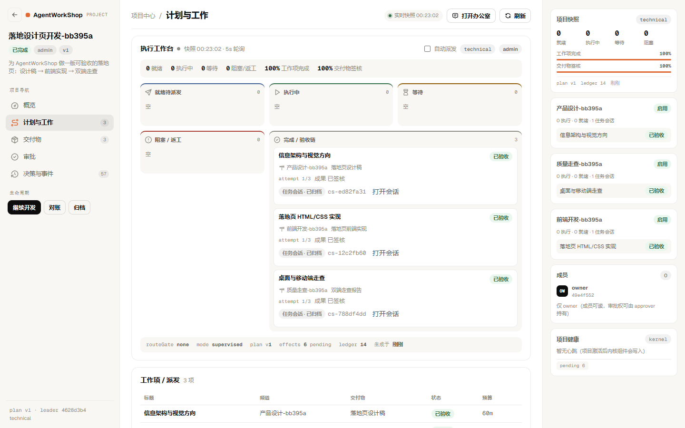
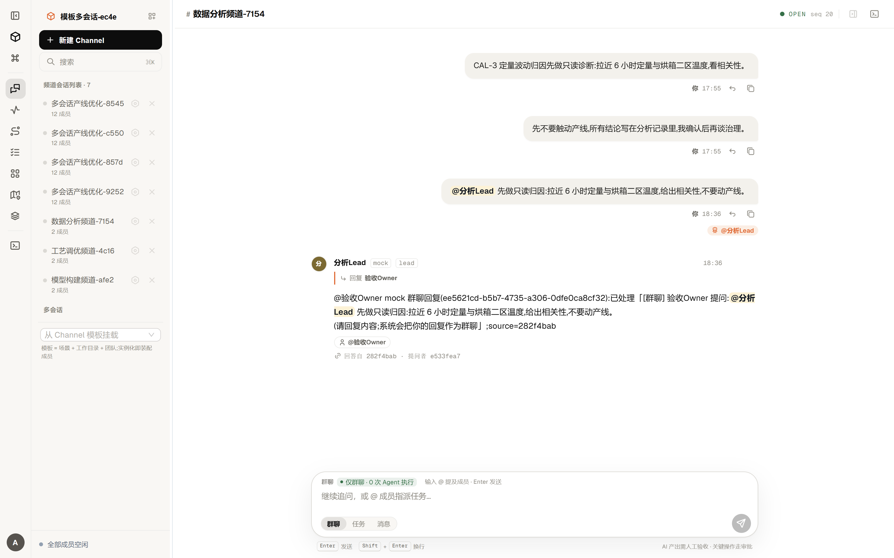
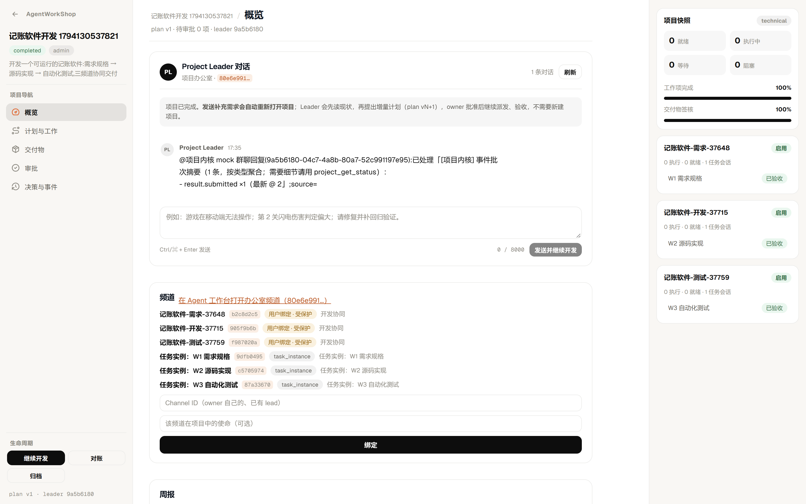
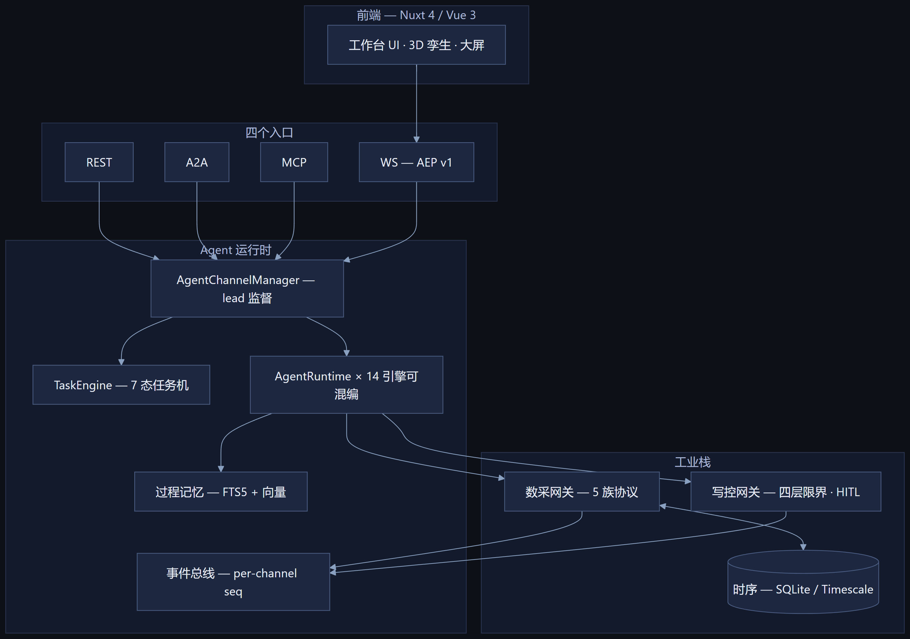
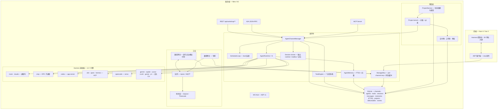

<div align="center">



<br />

# AgentWorkShop

**AI Agent 团队与产线在此交汇。**

[](https://www.npmjs.com/package/agentworkshop)
[](https://www.npmjs.com/package/agentworkshop)
[](https://github.com/kingdol666/AgentWorkShop/releases)
[](https://github.com/kingdol666/AgentWorkShop/stargazers)
[](https://github.com/kingdol666/AgentWorkShop/commits)
[](https://github.com/kingdol666/AgentWorkShop/issues)
[](./LICENSE)

[](https://nuxt.com)
[](https://vuejs.org)
[](https://www.typescriptlang.org)
[](https://nodejs.org)
[](https://nodejs.org/api/sqlite.html)
[](https://kingdol666.github.io/AgentWorkShop/guide/daq-protocols)
[](https://kingdol666.github.io/AgentWorkShop/guide/harness-ui)
[](./docs/plugins.md)
[](https://kingdol666.github.io/AgentWorkShop)

**[English](./README.md)** · **[在线文档](https://kingdol666.github.io/AgentWorkShop)** · **[版本发布](https://github.com/kingdol666/AgentWorkShop/releases)** · **[更新日志](./changelog.md)** · **[插件 API](./docs/plugins.md)** · **[SDK](./docs/sdk.md)**

<sub><b>v0.11.0</b> · 14 个执行引擎 · 6 种现场协议（5 内置 + 串口插件）+ MES REST（镜像与直连双路径）· **项目中心** · **RSI 经验演化** · 148 个宿主工具 · 144 个运行时设置项 · 双语文档（简体中文 / English）</sub>

<br />

*一个配置驱动的平台：**AI Agent 团队**与**工业数字孪生**共享同一运行时——Agent 查询真实遥测、经人工审批的写控回路下发监督设定值，每个事件实时推送到 3D 孪生。*

</div>

[快速开始](#快速开始) · [新增功能](#0110-新增了什么) · [Agent 团队模型](#agent-团队模型) · [核心能力](#核心能力) · [设计架构](#设计架构) · [验证与验收](#验证与验收) · [文档站](https://kingdol666.github.io/AgentWorkShop)

---

## 这是什么？

一个配置驱动的平台：**AI Agent 团队**与**工业产线**共享同一运行时——Agent 查询真实遥测、经人工审批的写控回路下发监督设定值，每个事件实时推送到 3D 孪生。

- **监督层定位**（SCADA 同位，秒级软实时）：数采、写控、产线/配方/批次、权限、审计一体；
- **Agent 不是聊天装饰**：14 个执行引擎可混编（omp / codex / opencode / claude / gemini / …），7 态任务机 + 根任务队列 + HITL 审批，并用 **Channel → Session → Agent** 三层对象模型保证团队隔离；
- **交付是一等概念**：**Project 模式**把蓝图变成计划、带依赖的 WBS、L1 技术复核、L2 Owner 验收与真实交付物——交付物不通过，项目不算完成；
- **闭环是真的**：读数 → 分析 → 提案 → 审批 → 写穿 → 回读证实 → 台账留痕，全链有实机验收。

## 0.11.0 新增了什么

三处结构性变化：Project 有了真正的门面、RSI 把"经验"变成可晋升可回滚的资产、真实模型 harness 跑通了 Channel 与 Project。

### 项目中心：交付层终于有了门

`/projects` 不再是"知道 URL 才进得去"的孤岛——侧栏、工作台首页、命令面板、路由元数据四处可达。

- **项目列表**：统计带、搜索、状态筛选、每项目进度、频道/交付物/审批 chips；`GET /api/workshop/projects` 服务端附带 `summary`（工作项、已签核交付物、绑定频道、待审批、最近活动），列表零 N+1。
- **项目详情**：频道全部显示人类可读名（绑定选择器、工作项表、交付物）；五列执行看板（就绪 / 执行中 / 等待 / 阻塞 / 完成与验收链）；交付物三级门（内容 → 技术验收 → 业务签核）；决策与事件统一时间线（游标分页）。
- **没有死路**：列表走平台壳层，详情保留回平台的面包屑，两页都能直达 Project Leader 办公室频道。

<p align="center">
  
  
</p>

→ [Project 模式指南](https://kingdol666.github.io/AgentWorkShop/guide/projects) · 实机验收：**39/39**（蓝图 → technical 409 门 → L1/L2 → completed）+ omp / `ustc/deepseek-flash` **13/13**。

### RSI：经验是挣来的，不是声明的

运行时把自身经验闭成 **capture → gate → promote → share → verify** 一圈：

- **沉淀**：任务完成或评审终态写入带任务证据的 scoped 经验行；治理写入落干预台账。
- **门禁**：单个任务永远不够——晋升 `validated` 需要独立证据（如两个任务），否则 fail-closed。
- **共享**：同产线的 validated 经验可被其他 Channel 读回，异产线零命中。
- **演化**：配对评测 → Harness Profile `pin → shadow → active`，带回滚与元层成功率视图。
- **证实**：独立回读验证器把设备 mismatch 变成 409，直接阻断 L1 复核——设备不同意时"完成"不算数。

→ [RSI 指南](https://kingdol666.github.io/AgentWorkShop/guide/rsi) · 实机验收：**32/32**（生产构建；沉淀、fail-closed 门、HITL 写入、回读阻断、跨频道隔离、Profile 晋升/回滚、元层统计、学习环零设备写）。

### 真实模型实证：omp + `ustc/deepseek-flash`

Channel 与 Project 不只用确定性 mock，也跑了**真实 LLM harness**：

- 同一 Channel 的两个会话各自收到不同的模型回执（`ALPHA-…` / `BETA-…`），**零跨会话串扰**；
- Project 工作项派发到自己的任务实例 Channel，由模型在 **619 秒**内交付 artifact（`PROJECT-SINGLE-OK`），随后对账、提交、L1 复核、L2 签核并完成。

→ [Channel 多会话](https://kingdol666.github.io/AgentWorkShop/guide/channels-sessions) · 证据：[`docs/audit/evidence/2026-11-09-full-acceptance/REPORT.md`](docs/audit/evidence/2026-11-09-full-acceptance/REPORT.md)

## 0.10.0 基线：Harness 控制台、多会话、Project 交付

0.10 定义了控制台的形态；0.11 在它之上补上了交付层的门面。

### 为阅读而生的 Harness 控制台

Channel 控制台与 Project 详情按 ChatGPT 式 harness 布局重排——**800px 阅读列**、Agent 通栏块、用户右侧浅泡、**每条回复带 harness 标识**、26px 圆角输入卡。工业外壳还在，只是不再和内容抢注意力。

<p align="center">
  
  
</p>

- **Channel**：Agent 通栏阅读块、用户右侧浅泡、harness / 角色 / 时间元信息、中性 Composer、hover 显影的频道操作；
- **Project**：面包屑头部、中列 880px、右栏 312px 项目快照、频道名替代 UUID 墙、Leader 输入框 2 行；
- **入口页**：项目列表 1080px + 三列新建表单，Workspace 列表 1240px；
- **行为零删除**：全部 `data-testid`、快捷键、@ 提及、HITL 语义与 API 原样保留——由 12/12 UI 交互套件验证。

→ [Harness UI 指南](https://kingdol666.github.io/AgentWorkShop/guide/harness-ui) · [设计画布与前后对比](docs/design/2026-11-08-harness-ui/README.md)

### Channel 多会话：同一支团队，各自独立的世界

Channel 是协作单元（成员、工具、记忆、任务机）；**Session** 是隔离执行环境：它克隆频道的基础成员——每个 clone 拥有独立的 runtime、mailbox、执行锁、引擎进程与记忆域——同时共享频道级团队记忆与节点绑定。

```
Channel（基础成员）── 会话 A ── 克隆 lead + workers → 独立 mailbox / runtime
                   └─ 会话 B ── 克隆 lead + workers → 独立 mailbox / runtime
```

- `POST /api/workshop/channels/:id/sessions` → `{ sessionId, members }`；每个 clone 都是真实 agent 行，`agentId` 唯一；
- 会话之间**并行**；会话内部保持串行（每 clone 一把执行锁）；
- **关闭会话 B**：取消其在飞任务树、卸载 clone、禁用成员；会话 A 与基础成员不受影响；
- 基础成员永不离开；已关闭会话的 clone 被禁用且 invoke 被拒；
- 模板 → 频道 → 会话：Channel 模板实例化整支团队（场景、工具档位、控制策略、产线绑定），会话实例化执行环境。

→ [Channel 多会话指南](https://kingdol666.github.io/AgentWorkShop/guide/channels-sessions) · 实机验收：**多会话 20/20**、**多 harness 隔离 24/24**

### Project 模式：是交付契约，不是聊天记录

Project 把**带 Project Leader 的办公室频道**与一个或多个**成员频道**绑定在同一份计划下。工作是带依赖的工作项；交付物是完成度的分母。

```
蓝图 ─▶ 计划批准 ─▶ WBS（dependsOn）─▶ 技术 L1 ─▶ Owner L2 ─▶ completed
  │         │              │                │            │
  └ 频道     └ 计划版本      └ attempts       └ reviewed   └ 已验收交付物
```

- **蓝图一键实例化**：`POST /api/workshop/projects/instantiate`，传模板名或蓝图文档（频道 + 交付物 + 工作项 + 路由策略 + 模式）；
- **模式**：`observe`（影子，只记录）/ `supervised`（默认；计划审批 + 破坏性动作审批）/ `auto`（自动派发，replan 仍需审批）；
- **工作项状态机**：`DRAFT → DISPATCHING → DISPATCHED → RUNNING → COMPLETED`，另有 `BLOCKED / REWORK / FAILED / CANCELED / SUPERSEDED`；状态是对 attempts 与根任务的投影对账；
- **交付物**：`planned → active → submitted → approved / rejected / waived`；先 L1 技术复核，再 L2 Owner 验收，证据必须引用真实 task / artifact / analysis report；
- **持续开发**：completed 项目收到 Owner 的补充需求后自动重开，Leader 先读现状态，再提增量计划（plan vN+1），不需要新建项目；
- **产线实证**：CAL-3 四期场景（只读分析 → HITL 写入 → 训练数据集 → 有界自主优化）在真实产线上 **78/78** 通过，含 300s / 60s 节拍闸与设备回读。

→ [Project 模式指南](https://kingdol666.github.io/AgentWorkShop/guide/projects) · 证据：[`docs/audit/evidence/2026-11-08-industrial-acceptance/REPORT.md`](docs/audit/evidence/2026-11-08-industrial-acceptance/REPORT.md)

## Agent 团队模型

| 层 | 是什么 | 带来什么 |
|---|---|---|
| **Channel** | 协作单元：lead + workers、harness/provider/model、工具、节点绑定、任务机、HITL | 一支身份稳定、授权面清晰的团队 |
| **Session** | 从频道基础成员克隆出的隔离执行环境 | 并行作业，不共享 mailbox、执行锁与记忆 |
| **Agent** | 可克隆对象，拥有唯一 `agentId`、独立生命周期与记忆域 | 创建 / 激活 / 停用 / 删除，不波及其他频道 |
| **Project** | 交付契约：办公室频道 + Leader + 成员频道 + 计划 + 交付物 | WBS、技术复核、Owner 验收、可审计的完成 |
| **Attempt** | 工作项针对频道任务的一次执行 | 重试、返工、替代，历史不丢 |
| **Deliverable** | 一个或多个 attempt 的已验收结果 | 完成由证据定义，不由一条聊天消息定义 |

四条边界是刻意设计的：Project Leader 永远不能替 Channel 提高写权限；Agent 看不到其他频道成员；关闭 Session 永远不碰基础团队。

## 核心能力

| 能力域 | 一句话 | 深入 |
|---|---|---|
| **Agent 团队运行时** | lead 编排 + worker 交付，7 态任务机、根任务 FIFO 队列、执行租约、过程记忆（FTS5+向量）、群聊与定时任务 | [设计架构](#设计架构) |
| **Channel 多会话** | 模板 → 频道 → 会话；克隆基础成员并给独立 runtime / mailbox / 执行锁 / 记忆；关一个，其余照常作业 | [Channel 多会话](https://kingdol666.github.io/AgentWorkShop/guide/channels-sessions) |
| **Project 交付** | 蓝图 → 计划审批 → 带依赖 WBS → 技术 L1 → Owner L2 → 交付物；observe / supervised / auto；**项目中心**提供入口、进度与执行看板 | [Project 模式](https://kingdol666.github.io/AgentWorkShop/guide/projects) |
| **RSI 经验演化** | 任务/评审证据沉淀 → fail-closed 晋升门 → 同产线经验共享 → 配对评测 Harness Profile（pin → shadow → active）→ 回读验证的 L1 门 + 回滚 | [RSI 指南](https://kingdol666.github.io/AgentWorkShop/guide/rsi) |
| **工业栈** | 五族现场协议（Modbus TCP/RTU · OPC UA · MQTT · HTTP）+ 串口插件 + MES REST（镜像/直连双路径）；数采三节拍、写控四层限界、逐参数 ACK | [协议指南](https://kingdol666.github.io/AgentWorkShop/guide/daq-protocols) |
| **Agent × 设备绑定** | 节点级授权三轨（dcw 点位收窄 / recipe 单配方 / line-recipe 产线管理权），语义卡注入提示词，直写恒拒、全部写入过联锁+HITL | [HITL 指南](https://kingdol666.github.io/AgentWorkShop/guide/hitl) |
| **模型闭环** | AML 自动建模（物理先验+残差+conformal UQ）→ 晋级门禁 → HITL 采纳 → production 投用 → 模型驱动试验 | [AML 手册](./docs/aml.md) |
| **优化器** | 过程模型 → OSQP 求解 → recipe_trial 试验 → 进步才固化 → 统一回退（PLC 整批恢复） | [配方版本](https://kingdol666.github.io/AgentWorkShop/guide/recipe-versions) |
| **治理与可观测** | 产线三态权限、结构化审计与错误台账、/operations 操作流水、系统监控指标、60s / 300s 写节拍闸 | [产线权限](https://kingdol666.github.io/AgentWorkShop/guide/line-permissions) |
| **插件生态** | 热重载插件：自定义驱动/处理器/节点模板/Agent 工具/HTTP 路由/浏览器面板/Twin Provider，`aw plugin` CLI + MCP `list_changed` | [插件与扩展](#插件与扩展) |

## 设计架构

<p align="center">
  
</p>

<details>
<summary><b>完整架构图源(mermaid,点开)</b></summary>



</details>

**Agent × 机器之桥**（值得读源码的部分）：

```
agent ──绑定──▶ 节点 (daq: auto / dcw: manual)
  │                    │
  │  my_industrial_nodes  ◀── 语义卡：物理含义 · 单位 · 安全量程 · 配方窗口
  │  daq_query             ◀── 时序库历史，统计 + 物理语义
  │  dcw_control           ──▶ 联锁（安全量程 ∩ 配方窗口）
  │                           ──▶ HITL 审批（manual 模式，180s 超时）
  │                           ──▶ PLC 写入 → 回读校验 → ACK + 写历史
  ◀── Agent 可引用数值的结果文本
```

## 快速开始

```bash
node -v                            # ≥ 23.4.0（需要内置 node:sqlite）
npm install -g agentworkshop       # → `aw` / `agentworkshop` 进入 PATH（含预构建产物，无需构建）
aw start                           # → http://localhost:3001，一切初始化进 ~/.AgentWorkShop
```

不想全局安装：`npx agentworkshop start`。源码运行：`git clone … && pnpm install && pnpm dev`（→ 3000）；生产：`pnpm build && pnpm start`。更新：`aw update`。

> 真实 Agent harness 需要对应 CLI 在 PATH 中（`omp` / `codex` / `opencode` / … 任选子集，同 Channel 可混用；`mock` 与 `claude` 进程内运行无需 CLI）。可选数采基础设施（MQTT broker + TimescaleDB）在 Docker 可达时自动拉起。

**第一次「Agent × 产线」会话（约 2 分钟）：**

1. **登录** —— 侧边栏注册（或 `POST /api/users/register`）。
2. **搭产线** —— 「产线运营」→ 建产线，加数采节点（如 `daq-temp-tc`）与数控节点（如 `dcw-temp-sp`），建产品 + 配方，点**开跑**。
3. **建团队** —— 「Agent 工作台」→ 选 lead + workers（可混用引擎）后**部署**进 Channel。
4. **绑定节点** —— Agent 详情面板 → 绑数采（*auto*）与数控（*manual* = 需您的批准）。
5. **提交目标** —— 「分析最近 5 分钟熔体温度；若与 182 °C 偏差超过 1 °C，修正设定值（等我的批准）。」
6. **审批** —— Agent 读真实历史、发起写请求 → HITL 面板批准 → 设定值变化，目标收口并给出数值报告。

想直接体验交付流程？打开 **Projects → 新建项目 → 继续开发**，或实例化一个蓝图：

```bash
curl -X POST http://localhost:3001/api/workshop/projects/instantiate \
  -H "authorization: Bearer <token>" -H "content-type: application/json" \
  -d '{"template":"line-optimisation","nameOverride":"CAL-3 复跑"}'
```

<details>
<summary><b>配置驱动 · 认证 · 产线权限 · 执行模式 · 定时任务（点开）</b></summary>

一个运行时，一个事实来源：**`config.yml`**（默认）< **`runtime-settings.json`**（运行时）< 环境变量 / CLI；每个键在 `shared/config/schema.json` 声明一次，前端设置页与 CLI 消费同一份描述符。

**认证**：邮箱+密码签发 bearer token（多 token、可单独吊销）；`POST /api/users/register` → `authorization: Bearer <token>` 调 `/api/workshop/**`。

**产线三态权限**（管理员在 `/permissions` 维护）：无权（默认，后端不返回数据）/ 仅查看（只读）/ 可操控（读+写）。Agent 写授权三轨：`dcw` 点位绑定=写授权兼下发收窄；`recipe`=单配方操作权；`line-recipe`=产线全部配方管理权。直写恒拒，全部写入仍经四层限界/运行门/HITL/逐参数 ACK。

**执行模式**：`goal`（lead 分解→判定→补发至满意）/ `loop`（固定间隔重放）/ `pipeline`（有序阶段）。

**定时任务**：`interval`（60s 下限）/ `daily` 双模式；忙等守卫、逐次历史、连续失败熔断；`/workshop/schedules` 页面或 REST 管理。

**四个入口**：WS（AEP v1，seq 续传）· MCP（进程内服务）· A2A（JSON-RPC 2.0 + AgentCard）· REST（完整管理面）。

**任务状态机**：`SUBMITTED → ASSIGNED → WORKING → WAITING → COMPLETED`（任一态可转 `CANCELED / FAILED`；FAILED 可改派重试并重置执行预算，根任务受预算守卫）。

</details>

<details>
<summary><b>部署 · 项目结构 · 开发指南（点开）</b></summary>

**部署**：TLS 终结在前置反代；可选基础设施 `docker compose up -d`（MQTT + Timescale + MinIO）；`pnpm build && pnpm start`（端口取 `config.yml` → `server.prod.port`）。数据全部落配置根，跨版本迁移在启动时自动执行。

**项目结构**：`app/`（Nuxt 前端）· `server/`（API 与服务：agents/daq/dcw/aml/projects/sessions/plugins）· `shared/`（前后端共享契约：配置 schema、协议目录）· `scripts/`（验收与工具脚本）· `bench/`（工业基准管线）· `docs/`（文档与验收证据）。

**开发**：`pnpm dev` 热更；`pnpm typecheck && pnpm lint` 门禁；`npm run test:unit`（自带 server tsconfig 与 force-exit）；文档站 `npm run docs:dev`（VitePress，中/英）。

</details>

## 插件与扩展

插件是平台的一等扩展面：一个目录 + `index.mjs` 即可获得 **Agent 工具注册（`ctx.tools`）、自定义数采驱动（`ctx.daq.registerDriver`）、处理器与节点模板、HTTP 路由、浏览器面板、设置项与 i18n、Twin Provider（`ctx.twin`）、产线权限钩子（`ctx.permissions`）**；启停即时热重载，单插件失败隔离不影响主服务。内置示例覆盖全家桶：自定义驱动+降额处理器（`aw-matrix-plugin`）、向量帧（`daq-vector-demo`）、知识库桥（`rag-bridge`）、诊断桥（`diag-bridge`）、串口（`serial-bridge`）、孪生 Provider（`twin-injection-default`）。外部仿真程序（如 MATLAB/Simulink）可经「Twin Provider 注册」或「插件工具 spawn」接入，仿真输出直接作为优化依据。→ [插件 API](./docs/plugins.md) · [SDK](./docs/sdk.md) · [MCP](./docs/mcp.md)

## 文档导航

| 上手 | 开发 | 运维 |
|---|---|---|
| [快速开始](https://kingdol666.github.io/AgentWorkShop/guide/getting-started) · [第一次会话](https://kingdol666.github.io/AgentWorkShop/guide/first-session) | [插件 API](./docs/plugins.md) · [SDK](./docs/sdk.md) · [CLI](./docs/cli.md) | [配置系统](https://kingdol666.github.io/AgentWorkShop/guide/configuration) · [HITL](https://kingdol666.github.io/AgentWorkShop/guide/hitl) · [产线权限](https://kingdol666.github.io/AgentWorkShop/guide/line-permissions) |
| [Harness UI](https://kingdol666.github.io/AgentWorkShop/guide/harness-ui) · [Channel 多会话](https://kingdol666.github.io/AgentWorkShop/guide/channels-sessions) · [Project 模式](https://kingdol666.github.io/AgentWorkShop/guide/projects) | [六协议数采](https://kingdol666.github.io/AgentWorkShop/guide/daq-protocols) · [数控读写](https://kingdol666.github.io/AgentWorkShop/guide/dcw-read-write) · [配方版本](https://kingdol666.github.io/AgentWorkShop/guide/recipe-versions) | [AML](./docs/aml.md) · [本体](https://kingdol666.github.io/AgentWorkShop/guide/ontology) · [EDA 工坊](https://kingdol666.github.io/AgentWorkShop/guide/eda) |

## 验证与验收

每一层论断背后都有可复跑的套件。验收按 **aw-system-acceptance 五层流程**（静态门禁 → 单元契约 → 实机核心闭环 → 回归面 → 插件工具面）执行。

**2026-11 验收轮（main 构建）：**

| 套件 | 结果 | 证据 |
|---|---|---|
| **RSI 经验演化**（沉淀 → 门禁 → 共享 → Profile → 回滚，生产构建） | **32/32** | [`2026-11-09-rsi-live-e2e/report.md`](docs/audit/evidence/2026-11-09-rsi-live-e2e/report.md) |
| **项目中心**（蓝图 → technical 409 → L1/L2 → completed，真实 Chrome） | **39/39** | [`2026-11-09-project-landing`](docs/audit/evidence/2026-11-09-project-landing/project-landing-live.md) |
| **omp / `ustc/deepseek-flash`**（真实 LLM 交付 Project 工作项，619s） | **13/13** | [`omp-single-report.json`](docs/audit/evidence/2026-11-09-full-acceptance/omp-single-report.json) |
| **Session 隔离**（双会话、真实模型回执、零串扰） | ✔ | [`2026-11-09-full-acceptance/REPORT.md`](docs/audit/evidence/2026-11-09-full-acceptance/REPORT.md) |
| CAL-3 四期产线闭环（只读分析 → HITL 写入 → 数据集 → 有界优化） | **78/78** | [`docs/audit/evidence/2026-11-08-industrial-acceptance/REPORT.md`](docs/audit/evidence/2026-11-08-industrial-acceptance/REPORT.md) |
| 多 harness 隔离（mock / omp / dsh / codex / opencode） | **24/24** | [`harness-isolation.json`](docs/audit/evidence/2026-11-08-full-acceptance/harness-isolation.json) |
| Channel 模板多会话（并行会话 + HITL 写入） | **20/20** | [`channel-multisession.json`](docs/audit/evidence/2026-11-08-multisession-opt/channel-multisession.json) |
| Project 模式（记账软件交付，3 频道 / 3 工作项） | **58/58** | [`bookkeeping.json`](docs/audit/evidence/2026-11-08-final-acceptance/bookkeeping.json) |
| UI 交互（真实 Chrome，12 条断言） | **12/12** | [`ui-results.json`](docs/audit/evidence/2026-11-08-full-acceptance/ui/ui-results.json) |
| 单测 / typecheck / lint | **1356 通过 · 0 失败 · 2 跳过** / ✔ / 0 error | [`docs/audit/evidence/`](docs/audit/evidence) |

历史轮次仍可复跑：2026-10-29 全量轮（**24 项套件/核查、约 1100+ 断言全绿**）、真实设备联动矩阵（`e2e-golive-matrix`）**21/21**——五族真实协议栈接通、平台样本=设备侧真值、四协议写穿、Agent 令牌批量落穿、断链如实失败与自愈；安全加固 **29/29**；对抗性错误处理 **26/26**；2026-10-31 可执行测试卡全层轮：静态论文-代码一致性 **100%**（20 锚点）· 真实五协议层 **13/13** · E1a 治理四臂消融理论模式全对 · api-live **75/75** · 对 20260914 冻结基线逐位复现 ×2。

| 验收层 | 代表套件 |
|---|---|
| 实机核心闭环 | 产线治理 44/44 · 本体 87/87 · 模型闭环 53/53 · 优化器 105/105 · 注塑闭环 6/6 · 设备联动矩阵 21/21 · CAL-3 78/78 |
| 团队与交付 | 多 harness 24/24 · Channel 多会话 20/20 · Project 58/58 · UI 12/12 |
| 回归面 | api-live 75/75 · auth-matrix 29/29 · 模板隔离 38/38 · 鲁棒性 ALL · agent-team 25/25 · 错误处理 26/26 |
| 专项 | 安全加固 S1-S16 29/29 · 生产硬门 8/8 · 节点授权 52/52 · 三模式真机 42/42 · 冻结基线复现 ×2 |

证据与复现命令见 [`docs/audit/evidence/`](./docs/audit/evidence) 与 [`docs/full-test-plan.md`](./docs/full-test-plan.md)；历史基线（约 1100+ 条，2026-09-24）见 [验收波次归档](./docs/audit/e2e-2026-09-24-full-coverage.md)。

## 路线图

已交付：Channel 运行时与四入口、工业五族协议数采/写控、节点绑定与 HITL、配方版本化与回退、AML 建模闭环与优化器、本体服务、插件系统 v2、3D 孪生、定时任务、多 Harness（14 引擎）、**ChatGPT 式 Harness 控制台**、**Channel 多会话**、**Project 交付模式**、**项目中心**、**RSI 经验演化**、双语文档——完整清单见 [更新日志](./changelog.md)。

进行中/规划：**绑定生命周期**（项目完成自动释放）· **持久化项目工作流**（outbox + 幂等消费 + saga）· **节拍感知调度** · **HITL 意图 TTL/幂等** · **harness 监管与卡死实例回收** · **SLO 看板与告警** · **报警外送**（邮件/webhook）· **边缘部署形态**（edge-agent + 中心 broker）· 更多场景模板与基准。

## 研究论文

治理机制已写成投稿级论文——**《Grading Machine-Originated Plant Writes: Separately Inspectable Evidence for Industrial Agent Teams》**（IEEE TII 匿名评审稿）。源文件与评审记录见 [`paper/tii/SUBMISSION-IEEE-TII/`](./paper/tii/SUBMISSION-IEEE-TII/)；每条机制主张由仓库证据支撑（[`docs/benchmarks/`](./docs/benchmarks) · [`docs/experiments/`](./docs/experiments) · [`docs/audit/`](./docs/audit)）。

## 参与贡献

欢迎 Issue 与 PR。提 PR 前：① 先读要改的契约（[插件](./docs/plugins.md) / [SDK](./docs/sdk.md) / [CLI](./docs/cli.md)）；② 本地过门禁（`pnpm typecheck && pnpm lint`，行为改动补真实 E2E）；③ 提交信息走约定式（`commitlint` 钩子强制）；④ 报 bug 前先跑 `aw doctor`。

## 安全

发现漏洞请**不要**开公开 Issue，通过 [GitHub Security Advisories](https://github.com/kingdol666/AgentWorkShop/security/advisories/new) 私下报告。把系统指向真实设备前，先复核 `config.yml` 的联锁、安全量程与 HITL 设置——默认姿态是建议性的，产线侧逻辑始终拥有最终否决权。

## 许可证

[Apache 2.0](./LICENSE)（宽松许可，允许商用与生产部署）。

---

<div align="center">

**如果这个项目对你有用，点一个 ⭐ 能让更多人找到它。**

当前版本：**v0.11.0** —— [版本发布](https://github.com/kingdol666/AgentWorkShop/releases) · [更新日志](./changelog.md) · [在线文档](https://kingdol666.github.io/AgentWorkShop)

<a href="https://star-history.com/#kingdol666/AgentWorkShop&Date">
  
</a>

</div>
