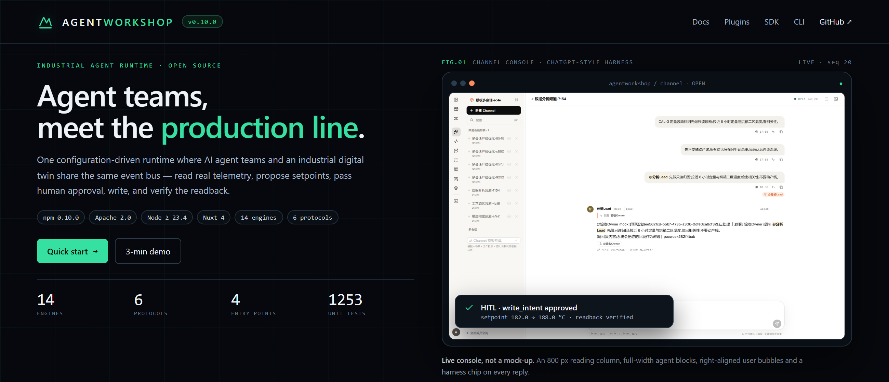
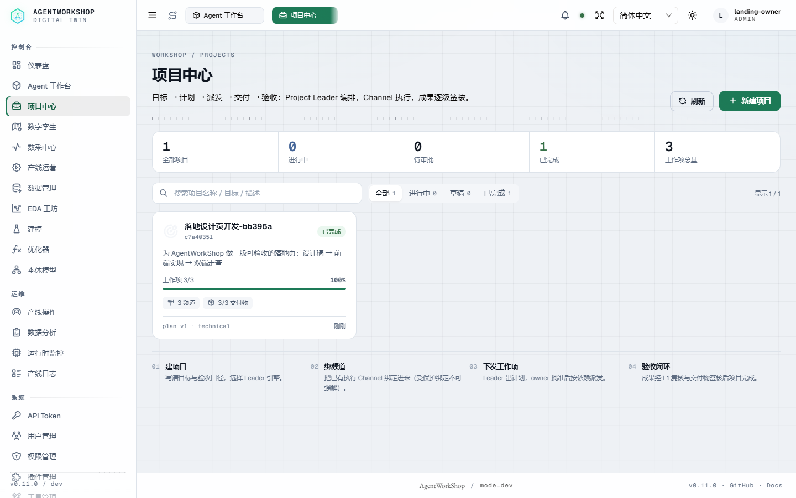
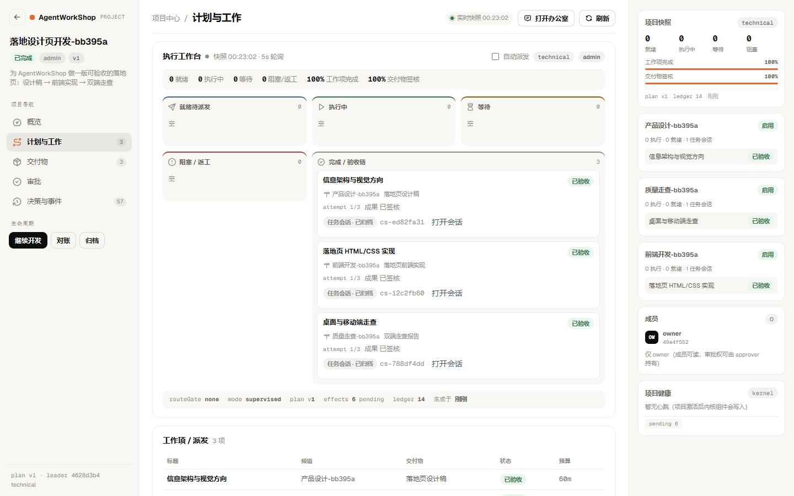
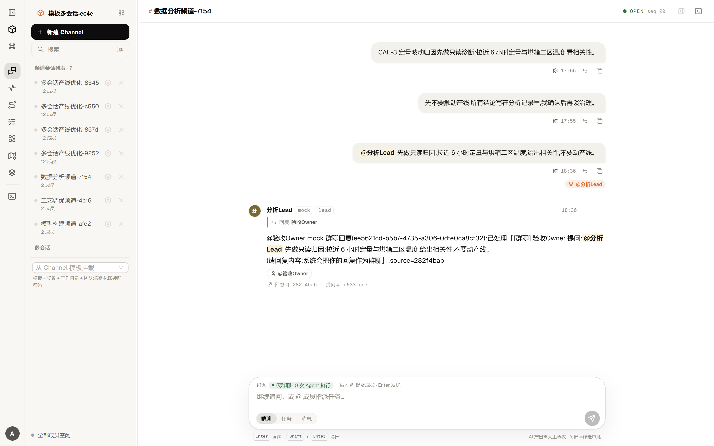
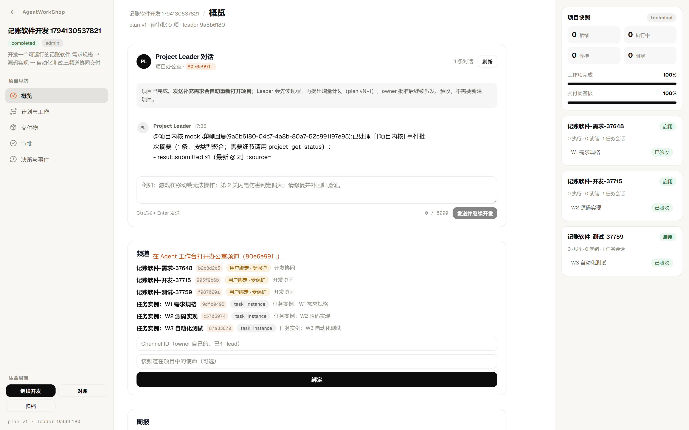
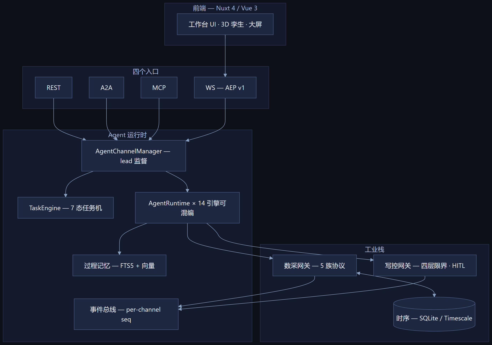
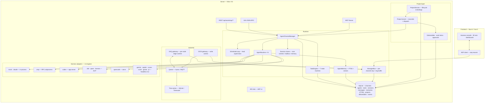

<div align="center">



<br />

# AgentWorkShop

**Where AI agent teams meet the production line.**

[](https://www.npmjs.com/package/agentworkshop)
[](https://www.npmjs.com/package/agentworkshop)
[](https://github.com/kingdol666/AgentWorkShop/releases/tag/v0.15.0)
[](https://github.com/kingdol666/AgentWorkShop/stargazers)
[](https://github.com/kingdol666/AgentWorkShop/commits)
[](https://github.com/kingdol666/AgentWorkShop/issues)
[](./LICENSE)

[](https://nuxt.com)
[](https://vuejs.org)
[](https://www.typescriptlang.org)
[](https://nodejs.org)
[](https://nodejs.org/api/sqlite.html)
[](https://kingdol666.github.io/AgentWorkShop/guide/daq-protocols)
[](https://kingdol666.github.io/AgentWorkShop/guide/harness-ui)
[](./docs/plugins.md)
[](https://kingdol666.github.io/AgentWorkShop)

**[简体中文](./README-zh.md)** · **[Documentation](https://kingdol666.github.io/AgentWorkShop)** · **[Releases](https://github.com/kingdol666/AgentWorkShop/releases)** · **[Changelog](./changelog.md)** · **[Plugin API](./docs/plugins.md)** · **[SDK](./docs/sdk.md)**

<sub><b>source v0.15.0 (released 2026-11-21)</b> · 14 engines · 6 field protocols (5 built-in + serial plugin) + MES REST (mirror & live) · **Project center** · **RSI experience evolution** · **governed product experience** · **IDD/RAG plugin integration** · **AgentPrefab / Skills / MCP capability supply chain** · bilingual docs (简体中文 / English)</sub>

<br />

*A configuration-driven platform where **AI agent teams** and industrial systems share one runtime. Agents query telemetry and propose supervisory changes through governed paths; whether a write needs HITL depends on the effective line, Channel and binding modes. Simulation evidence is not physical HIL or production approval.*

</div>

[Quick start](#quick-start) · [Current source](#current-source-v0-15-0) · [0.15.0 release notes](#whats-new-in-0150) · [Agent team model](#the-agent-team-model) · [Capabilities](#capabilities) · [Architecture](#architecture) · [Verification](#verification) · [Docs site](https://kingdol666.github.io/AgentWorkShop)

---

## What is this?

A configuration-driven platform where **AI agent teams** and industrial systems share one runtime. Agents can query telemetry and propose supervisory changes through policy-governed paths; whether a write requires HITL depends on the effective line, Channel and binding modes. Simulation evidence is not physical HIL or production approval.

- **Supervisory layer** (SCADA-adjacent, second-level soft real-time): DAQ, write control, line/recipe/batch, permissions and audit in one place;
- **Agents are not chat decoration**: 14 executable engines, mixable per channel (omp / codex / opencode / claude / gemini / …), a 7-state task machine + root queue + HITL approvals, and a **Channel → Session → Agent** object model that keeps teams isolated;
- **Delivery is a first-class concept**: **Project mode** turns a blueprint into a plan, a WBS with dependencies, L1 technical review, L2 owner acceptance and real deliverables — the project closes only when the deliverables pass;
- **The loop is implemented in governed stages**: read → analyze → propose → policy-controlled approval where required → write → readback/audit; the scope of each test and whether it used a simulator or physical equipment are stated with its evidence.

## Current source: v0.15.0

The source version is **0.15.0** (npm + GitHub Release, 2026-11-21). This release implements the AgentPrefab capability-assembly plan end to end (seven merged PRs, #252–#258). System Settings gains three capability supply-chain panes: **Skills** (standard `SKILL.md` discovery → immutable managed import → explicit enable; discovery covers built-in `skills/`, managed `<configRoot>/skills`, `~/.agent/skills` (the npm/Agent Skills standard), `~/.agents/skills`, XDG and `AW_SKILL_ROOTS`; no Skill script is ever executed during discovery, import or activation), **External MCP** (HTTPS-only Streamable HTTP manifests + `AW_MCP_*` credential references + admin-reviewed shared-safe read tools + egress guard blocking private/loopback/reserved addresses), and **Agent Prefabs** (role/scenario prompts + multi-dimensional custom slots + per-capability switches packaged as immutable revisions frozen at publish). A Channel member pins `(prefabId, revision, slots, contentHash)`; Session clones and Project task instances freeze the same snapshot; the runtime re-authorizes every dispatch against the intersection of prefab selection × system enablement/review × Channel/Project policy × role/industrial gating × harness-managed surface, so revocation cannot be bypassed by a cached catalog. Database schema contract moves v7→v8 (additive migration, no behavior change for existing rows).

Merged-main gates at `87805eaf`: typecheck, lint, build, docs **101/0**, readme, i18n **3439/3439**, cssvars, frontend-lifecycle, skills **197/0**, MCP **14/14**, unit **2185/2186** (1 conditional skip) all green. Isolated fresh-instance live acceptance **21/21**: `~/.agent/skills` global discovery → immutable import → enable → prefab publish/member binding → tool-catalog narrowing → `activate_skill` low-trust body injection → unauthorized-invocation denial → session clone binding and snapshot hash → new revision does not auto-upgrade → skill revocation denied immediately → MCP non-HTTPS/secret-less/bounded failure. A provisioned instance additionally passed two restart persistence cycles (write-attempt ledger 3277 rows, identical outcome distribution, never resent) and live governed-evaluation gate triggers (falsified summary 400, promotion to active without host provenance rejected, client-submitted run rejected, shadow promotion succeeds). Boundaries: external MCP positive live trace, real-OMP-model work under a prefab, and browser UI click-through remain NOT_RUN; the Mimosa deep scan is sealed but inconclusive — no security-pass claim. See the [full-flow acceptance report](docs/audit/evidence/2026-11-21-fullflow-round/REPORT.md) and the [Prefab/Skills/MCP live report](docs/audit/evidence/2026-11-21-agent-prefab-acceptance/REPORT.md).

## What's new in 0.15.0

- **Skills management (#253)**: Agent Skills-standard discovery catalog and immutable managed copies (`<configRoot>/skills/<name>/<hash>/`, imports disabled by default); the Settings pane supports discover/import/enable/disable/delete and SKILL.md reading; same-name multi-source conflicts keep every source visible; `allowed-tools` stays experimental metadata and never grants tool permissions.
- **External MCP management (#254)**: HTTPS-only Streamable HTTP manifests (`<configRoot>/mcp/servers/<id>.json`), `AW_MCP_*` environment credential references (never persisted to files/UI/logs), discovery → pending → admin review (`dataSharing=shared-safe` and `classification=read` required; no write tools in the first rollout), automatic re-pending on endpoint/credential-generation/protocol/tool-name/schema changes or `maxDiscoveryAgeMs` expiry, and egress guarding (private/loopback/reserved addresses rejected, pinned DNS resolution, same-origin redirects only, no automatic retry after timeout).
- **MCP ingress identity hardening (#252)**: per-request bearer authentication, session-to-principal binding (principal change → 403 `MCP_SESSION_PRINCIPAL_MISMATCH`), device surface scoped to authorized workspaces (`device.list`/`device.read`/`device.bind_agent` self-binding only).
- **AgentPrefab revisions & bindings (#255)**: draft validation (dangerous slot keys such as command/env/token fail closed, missing required slots rejected) → CAS-published immutable revisions with content hash → Channel members pinned to a revision; the capability catalog projects builtin tools, plugin tools, managed skills and approved MCP tools into one switch surface.
- **Runtime assembly (#256)**: effective capability = prefab selection ∩ system enablement/review ∩ Channel/Project policy ∩ role/industrial gate ∩ harness-managed surface, re-authorized on every invocation; prefab prompts are injected as a low-trust wrapped context prefix; `activate_skill` serves only pinned, enabled managed skills; session clones, task-instance channels and project work items freeze snapshots at creation and retries reuse the original snapshot; missing required capabilities or broken bindings fail closed (409) for new work.
- **Packaging & docs (#257/#258)**: `skills/` ships with the production build (including a zod duplication fix); bilingual guide plus a reusable L10 live-acceptance leg.
- **Bilingual docs**: the [AgentPrefabs, Skills & MCP guide](https://kingdol666.github.io/AgentWorkShop/guide/agent-prefabs) covers discovery roots, import semantics, MCP review rules, the prefab lifecycle and snapshot boundaries.

## What's new in 0.14.0 (historical release notes)

- **Immutable experience versions (#241)**: insert-only `experience_versions` with content/evidence snapshot hashes, CAS head pointers (`EXPERIENCE_VERSION_CONFLICT`), transactional idempotent backfill (legacy rows → `legacy-unverified`, never auto-injected), and cross-kind key isolation (`EXPERIENCE_KEY_CONFLICT`).
- **One governed resolver (#241)**: authorization-epoch → scope → purpose gating; `automatic` reads require `validated` + `canary/active` deployment; overlay cache keys include the epoch so revoke/product-switch stops injection on the next turn.
- **Host-provenanced release gate (#243)**: promotion to `active` requires a `host-evaluation` ledger row; the ledger records real C−B measurements (`pValue: null` when no significance test ran — fabricated significance is rejected), release is pending → audit-acked → CAS with maker-checker separation, and withdrawal stops injection without rewriting facts.
- **Durable write-attempt ledger (#244)**: prepared/dispatched/verified/rejected/not_sent/unknown around every plant write; restart reconciliation classifies unclosed attempts and never resends; old approvals are rejected on generation/lease/context/payload mismatch. HITL rows gain the same correlation columns.
- **Plan progress & pending-plan fencing (#244)**: `planProgress` projection on project observability (`pending_approval/applied/rejected/attention_required`), and `PLAN_CHANGE_PENDING` rejects manual work items that conflict with a pending plan approval.
- **Dependency health & evidence quality (#244)**: provider/RPC/process/budget/queue/progress produce bounded actions (`continue/wait/retry/fallback_readonly/attention_required/failed`) with unknown-effect → attention; batch quality gates control evidence and training on coverage/gaps; external jobs keep upstream terminal state faithful while artifact validity gates acceptance; OMP readiness timeout reaps its own child.
- **Ontology tri-state & model reuse (#245)**: missing declared edge is `unknown` (not refuted), critical-guard observability and recipe/product lineage gate artifact reuse, and ontology candidates carry evidence provenance behind the existing human publication gate.
- **Acceptance runner & merged-main checker (#245)**: a simulation manifest is BLOCKED before any write unless environment/revision/targets/ownership-proof/arm-roots all verify; the main-audit checker requires an exact SHA, ancestor merge commits, a clean checkout and a complete evidence-digested check matrix.
- **Bilingual docs**: [governed product experience guide](https://kingdol666.github.io/AgentWorkShop/guide/governed-learning) covers the version lifecycle, resolver purposes, release flow, write ledger and audit boundaries.

## What's new in 0.13.0 (historical release notes)

- **diag-bridge v2.4**: `external/v1` is the primary contract with a pre-submit `GET /capabilities` probe (5-min fingerprint cache) and an explicit `contract=legacy` fallback; the six v1 terminal states are handled, `awaiting_input` holds the line single-flight lock and ages to `expired`, and `diag_chat` / `diag_stop` / `diag_deposit` are new tools. All seven analysis intents pass through, along with ontology / preprocessing / report-language fields.
- **rag-bridge v2.3**: document tools `kb_doc_create` / `kb_doc_search` / `kb_doc_read` / `kb_catalog` on the `aw-docs` knowledge base (separate from the `aw-industrial` experience base); two-stage retrieval is the primary path with a labelled keyword fallback; creation is idempotent and uses `index-document` (vector + BM25) because a whole-KB reindex does not refresh the backend's in-process BM25 index.
- **One-loop deposit**: `diag_deposit` reads a completed run's report, writes it to `aw-docs`, indexes it, tags it and self-checks retrieval — no manual copy step; empty reports fail readably without creating a partial document.
- **Write safety & observability**: `isPolicyWriteTool` now unions the static write list with registered plugin tools declaring `riskClass: 'write'`; plugin health exposes per-tool ok/err counters and write tools emit ops audits.
- **Bilingual guide**: [IDD / RAG plugin integration](https://kingdol666.github.io/AgentWorkShop/guide/idd-rag-plugins) covers tools, contract pinning, lifecycle, error codes, degradation and gray release.

## What's new in 0.12.0 (historical release notes)

The 0.12.0 round added claim-token CAS, recovery-hold dispositions, DCW transport-ack verification and simulator attestation; see the [changelog](./changelog.md) for the full list. Post-release hardening round 2 (`900ad228`, PR #228) fixed the four defects reproduced in the round-2 evaluation: the message watchdog is now an activity window (HITL waits no longer kill healthy long turns; the 16-minute governed turn that was aborted and replayed 3× in round 1 completed once with zero watchdog aborts), HITL expiry settles authoritatively with denial notices, rag-bridge kb_agent errors are classified (401 → rotate token instead of a misleading "check the web"), and verify-line V6 treats a missing fresh-home fixture as a documented SKIP. Gates: lint, typecheck, unit **1799/1799**, build, docs **101/101**, Skills **176/176**, MCP **14/14**, plugin **22/22**, SDK, twin 5/5. Fresh-home five-protocol round: onboarding 25/25 + smoke 7/7 on first pass; omp + `ustc/deepseek-flash` Channel governed step (HITL → run `readback-verified` 1/1, journal anchor); IDD `industrial-optimizer-loop` R001 31.7875→32.5611 g (incumbent, D=0.825) + R002 GP-EI within CI, gate 13/13; RAG index → retrieval rank 1. See the [round-2 report](docs/audit/2026-11-16-round2-fixes-full-acceptance.md). Physical HIL unverified; RAG internal agent still flaky (external); Mimosa inconclusive; the USTC key hit its 3h budget twice (external quota).

## What's new in 0.11.2 (historical release snapshot)

This patch release closes the final acceptance findings after merging PR #185 and PR #186.

- **Recipe trial preflight**: deterministic out-of-range and recipe-window-invalid candidates are rejected before HITL, with no approval card, driver write, execution batch, or device mutation.
- **Strict recipe input validation**: null, booleans, empty strings, NaN, Infinity, and nonnumeric strings fail closed as a whole batch; finite numbers and numeric strings remain supported.
- **AML nearest-neighbor regression coverage**: offset timestamps, exact timestamp precedence, tolerance boundary, and beyond-tolerance missing behavior are now independently locked to the production helper.
- **Final main acceptance**: main at report time `6af25a8b`, unit 1516/1516, PLC 11/11, Agent 9/9, API 75/75, Project 14/14, RSI 32/32, multi-round RSI 10/10, and six production UI screenshots. Evidence: `docs/audit/evidence/2026-11-12-final-main-acceptance/`.

- **Boundaries**: PLC coverage uses an isolated digital twin; deterministic mock harnesses cover orchestration; Mimosa full scan remained incomplete (`scanner_enobufs`), so this release makes no security-pass claim.
- **UI observation**: the final screenshot matrix recorded one hydration-mismatch warning on `/dcw`; no page crashed and `overflowX=0`. This remains a P3 follow-up, not a silently reported zero-console-error claim.

- **Cancellation hard-stop** (#176): canceled projects are immutable — every write/approval/proposal entry fails closed, missing runtime cancel capability aborts termination with 503 instead of silently skipping, orphan task-instance channels are cancelled and torn down in the same transaction, and unbind stops the runtime first and commits the database side in one atomic transaction.
- **RSI evidence integrity** (#180): bench p-values are recomputed server-side from per-seed data, experience promotion requires real completed same-channel task evidence, harness-profile pins render only channel-owned validated rows in matching scope, and all lifecycle transitions are expected-state CAS.
- **Session idempotency & shutdown** (#181): session messages get a durable actor-scoped `clientMessageId` (atomic INSERT-on-conflict replay, deterministic 409 on payload change), DAQ frames carry `lineId` end-to-end, and runtime stop waits for loop/dispose so shutdown no longer races the database.
- **Upgrade safety** (#182): existing databases upgrade cleanly — the messages idempotency index is now created after its columns migrate (previously crashed startup on pre-0.11.1 databases).
- **UI P0 trio** (#177–#179): shell/tokens/navigation a11y, ChatGPT-style chat rhythm, and a dashboard shift band with a real alarm queue.
- Also landed: AML nearest-neighbor dataset alignment (#166), MV-scoped action evidence (#167/#168), lock-free root-deadline collection (#169), the agent.block protocol surface end-to-end (#170/#172/#173), honest harness capability claims (#171), OMP identity harness (#174), and shared ACP HITL reply mapping (#175).

Verification: unit **1516/1516**, lint/typecheck/i18n/docs 0 fail, final main production-style acceptance on an isolated build — PLC twin **11/11**, governed agent control **9/9**, REST/WS/MCP **75/75**, Project multi-channel dispatch **14/14**, RSI evolution **32/32**, multi-round RSI **10/10**. Evidence: `docs/audit/evidence/2026-11-12-final-main-acceptance/`.

## What's new in 0.11.0

Three additions make the delivery layer reachable, self-improving, and provable on a real model harness.

### Project center: the delivery layer gets a front door

`/projects` is now a first-class navigation destination — sidebar, workspace homepage, command palette and route metadata — instead of a page you could only reach by typing the URL.

- **Project list**: stat band, search, status filter, per-project progress, channel / deliverable / approval chips. `GET /api/workshop/projects` now returns a server-side `summary` (work items, signed deliverables, bound channels, pending approvals, last activity), so the list renders without N+1 calls.
- **Project detail**: real channel names everywhere (binding picker, work-item table, deliverables), a five-column execution board (ready / running / waiting / blocked / completion-and-acceptance), deliverable gates (content → technical → business) and a unified decision-and-event timeline with cursor pagination.
- **No dead ends**: the list uses the platform shell, the detail keeps a breadcrumb back to the platform, and both expose the Project Leader office channel.

<p align="center">
  
  
</p>

→ [Project guide](https://kingdol666.github.io/AgentWorkShop/guide/projects) · Live acceptance: **39/39** (blueprint → technical 409 gate → L1/L2 → completed) and **13/13** on omp / `ustc/deepseek-flash`.

### RSI: experience that is earned, not asserted

The runtime now closes a **capture → gate → promote → share → verify** loop around its own experience:

- **Capture** — a completed task or a review outcome writes a scoped experience row with task evidence; a governance write becomes an intervention-ledger row.
- **Gate** — one task is never enough: promotion to `validated` requires independent evidence (e.g. two tasks), otherwise the gate fails closed.
- **Share** — validated line-scoped experience is readable by other channels on the same line and invisible to other lines.
- **Evolve** — paired evaluation → Harness Profile `pin → shadow → active`, with rollback and a meta-layer success-rate view.
- **Verify** — an independent readback verifier turns device mismatches into a 409 that blocks L1 review: "done" is not accepted when the device disagrees.

→ [RSI guide](https://kingdol666.github.io/AgentWorkShop/guide/rsi) · Live acceptance: **32/32** on a production build (capture, fail-closed gate, HITL writes, readback block, cross-channel isolation, profile promote/rollback, meta stats, zero device writes in the learning ring).

### Real-model proof: omp + `ustc/deepseek-flash`

Channel and Project tests ran with a **real LLM harness**, not only the deterministic mock:

- two sessions in one channel each received a distinct model reply (`ALPHA-…` / `BETA-…`) with **zero cross-session leakage**;
- a Project work item dispatched into its own task-instance channel was delivered by the model in **619 s** (artifact `PROJECT-SINGLE-OK`), then reconciled, submitted, L1-reviewed, L2-accepted and completed.

→ [Channel sessions](https://kingdol666.github.io/AgentWorkShop/guide/channels-sessions) · Evidence: [`docs/audit/evidence/2026-11-09-full-acceptance/REPORT.md`](docs/audit/evidence/2026-11-09-full-acceptance/REPORT.md)

## What's new in 0.10.0 baseline: harness console, sessions, project mode

### A harness console built for reading

The Channel console and Project detail were rebuilt around the ChatGPT harness pattern — an **800 px reading column**, full-width agent blocks, right-aligned user bubbles, a **harness chip on every reply**, and a 26 px composer that keeps the conversation as the visual center. The industrial shell is still there; it just stopped competing with the work.

<p align="center">
  
  
</p>

- **Channel**: full-width agent blocks, user right bubble, harness / role / time metadata, neutral composer, hover-revealed channel ops;
- **Project**: breadcrumb header, 880 px reading column, 312 px snapshot rail, channel names instead of UUID walls, 2-line leader composer;
- **Entry pages**: 1080 px project grid with a 3-column create form, 1240 px workspace grid;
- **No behaviour removed**: every `data-testid`, keyboard shortcut, @-mention, HITL semantic and API is unchanged — verified by the 12/12 UI interaction suite.

→ [Harness UI guide](https://kingdol666.github.io/AgentWorkShop/guide/harness-ui) · [Design canvas & before/after](docs/design/2026-11-08-harness-ui/README.md)

### Channel sessions: same team, separate worlds

A Channel is the collaboration unit (members, tools, memory, task machine). A **Session** is an isolated execution environment: it clones the channel's base members — each clone gets its own runtime, mailbox, execution lock, engine process and memory domain — while sharing the channel's team memory and node bindings.

```
Channel (base members) ── session A ── clone lead + workers  → own mailbox / runtime
                       └─ session B ── clone lead + workers  → own mailbox / runtime
```

- `POST /api/workshop/channels/:id/sessions` → `{ sessionId, members }`; each clone is a real agent row with a unique `agentId`;
- sessions run **in parallel**; work inside a session stays serialized (one execution lock per clone);
- **closing session B** cancels its in-flight task tree, unloads its clones and leaves session A and the base members untouched;
- base members never leave; a closed session's clones are disabled and refused by invoke;
- template → channel → session: channel templates instantiate full teams (scene, tool profile, control policy, line binding), sessions instantiate execution environments.

→ [Channel sessions guide](https://kingdol666.github.io/AgentWorkShop/guide/channels-sessions) · Live acceptance: **20/20 multi-session**, **24/24 multi-harness isolation**

### Project mode: a contract, not a transcript

A Project binds an **office Channel with a Project Leader** and one or more **member Channels** under a plan. Work is tracked as work items with dependencies; deliverables are the denominator of completion.

```
Blueprint ─▶ Plan approval ─▶ WBS (dependsOn) ─▶ technical L1 ─▶ owner L2 ─▶ completed
   │              │                 │                  │             │
   └ channels     └ plan version    └ attempts         └ reviewed    └ approved deliverables
```

- **Blueprint instantiation**: `POST /api/workshop/projects/instantiate` with a template name or a blueprint document (channels + deliverables + work items + routing policy + mode);
- **Modes**: `observe` (shadow, record only) · `supervised` (default; plan approval + destructive-action approval) · `auto` (auto-dispatch, replan still needs approval);
- **Work item state machine**: `DRAFT → DISPATCHING → DISPATCHED → RUNNING → COMPLETED`, with `BLOCKED / REWORK / FAILED / CANCELED / SUPERSEDED`; state is a projection reconciled against attempts and root tasks;
- **Deliverables**: `planned → active → submitted → approved / rejected / waived`; L1 technical review then L2 owner acceptance, evidence must reference a real task, artifact or analysis report;
- **Continuation**: a completed project reopens when the owner sends a follow-up requirement to the same Project Leader; a new plan version is proposed instead of a new project;
- **CAL-3 historical line evidence**: the 2026-11-08 report records **78/78** for a four-stage scenario (read-only analysis → HITL write → dataset → bounded autonomous optimization), including 300 s / 60 s write gates and device readback. This is dated evidence from the line used for that report, not evidence for this simulated acceptance or other environments.

→ [Project mode guide](https://kingdol666.github.io/AgentWorkShop/guide/projects) · Evidence: [`docs/audit/evidence/2026-11-08-industrial-acceptance/REPORT.md`](docs/audit/evidence/2026-11-08-industrial-acceptance/REPORT.md)

## The agent team model

| Layer | What it is | What it gives you |
|---|---|---|
| **Channel** | The collaboration unit: lead + workers, harness/provider/model, tools, node bindings, task machine, HITL | A team with a stable identity and authority surface |
| **Session** | An isolated execution environment cloned from the channel's base members | Parallel work without a shared mailbox, lock or memory leak |
| **Agent** | A clonable object with a unique `agentId`, its own lifecycle and memory scope | Create / activate / disable / delete without touching other channels |
| **Project** | A delivery contract: office channel + leader + member channels + plan + deliverables | WBS, technical review, owner acceptance, auditable completion |
| **Attempt** | One execution of a work item against a channel task | Retries, rework and supersession without losing history |
| **Deliverable** | The accepted result of one or more attempts | Completion is defined by evidence, not by a chat message |

The four boundaries are deliberate: a Project Leader can never raise a Channel's write authority, an Agent can never see another channel's members, and a Session close never touches the base team.

## Capabilities

| Area | In one sentence | Deep dive |
|---|---|---|
| **Agent team runtime** | lead orchestration + worker delivery; 7-state task machine, FIFO root queue, lease fencing, process memory (FTS5 + vector), group chat & scheduled jobs | [Architecture](#architecture) |
| **Channel sessions** | template → channel → session; clone base members with their own runtime, mailbox, execution lock and memory; close one and the others keep working | [Channel sessions](https://kingdol666.github.io/AgentWorkShop/guide/channels-sessions) |
| **Project delivery** | blueprint → plan approval → WBS with dependencies → technical L1 → owner L2 → deliverables; observe / supervised / auto; **project center** for entry, progress and the execution board | [Project mode](https://kingdol666.github.io/AgentWorkShop/guide/projects) |
| **RSI experience evolution** | capture task/review evidence → fail-closed promotion gate → line-scoped sharing → paired-eval Harness Profile (`pin → shadow → active`) → readback-verified L1 gate + rollback | [RSI guide](https://kingdol666.github.io/AgentWorkShop/guide/rsi) |
| **Industrial stack** | Five field protocols (Modbus TCP/RTU · OPC UA · MQTT · HTTP) + serial plugin + MES REST (mirror & live); DAQ cadences, four-layer write limits and per-parameter acknowledgements | [Protocol guide](https://kingdol666.github.io/AgentWorkShop/guide/daq-protocols) |
| **Agent × device binding** | Three-track node authority (dcw point scoping / recipe / line-recipe management), semantic cards injected into prompts, direct writes refused; HITL is required when the effective line, Channel or binding policy requires approval | [HITL guide](https://kingdol666.github.io/AgentWorkShop/guide/hitl) · [Line integration](https://kingdol666.github.io/AgentWorkShop/guide/line-integration) |
| **Model loop** | AML auto-ML (physics priors + residual ensemble + conformal UQ) → promotion gates → policy-governed adoption where required → model deployment subject to release gates → model-driven trials | [AML manual](./docs/aml.md) |
| **Optimizer** | process model → OSQP solve → recipe_trial → promote only on improvement → unified rollback (PLC batch restore) | [Recipe versions](https://kingdol666.github.io/AgentWorkShop/guide/recipe-versions) |
| **Governance & observability** | line-scoped tri-state permissions, structured audit & error ledger, /operations timeline and system monitor; configured 60 s / 300 s write gates | [Line permissions](https://kingdol666.github.io/AgentWorkShop/guide/line-permissions) |
| **Plugin ecosystem** | hot-reloadable plugins: custom drivers/processors/node templates/agent tools/HTTP routes/browser panels/Twin Providers, `aw plugin` CLI + MCP `list_changed` | [Plugins & extension](#plugins--extension) |

## Architecture

<p align="center">
  
</p>

<details>
<summary><b>Full diagram source (mermaid, open)</b></summary>



</details>

**The agent × machine bridge** (the part worth reading source for):

```
agent ──binding──▶ node (DAQ read / governed write)
  │                    │
  │  my_industrial_nodes  ◀── semantic card: meaning · unit · safe range · recipe window
  │  daq_query             ◀── scalar history, statistics + semantics
  │  daq_frames            ◀── vector/image frames
  │  recipe_propose        ──▶ structured candidate + proposal approval card
  │  recipe_trial/apply    ──▶ effective policy gates (including optional dispatch approval)
  │  line_start/stop       ──▶ HITL approval
  │                           ──▶ device write → readback → ACK + write journal
  ◀── result text with numeric values the agent can cite
```

## Quick start

```bash
node -v                            # ≥ 23.4.0 (needs built-in node:sqlite)
npm install -g agentworkshop       # → `aw` / `agentworkshop` on PATH (prebuilt output, no build step)
aw start                           # → http://localhost:3001, everything initializes into ~/.AgentWorkShop
```

Prefer not to install globally: `npx agentworkshop start`. From source: `git clone … && pnpm install && pnpm dev` (→ 3000); production: `pnpm build && pnpm start`. Update: `aw update`.

> **Bundled PLC simulator (source checkouts):** the five-protocol virtual device lives at `plc-node-simulator/` and is part of this repository, so a normal clone includes it. Root `pnpm install` installs its workspace dependencies (including `tsx`); the onboarding scripts start it as an isolated shadow. It is not included in the npm tarball. See its separate license below.

> A real agent harness needs its CLI on PATH (`omp` / `codex` / `opencode` / … pick a subset, channels can mix; `mock` and `claude` run in-process, no CLI needed). Optional DAQ infrastructure (MQTT broker + TimescaleDB) auto-starts when Docker is reachable.

**Your first “agent × line” session (about 2 minutes):**

> Start with an isolated simulator: use a fresh `AW_HOME`, independent platform/simulator ports and a `simulated=true` test line. The walkthrough provisions and starts the line, and its proposed recipe change can write to that simulator; do not connect it to a shared simulator or real production device. See the [line integration guide](https://kingdol666.github.io/AgentWorkShop/guide/line-integration) before proceeding.

1. **Sign in** — register on the isolated test instance; its first account becomes admin.
2. **Build a simulated line** — use a reviewed blueprint and the simulator onboarding flow, then create the DAQ/DCW nodes, product and recipe on the isolated test line.
3. **Create a team and Session** — deploy an Agent team into an integrated Channel and bind the Session to its trusted product snapshot.
4. **Bind nodes** — grant only the required DAQ and recipe/write scopes; do not assume `auto` or `manual` in one binding alone determines the effective approval behavior.
5. **Submit a goal** — ask for a bounded analysis and, only if justified, a governed recipe proposal.
6. **Check the result** — resolve HITL only when effective policy requires it; verify simulator readback, follow-up DAQ data and the journal. A pass is simulator evidence, not physical HIL or production acceptance.

Want the delivery experience instead of a single channel? Open **Projects → New project → continue development**, or instantiate a blueprint:

```bash
curl -X POST http://localhost:3001/api/workshop/projects/instantiate \
  -H "authorization: Bearer <token>" -H "content-type: application/json" \
  -d '{"template":"line-optimisation","nameOverride":"CAL-3 rerun"}'
```

<details>
<summary><b>Config-driven · auth · line permissions · exec modes · scheduled jobs (open)</b></summary>

One runtime, one source of truth: **`config.yml`** (defaults) < **`runtime-settings.json`** (runtime overrides) < env vars / CLI flags; every key is declared once in `shared/config/schema.json`, and the settings UI and CLI consume the same descriptors.

**Auth**: email + password issues a bearer token (multiple tokens, revocable); `POST /api/users/register` → `authorization: Bearer <token>` on `/api/workshop/**`.

**Line tri-state permissions** (admin-managed at `/permissions`): none (default — backend returns no data) / view-only / operate (read + write). Agent write authority tracks: `dcw` point bindings (write scope + dispatch narrowing), `recipe` (single-recipe operations), `line-recipe` (all recipes on a line). Direct writes are refused; all writes retain range, recipe, step, run and ACK gates. `manual` uses HITL according to policy; `auto` does not bypass interlocks or audit.

**Exec modes**: `goal` (lead decomposes → judges → re-dispatches until satisfied) / `loop` (fixed-interval replay) / `pipeline` (ordered stages).

**Scheduled jobs**: `interval` (60s floor) / `daily` modes; busy-guard, per-run history, consecutive-failure circuit breaker; `/workshop/schedules` page or REST.

**Four entry points**: WS (AEP v1, seq resume) · MCP (in-process server) · A2A (JSON-RPC 2.0 + AgentCard) · REST (full management surface).

**Task state machine**: `SUBMITTED → ASSIGNED → WORKING → WAITING → COMPLETED` (any state may go `CANCELED / FAILED`; a FAILED task can be reassigned to retry with a fresh execution budget, root tasks are guarded by that budget).

</details>

<details>
<summary><b>Deployment · project layout · development (open)</b></summary>

**Deployment**: terminate TLS on a reverse proxy; optional infra via `docker compose up -d` (MQTT + Timescale + MinIO); `pnpm build && pnpm start` (port from `config.yml` → `server.prod.port`). All data lives in the config root and migrates automatically across versions.

**Project layout**: `app/` (Nuxt frontend) · `server/` (API and services: agents/daq/dcw/aml/projects/sessions/plugins) · `shared/` (cross-boundary contracts: config schema, protocol catalogs) · `scripts/` (acceptance and tooling) · `bench/` (industrial benchmark pipeline) · `docs/` (docs and acceptance evidence).

**Development**: `pnpm dev` hot reload; `pnpm typecheck && pnpm lint` gates; `npm run test:unit` (server tsconfig + force-exit); docs site via `npm run docs:dev` (VitePress, 中/EN).

</details>

## Plugins & extension

Plugins are a first-class extension surface: a directory + `index.mjs` gives you **agent tool registration (`ctx.tools`), custom DAQ drivers (`ctx.daq.registerDriver`), processors & node templates, HTTP routes, browser panels, settings & i18n, Twin Providers (`ctx.twin`), and line-permission hooks (`ctx.permissions`)** — enable/disable hot-reloads instantly, and a failing plugin is isolated from the main service. Built-ins cover the whole surface: custom driver + derate processor (`aw-matrix-plugin`), vector frames (`daq-vector-demo`), knowledge bridge (`rag-bridge`), diagnostics bridge (`diag-bridge`), serial (`serial-bridge`), twin provider (`twin-injection-default`). External simulators (e.g. MATLAB/Simulink) plug in via “Twin Provider registration” or “plugin tool spawn”, and their outputs feed the optimizer directly. → [Plugin API](./docs/plugins.md) · [SDK](./docs/sdk.md) · [MCP](./docs/mcp.md)

## AgentPrefabs, Skills & MCP

System Settings (0.15.0) manages the **capability supply chain** in three panes:

- **Skills**: Agent Skills-standard `SKILL.md` discovery (built-in `skills/`, managed `<configRoot>/skills`, `~/.agent/skills` (npm standard), `~/.agents/skills`, XDG, `AW_SKILL_ROOTS`); import creates an immutable managed copy (content-hash address, disabled by default) with enable/disable/delete audited; **no script inside a Skill package is ever executed** during discovery/import/activation, and `allowed-tools` remains experimental metadata.
- **External MCP**: admins register HTTPS Streamable HTTP servers (credentials only via `AW_MCP_*` environment references); tool discovery only produces a pending list and an admin must explicitly review tools as shared-safe read before any call; identity/credential/protocol/schema changes or expiry flip tools back to pending; outbound calls pass the SSRF egress guard (private/loopback/reserved rejected, same-origin redirects only, no auto-retry).
- **Agent Prefabs**: draft role prompts, scenario prompts, multi-dimensional custom slots (key/label/default/required/member-overridable/length) and per-capability switches (builtin tools / plugin tools / managed skills / approved MCP tools), then publish an immutable revision with CAS and a content hash; Channel members pin `(prefabId, revision, slots)`.

At runtime, a bound member's work is re-authorized **on every invocation** against the intersection of prefab selection × system enablement/review × Channel/Project policy × role/industrial gating × harness-managed surface; session clones, task instances and project work items freeze snapshots at creation and retries reuse them; `activate_skill` injects managed skill bodies as low-trust text; revoking a tool/skill/MCP denies the next call immediately. Live acceptance **21/21** (discover → import → enable → publish → bind → narrow → activate → deny → snapshot → no auto-upgrade → revoke → MCP checks), see the [acceptance report](docs/audit/evidence/2026-11-21-fullflow-round/REPORT.md). → [AgentPrefabs, Skills & MCP guide](https://kingdol666.github.io/AgentWorkShop/guide/agent-prefabs)

## Documentation

| Start | Build | Operate |
|---|---|---|
| [Getting started](https://kingdol666.github.io/AgentWorkShop/guide/getting-started) · [First session](https://kingdol666.github.io/AgentWorkShop/guide/first-session) | [Plugin API](./docs/plugins.md) · [SDK](./docs/sdk.md) · [CLI](./docs/cli.md) | [Configuration](https://kingdol666.github.io/AgentWorkShop/guide/configuration) · [HITL](https://kingdol666.github.io/AgentWorkShop/guide/hitl) · [Permissions](https://kingdol666.github.io/AgentWorkShop/guide/line-permissions) |
| [Harness UI](https://kingdol666.github.io/AgentWorkShop/guide/harness-ui) · [Channel sessions](https://kingdol666.github.io/AgentWorkShop/guide/channels-sessions) · [Project mode](https://kingdol666.github.io/AgentWorkShop/guide/projects) | [DAQ protocols](https://kingdol666.github.io/AgentWorkShop/guide/daq-protocols) · [DCW read/write](https://kingdol666.github.io/AgentWorkShop/guide/dcw-read-write) · [Recipes](https://kingdol666.github.io/AgentWorkShop/guide/recipe-versions) · [Line integration](https://kingdol666.github.io/AgentWorkShop/guide/line-integration) | [AML](./docs/aml.md) · [Ontology](https://kingdol666.github.io/AgentWorkShop/guide/ontology) · [EDA studio](https://kingdol666.github.io/AgentWorkShop/guide/eda) · [AgentPrefabs / Skills / MCP](https://kingdol666.github.io/AgentWorkShop/en/guide/agent-prefabs) |

## Verification

Acceptance follows the **aw-system-acceptance six-layer flow**: T0 static gates → T1 unit & contract → T2 live core loops → T3 regression → T4 plugin/tool surface → T5 release-artifact smoke.

**2026-11-08 to 2026-11-12 historical acceptance evidence (each report identifies its build/commit):**

| Suite | Result | Evidence |
|---|---|---|
| **RSI experience evolution** (capture → gate → share → profile → rollback, production build) | **32/32** | [`2026-11-09-rsi-live-e2e/report.md`](docs/audit/evidence/2026-11-09-rsi-live-e2e/report.md) |
| **Project center** (blueprint → technical 409 → L1/L2 → completed, real Chrome) | **39/39** | [`2026-11-09-project-landing`](docs/audit/evidence/2026-11-09-project-landing/project-landing-live.md) |
| **omp / `ustc/deepseek-flash`** (Project work item delivered by a real LLM, 619 s) | **13/13** | [`omp-single-report.json`](docs/audit/evidence/2026-11-09-full-acceptance/omp-single-report.json) |
| **Session isolation** (two sessions, real model replies, zero leakage) | ✔ | [`2026-11-09-full-acceptance/REPORT.md`](docs/audit/evidence/2026-11-09-full-acceptance/REPORT.md) |
| CAL-3 four-stage industrial loop (read-only → HITL write → dataset → bounded optimization) | **78/78** | [`docs/audit/evidence/2026-11-08-industrial-acceptance/REPORT.md`](docs/audit/evidence/2026-11-08-industrial-acceptance/REPORT.md) |
| Multi-harness isolation (mock / omp / dsh / codex / opencode) | **24/24** | [`harness-isolation.json`](docs/audit/evidence/2026-11-08-full-acceptance/harness-isolation.json) |
| Channel template multi-session (parallel sessions + HITL write) | **20/20** | [`channel-multisession.json`](docs/audit/evidence/2026-11-08-multisession-opt/channel-multisession.json) |
| Project mode (bookkeeping delivery, 3 channels / 3 work items) | **58/58** | [`bookkeeping.json`](docs/audit/evidence/2026-11-08-final-acceptance/bookkeeping.json) |
| UI interaction (real Chrome, 12 assertions) | **12/12** | [`ui-results.json`](docs/audit/evidence/2026-11-08-full-acceptance/ui/ui-results.json) |
| Unit / typecheck / lint | **1356 pass · 0 fail · 2 skip** / ✔ / 0 error | [`docs/audit/evidence/`](docs/audit/evidence) |

Earlier rounds remain reproducible: the 2026-10-29 full round (**24 suites/checks, ~1100+ assertions, all green**), the real-device integration matrix (`e2e-golive-matrix`) **21/21** — five real protocol stacks connected, platform samples equal device-side values, four-protocol write-through, agent-token batch dispatch, honest disconnect failure and self-healing; security hardening **29/29**; adversarial error handling **26/26**; the 2026-10-31 executable test-card round: static paper-code consistency **100%** (20 anchors) · real five-protocol tier **13/13** · E1a governance ablation matches theory · api-live **75/75** · bit-exact reproduction against the 20260914 frozen baseline ×2.

| Layer | Representative suites |
|---|---|
| Live core loops | line governance 44/44 · ontology 87/87 · model loop 53/53 · optimizer 105/105 · injection closed loop 6/6 · device matrix 21/21 · CAL-3 78/78 |
| Team & delivery | multi-harness 24/24 · channel multi-session 20/20 · Project 58/58 · UI 12/12 |
| Regression | api-live 75/75 · auth matrix 29/29 · template isolation 38/38 · robustness ALL · agent-team 25/25 · error handling 26/26 |
| Special | security S1–S16 29/29 · production gates 8/8 · node authority 52/52 · three-mode live 42/42 · frozen-baseline reproduction ×2 |

Evidence and reproduction commands: [`docs/audit/evidence/`](./docs/audit/evidence) and [`docs/full-test-plan.md`](./docs/full-test-plan.md); the historical baseline (~1100+ assertions, 2026-09-24) is archived in [this coverage report](./docs/audit/e2e-2026-09-24-full-coverage.md).

## Roadmap

Delivered: channel runtime & four entry points, five-protocol DAQ/write control, node binding & HITL, recipe versioning & rollback, AML model loop & optimizer, ontology service, plugin system v2, 3D twin, scheduled jobs, 14-engine harness registry, **ChatGPT-style harness UI**, **Channel multi-session**, **Project delivery mode**, **Project center**, **RSI experience evolution**, bilingual docs — the full list lives in the [changelog](./changelog.md).

In progress / planned: **binding lifecycle** (auto-release on project completion) · **durable project workflow** (outbox + idempotent consumers + saga) · **rate-gate-aware scheduling** · **HITL intent TTL/idempotency** · **harness supervision & stuck-instance reaping** · **SLO dashboards and alerts** · **alarm outbound** (email/webhook) · **edge deployment** (edge-agent + central broker) · more scenario templates & benchmarks.

## Research paper

The governance mechanisms are written up as **“Agent-Mediated Online Data Acquisition and Governed Setpoint Control in Industrial Production Lines”** (IEEE TII submission under review). Sources and compiled draft: [`paper/tii/TII-SUBMISSION-PACKAGE-20261112/`](./paper/tii/TII-SUBMISSION-PACKAGE-20261112/); every mechanism claim is backed by in-repo evidence ([`docs/benchmarks/`](./docs/benchmarks) · [`docs/experiments/`](./docs/experiments) · [`docs/audit/`](./docs/audit)).

## Contributing

Issues and PRs welcome. Before a PR: ① read the contract you are changing ([plugins](./docs/plugins.md) / [SDK](./docs/sdk.md) / [CLI](./docs/cli.md)); ② run gates locally (`pnpm typecheck && pnpm lint`, add a real E2E for behavior changes); ③ conventional commits (enforced by the `commitlint` hook); ④ run `aw doctor` before filing a bug.

## Security

Please **do not** open public issues for vulnerabilities — report privately via [GitHub Security Advisories](https://github.com/kingdol666/AgentWorkShop/security/advisories/new). Before pointing AgentWorkShop at real devices, review the interlocks, safe ranges and HITL settings in `config.yml` — the default posture is advisory, and plant-side logic always holds the final veto.

## License

[Apache 2.0](./LICENSE) (permissive; commercial and production use allowed).

**Bundled simulator exception:** `plc-node-simulator/` is licensed separately under the PolyForm Noncommercial License 1.0.0 (see [`plc-node-simulator/LICENSE`](./plc-node-simulator/LICENSE)); it is not covered by the Apache-2.0 license above, and its required notice must be preserved. Obtain a commercial license from its copyright holder before commercial use.

---

<div align="center">

**If this project is useful to you, a ⭐ helps others find it.**

Current source version: **v0.15.0 (released 2026-11-21)** — [Latest release v0.15.0](https://github.com/kingdol666/AgentWorkShop/releases/tag/v0.15.0) · [Changelog](./changelog.md) · [Documentation](https://kingdol666.github.io/AgentWorkShop)

<a href="https://star-history.com/#kingdol666/AgentWorkShop&Date">
  
</a>

</div>
