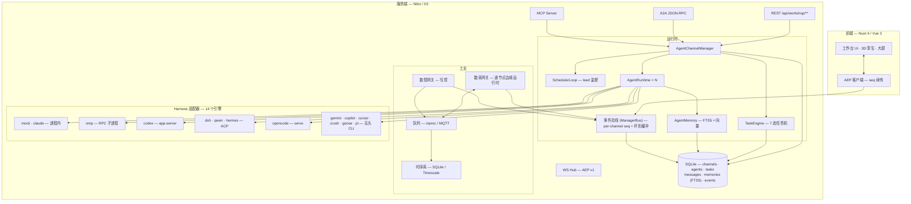

<div align="center">


<br />

# AgentWorkShop

**Where AI agent teams meet the production line.**

[](https://github.com/kingdol666/AgentWorkShop)
[](https://github.com/kingdol666/AgentWorkShop)
[](https://github.com/kingdol666/AgentWorkShop/releases)
[](https://github.com/kingdol666/AgentWorkShop/stargazers)
[](https://github.com/kingdol666/AgentWorkShop/commits)
[](https://github.com/kingdol666/AgentWorkShop/issues)
[](./LICENSE)

[](https://nuxt.com)
[](https://vuejs.org)
[](https://www.typescriptlang.org)
[](https://nodejs.org)
[](https://nodejs.org/api/sqlite.html)
[](./docs/site/guide/daq-protocols.md)
[](./docs/plugins.md)
[](https://kingdol666.github.io/AgentWorkShop)
**[简体中文](./README-zh.md)** · **[Documentation](https://kingdol666.github.io/AgentWorkShop)** · **[Releases](https://github.com/kingdol666/AgentWorkShop/releases)** · **[Changelog](./changelog.md)** · **[Plugin API](./docs/plugins.md)** · **[SDK](./docs/sdk.md)**

<sub><b>v0.8.7</b> · 14 engines · 6 field protocols (5 built-in + serial plugin) + MES REST integration (mirror & live) · data-analysis ledger with line-scoped permissions · process optimizer (process model → AML → OSQP solver → governed dispatch) · **ontology service + AI-first model loop** (ontology · twin · solver · AML adoption) · 104 host tools · 128 runtime settings · bilingual docs (简体中文 / English)</sub>

<br />

*A configuration-driven platform where **AI agent teams** and an **industrial digital twin** share one runtime — agents query real telemetry, issue supervisory setpoints through human-approved write control, and every event streams live to a 3D twin.*

</div>
[Quick start](#quick-start) · [Live demo](#live-demo) · [Capabilities](#capabilities) · [Architecture](#architecture) · [Plugins & extension](#plugins--extension) · [Verification](#verification) · [Docs site](https://kingdol666.github.io/AgentWorkShop)

---

## What is this?

A configuration-driven platform where **AI agent teams** and an **industrial production line** share one runtime — agents query real telemetry, issue supervisory setpoints through human-approved write control, and every event streams live to a 3D twin.

- **Supervisory layer** (SCADA-adjacent, second-level soft real-time): DAQ, write control, line/recipe/batch, permissions and audit in one place;
- **Agents are not chat decoration**: 14 executable engines, mixable per channel (omp / codex / opencode / claude / gemini / …), a 7-state task machine + root queue + HITL approvals — bound agents read and write real devices under scoped authority;
- **The loop is real**: read → analyze → propose → approve → write → verify readback → audited ledger, proven by live acceptance runs.

## Live demo

<p align="center">
  
  <br/>
  <sub><b>Closed loop</b> — recorded from a running instance: real DAQ history, real write control, real HITL approval</sub>
</p>

<p align="center">
  
</p>

<p align="center">
  
</p>

> [!NOTE]
> Every image in this README is a screenshot of a **running instance** (v0.8.7 production build) — none are mock-ups.

<p align="center">
  <a href="https://kingdol666.github.io/AgentWorkShop/demo/player.html">
    
    <br/>
    <sub><b>🎬 3-minute product demo</b> (click the poster to open the player · English UI/voiceover · EN/中文 subtitles)</sub>
  </a>
</p>

## Capabilities

| Area | In one sentence | Deep dive |
|---|---|---|
| **Agent team runtime** | lead orchestration + worker delivery; 7-state task machine, FIFO root queue, lease fencing, process memory (FTS5 + vector), group chat & scheduled jobs | [Architecture](#architecture) |
| **Industrial stack** | five field protocols (Modbus TCP/RTU · OPC UA · MQTT · HTTP) + serial plugin + MES REST (mirror & live); DAQ cadences, four-layer write limits, per-parameter ACK | [Protocol guide](./docs/site/guide/daq-protocols.md) |
| **Agent × device binding** | three-track node authority (dcw point scoping / recipe / line-recipe management), semantic cards injected into prompts, direct writes always refused, every write passes interlocks + HITL | [HITL guide](./docs/site/guide/hitl.md) |
| **Model loop** | AML auto-ML (physics priors + residual ensemble + conformal UQ) → promotion gates → HITL adoption → production deployment → model-driven trials | [AML manual](./docs/aml.md) |
| **Optimizer** | process model → OSQP solve → recipe_trial → promote only on improvement → unified rollback (PLC batch restore) | [Recipe versions](./docs/site/guide/recipe-versions.md) |
| **Governance & observability** | line-scoped tri-state permissions, structured audit & error ledger, /operations timeline, system monitor | [Line permissions](./docs/site/guide/line-permissions.md) |
| **Plugin ecosystem** | hot-reloadable plugins: custom drivers/processors/node templates/agent tools/HTTP routes/browser panels/Twin Providers, `aw plugin` CLI + MCP `list_changed` | [Plugins & extension](#plugins--extension) |

## Architecture

<p align="center">
  
</p>

<details>
<summary><b>Full diagram source (mermaid, open)</b></summary>



</details>

**The agent × machine bridge** (the part worth reading source for):

```
agent ──binding──▶ node (daq: auto / dcw: manual)
  │                    │
  │  my_industrial_nodes  ◀── semantic card: meaning · unit · safe range · recipe window
  │  daq_query             ◀── time-series history, statistics + physics semantics
  │  dcw_control           ──▶ interlock (safe range ∩ recipe window)
  │                           ──▶ HITL approval (manual mode, 180s timeout)
  │                           ──▶ PLC write → readback verify → ACK + write ledger
  ◀── result text with numeric values the agent can cite
```

## Quick start

```bash
node -v                            # ≥ 23.4.0 (needs built-in node:sqlite)
npm install -g agentworkshop       # → `aw` / `agentworkshop` on PATH (prebuilt output, no build step)
aw start                           # → http://localhost:3001, everything initializes into ~/.AgentWorkShop
```

Prefer not to install globally: `npx agentworkshop start`. From source: `git clone … && pnpm install && pnpm dev` (→ 3000); production: `pnpm build && pnpm start`. Update: `aw update`.

> A real agent harness needs its CLI on PATH (`omp` / `codex` / `opencode` / … pick a subset, channels can mix; `mock` and `claude` run in-process, no CLI needed). Optional DAQ infrastructure (MQTT broker + TimescaleDB) auto-starts when Docker is reachable.

**Your first “agent × line” session (about 2 minutes):**

1. **Sign in** — register in the sidebar (or `POST /api/users/register`).
2. **Build a line** — “Line Operations” → create a line, add a DAQ node (e.g. `daq-temp-tc`) and a write node (e.g. `dcw-temp-sp`), create product + recipe, press **start**.
3. **Create a team** — “Agent Workbench” → pick lead + workers, **deploy** into a channel.
4. **Bind nodes** — agent detail panel → bind DAQ (*auto*) and write nodes (*manual* = needs your approval).
5. **Submit a goal** — “Analyze the last 5 minutes of melt temperature; if it deviates more than 1 °C from 182 °C, correct the setpoint (wait for my approval).”
6. **Approve** — the agent reads real history and proposes a write → approve in the HITL panel → watch the setpoint move, and the goal closes with a numeric report.

<details>
<summary><b>Config-driven · auth · line permissions · exec modes · scheduled jobs (open)</b></summary>

One runtime, one source of truth: **`config.yml`** (defaults) < **`runtime-settings.json`** (runtime overrides) < env vars / CLI flags; every key is declared once in `shared/config/schema.json`, and the settings UI and CLI consume the same descriptors.

**Auth**: email + password issues a bearer token (multiple tokens, revocable); `POST /api/users/register` → `authorization: Bearer <token>` on `/api/workshop/**`.

**Line tri-state permissions** (admin-managed at `/permissions`): none (default — the backend returns no data) / view-only / operate (read + write). Agent write authority tracks: `dcw` point bindings (write scope + dispatch narrowing), `recipe` (single-recipe operations), `line-recipe` (all recipes on a line). Direct writes are always refused; every write passes four-layer limits, run gates, HITL and per-parameter ACK.

**Exec modes**: `goal` (lead decomposes → judges → re-dispatches until satisfied) / `loop` (fixed-interval replay) / `pipeline` (ordered stages).

**Scheduled jobs**: `interval` (60s floor) / `daily` modes; busy-guard, per-run history, consecutive-failure circuit breaker; `/workshop/schedules` page or REST.

**Four entry points**: WS (AEP v1, seq resume) · MCP (in-process server) · A2A (JSON-RPC 2.0 + AgentCard) · REST (full management surface).

**Task state machine**: `SUBMITTED → ASSIGNED → WORKING → WAITING → COMPLETED` (any state may go `CANCELED / FAILED`; a FAILED task can be reassigned to retry with a fresh execution budget, root tasks are guarded by that budget).

</details>

<details>
<summary><b>Deployment · project layout · development (open)</b></summary>

**Deployment**: terminate TLS on a reverse proxy; optional infra via `docker compose up -d` (MQTT + Timescale + MinIO); `pnpm build && pnpm start` (port from `config.yml` → `server.prod.port`). All data lives in the config root and migrates automatically across versions.

**Project layout**: `app/` (Nuxt frontend) · `server/` (API and services: agents/daq/dcw/aml/plugins) · `shared/` (cross-boundary contracts: config schema, protocol catalogs) · `scripts/` (acceptance and tooling) · `bench/` (industrial benchmark pipeline) · `docs/` (docs and acceptance evidence) · `plugins-builtin/` (built-in plugins).

**Development**: `pnpm dev` hot reload; `pnpm typecheck && pnpm lint` gates; `npm run test:unit` (server tsconfig + force-exit); docs site via `npm run docs:dev` (VitePress, 中/EN).

</details>

## Plugins & extension

Plugins are a first-class extension surface: a directory + `index.mjs` gives you **agent tool registration (`ctx.tools`), custom DAQ drivers (`ctx.daq.registerDriver`), processors & node templates, HTTP routes, browser panels, settings & i18n, Twin Providers (`ctx.twin`), and line-permission hooks (`ctx.permissions`)** — enable/disable hot-reloads instantly, and a failing plugin is isolated from the main service. Built-ins cover the whole surface: custom driver + derate processor (`aw-matrix-plugin`), vector frames (`daq-vector-demo`), knowledge bridge (`rag-bridge`), diagnostics bridge (`diag-bridge`), serial (`serial-bridge`), twin provider (`twin-injection-default`). External simulators (e.g. MATLAB/Simulink) plug in via “Twin Provider registration” or “plugin tool spawn”, and their outputs feed the optimizer directly. → [Plugin API](./docs/plugins.md) · [SDK](./docs/sdk.md) · [MCP](./docs/mcp.md)

## Verification

Every claim above has a re-runnable suite behind it. Acceptance follows the **aw-system-acceptance five-layer flow** (static gates → unit & contract → live core loops → regression → plugin/tool surface). The 2026-10-29 full round: **24 suites/checks, ~1100+ assertions, all green**; the real-device integration matrix (`e2e-golive-matrix`) **21/21** — five real protocol stacks connected, platform samples equal device-side values, four-protocol write-through, agent-token batch dispatch, honest disconnect failure and self-healing; security hardening **29/29**; adversarial error handling **26/26**.

| Layer | Representative suites (this round) |
|---|---|
| Live core loops | line governance 44/44 · ontology 87/87 · model loop 53/53 · optimizer 105/105 · injection closed loop 6/6 · device matrix 21/21 |
| Regression | api-live 61/61 · auth matrix 29/29 · template isolation 38/38 · robustness ALL · agent-team 25/25 · error handling 26/26 |
| Special | security S1–S16 29/29 · production gates 8/8 · node authority 52/52 · three-mode live 42/42 |

Evidence and reproduction commands: [`docs/audit/evidence/`](./docs/audit/evidence) and [`docs/full-test-plan.md`](./docs/full-test-plan.md); the historical baseline (~1100+ assertions, 2026-09-24) is archived in [this coverage report](./docs/audit/e2e-2026-09-24-full-coverage.md).

## Roadmap

Delivered: channel runtime & four entry points, five-protocol DAQ/write control, node binding & HITL, recipe versioning & rollback, AML model loop & optimizer, ontology service, plugin system v2, 3D twin, scheduled jobs, 14-engine harness registry, bilingual docs — the full list lives in the [changelog](./changelog.md).

In progress / planned: **alarm outbound** (email/webhook) + acknowledgment workflow · **edge deployment** (edge-agent + central broker) · **CI pipeline** (typecheck + lint + e2e) · production hardening (TLS/MQTT auth/OPC UA signing) · more scenario templates & benchmarks.

## Research paper

The governance mechanisms are written up as **“Grading Machine-Originated Plant Writes: Separately Inspectable Evidence for Industrial Agent Teams”** (IEEE TII submission under review). Sources and review records: [`paper/tii/SUBMISSION-IEEE-TII/`](./paper/tii/SUBMISSION-IEEE-TII/); every mechanism claim is backed by in-repo evidence ([`docs/benchmarks/`](./docs/benchmarks) · [`docs/experiments/`](./docs/experiments) · [`docs/audit/`](./docs/audit)).

## Contributing

Issues and PRs welcome. Before a PR: ① read the contract you are changing ([plugins](./docs/plugins.md) / [SDK](./docs/sdk.md) / [CLI](./docs/cli.md)); ② run gates locally (`pnpm typecheck && pnpm lint`, add a real E2E for behavior changes); ③ conventional commits (enforced by the `commitlint` hook); ④ run `aw doctor` before filing a bug.

## Security

Please **do not** open public issues for vulnerabilities — report privately via [GitHub Security Advisories](https://github.com/kingdol666/AgentWorkShop/security/advisories/new). Before pointing AgentWorkShop at real devices, review the interlocks, safe ranges and HITL settings in `config.yml` — the default posture is advisory, and plant-side logic always holds the final veto.

## License

[Apache 2.0](./LICENSE) (permissive; commercial and production use allowed).

---

<div align="center">

**If this project is useful to you, a ⭐ helps others find it.**

Current version: **v0.8.7** — [Releases](https://github.com/kingdol666/AgentWorkShop/releases) · [Changelog](./changelog.md) · [Documentation](https://kingdol666.github.io/AgentWorkShop)

</div>
