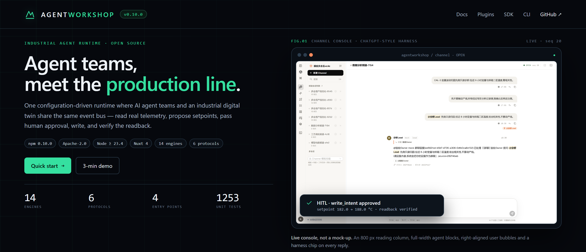
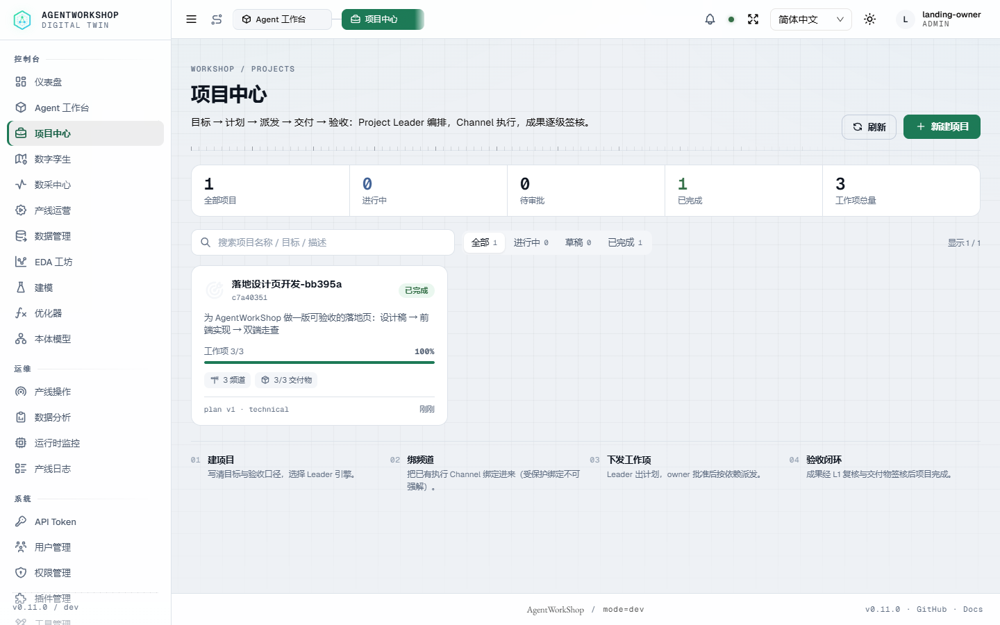
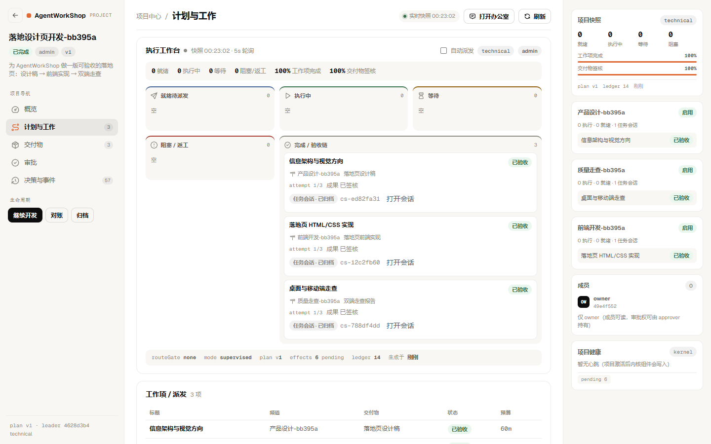
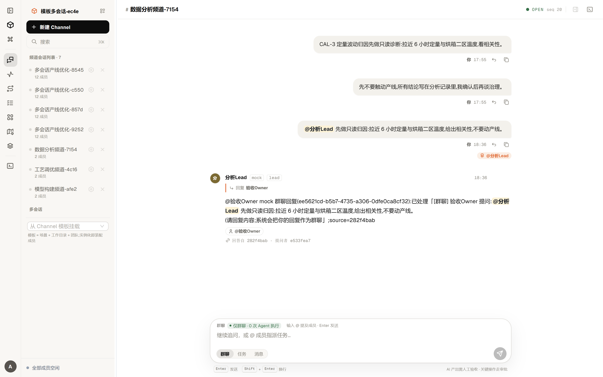
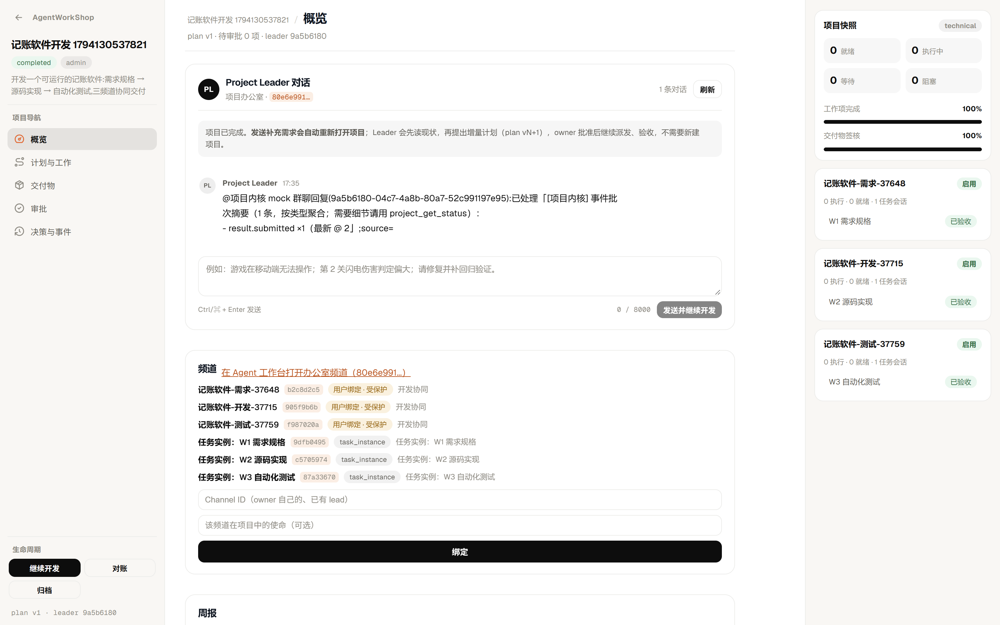
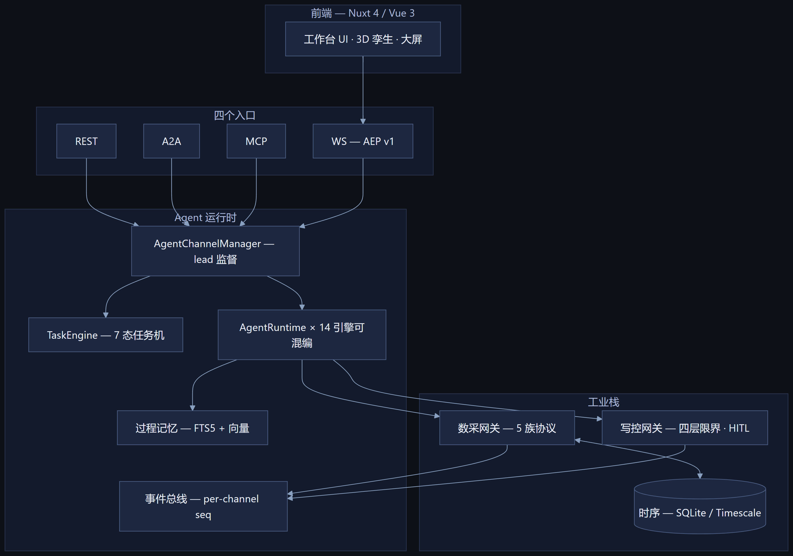
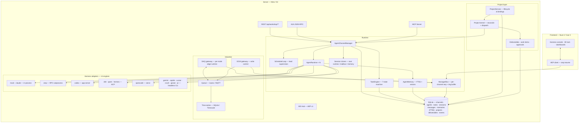

<div align="center">



<br />

# AgentWorkShop

**Where AI agent teams meet the production line.**

[](https://www.npmjs.com/package/agentworkshop)
[](https://www.npmjs.com/package/agentworkshop)
[](https://github.com/kingdol666/AgentWorkShop/releases/tag/v0.11.2)
[](https://github.com/kingdol666/AgentWorkShop/stargazers)
[](https://github.com/kingdol666/AgentWorkShop/commits)
[](https://github.com/kingdol666/AgentWorkShop/issues)
[](./LICENSE)

[](https://nuxt.com)
[](https://vuejs.org)
[](https://www.typescriptlang.org)
[](https://nodejs.org)
[](https://nodejs.org/api/sqlite.html)
[](https://kingdol666.github.io/AgentWorkShop/guide/daq-protocols)
[](https://kingdol666.github.io/AgentWorkShop/guide/harness-ui)
[](./docs/plugins.md)
[](https://kingdol666.github.io/AgentWorkShop)

**[简体中文](./README-zh.md)** · **[Documentation](https://kingdol666.github.io/AgentWorkShop)** · **[Releases](https://github.com/kingdol666/AgentWorkShop/releases)** · **[Changelog](./changelog.md)** · **[Plugin API](./docs/plugins.md)** · **[SDK](./docs/sdk.md)**

<sub><b>v0.11.2</b> · 14 engines · 6 field protocols (5 built-in + serial plugin) + MES REST (mirror & live) · **Project center** · **RSI experience evolution** · 148 host tools · 144 runtime settings · bilingual docs (简体中文 / English)</sub>

<br />

*A configuration-driven platform where **AI agent teams** and an **industrial digital twin** share one runtime — agents query real telemetry, issue supervisory setpoints through human-approved write control, and every event streams live to the 3D twin.*

</div>

[Quick start](#quick-start) · [What's new](#whats-new-in-0112) · [Agent team model](#the-agent-team-model) · [Capabilities](#capabilities) · [Architecture](#architecture) · [Verification](#verification) · [Docs site](https://kingdol666.github.io/AgentWorkShop)

---

## What is this?

A configuration-driven platform where **AI agent teams** and an **industrial production line** share one runtime — agents query real telemetry, issue supervisory setpoints through human-approved write control, and every event streams live to a 3D twin.

- **Supervisory layer** (SCADA-adjacent, second-level soft real-time): DAQ, write control, line/recipe/batch, permissions and audit in one place;
- **Agents are not chat decoration**: 14 executable engines, mixable per channel (omp / codex / opencode / claude / gemini / …), a 7-state task machine + root queue + HITL approvals, and a **Channel → Session → Agent** object model that keeps teams isolated;
- **Delivery is a first-class concept**: **Project mode** turns a blueprint into a plan, a WBS with dependencies, L1 technical review, L2 owner acceptance and real deliverables — the project closes only when the deliverables pass;
- **The loop is real**: read → analyze → propose → approve → write → verify readback → audited ledger, proven by live acceptance runs.

## What's new in 0.11.2

This patch release closes the final acceptance findings after merging PR #185 and PR #186.

- **Recipe trial preflight**: deterministic out-of-range and recipe-window-invalid candidates are rejected before HITL, with no approval card, driver write, execution batch, or device mutation.
- **Strict recipe input validation**: null, booleans, empty strings, NaN, Infinity, and nonnumeric strings fail closed as a whole batch; finite numbers and numeric strings remain supported.
- **AML nearest-neighbor regression coverage**: offset timestamps, exact timestamp precedence, tolerance boundary, and beyond-tolerance missing behavior are now independently locked to the production helper.
- **Final main acceptance**: latest main `6af25a8b`, unit 1516/1516, PLC 11/11, Agent 9/9, API 75/75, Project 14/14, RSI 32/32, multi-round RSI 10/10, and six production UI screenshots. Evidence: `docs/audit/evidence/2026-11-12-final-main-acceptance/`.
- **Boundaries**: PLC coverage uses an isolated digital twin; deterministic mock harnesses cover orchestration; Mimosa full scan remained incomplete (`scanner_enobufs`), so this release makes no security-pass claim.
- **UI observation**: the final screenshot matrix recorded one hydration-mismatch warning on `/dcw`; no page crashed and `overflowX=0`. This remains a P3 follow-up, not a silently reported zero-console-error claim.

- **Cancellation hard-stop** (#176): canceled projects are immutable — every write/approval/proposal entry fails closed, missing runtime cancel capability aborts termination with 503 instead of silently skipping, orphan task-instance channels are cancelled and torn down in the same transaction, and unbind stops the runtime first and commits the database side in one atomic transaction.
- **RSI evidence integrity** (#180): bench p-values are recomputed server-side from per-seed data, experience promotion requires real completed same-channel task evidence, harness-profile pins render only channel-owned validated rows in matching scope, and all lifecycle transitions are expected-state CAS.
- **Session idempotency & shutdown** (#181): session messages get a durable actor-scoped `clientMessageId` (atomic INSERT-on-conflict replay, deterministic 409 on payload change), DAQ frames carry `lineId` end-to-end, and runtime stop waits for loop/dispose so shutdown no longer races the database.
- **Upgrade safety** (#182): existing databases upgrade cleanly — the messages idempotency index is now created after its columns migrate (previously crashed startup on pre-0.11.1 databases).
- **UI P0 trio** (#177–#179): shell/tokens/navigation a11y, ChatGPT-style chat rhythm, and a dashboard shift band with a real alarm queue.
- Also landed: AML nearest-neighbor dataset alignment (#166), MV-scoped action evidence (#167/#168), lock-free root-deadline collection (#169), the agent.block protocol surface end-to-end (#170/#172/#173), honest harness capability claims (#171), OMP identity harness (#174), and shared ACP HITL reply mapping (#175).

Verification: unit **1516/1516**, lint/typecheck/i18n/docs 0 fail, final main production-style acceptance on an isolated build — PLC twin **11/11**, governed agent control **9/9**, REST/WS/MCP **75/75**, Project multi-channel dispatch **14/14**, RSI evolution **32/32**, multi-round RSI **10/10**. Evidence: `docs/audit/evidence/2026-11-12-final-main-acceptance/`.

## What's new in 0.11.0

Three additions make the delivery layer reachable, self-improving, and provable on a real model harness.

### Project center: the delivery layer gets a front door

`/projects` is now a first-class navigation destination — sidebar, workspace homepage, command palette and route metadata — instead of a page you could only reach by typing the URL.

- **Project list**: stat band, search, status filter, per-project progress, channel / deliverable / approval chips. `GET /api/workshop/projects` now returns a server-side `summary` (work items, signed deliverables, bound channels, pending approvals, last activity), so the list renders without N+1 calls.
- **Project detail**: real channel names everywhere (binding picker, work-item table, deliverables), a five-column execution board (ready / running / waiting / blocked / completion-and-acceptance), deliverable gates (content → technical → business) and a unified decision-and-event timeline with cursor pagination.
- **No dead ends**: the list uses the platform shell, the detail keeps a breadcrumb back to the platform, and both expose the Project Leader office channel.

<p align="center">
  
  
</p>

→ [Project guide](https://kingdol666.github.io/AgentWorkShop/guide/projects) · Live acceptance: **39/39** (blueprint → technical 409 gate → L1/L2 → completed) and **13/13** on omp / `ustc/deepseek-flash`.

### RSI: experience that is earned, not asserted

The runtime now closes a **capture → gate → promote → share → verify** loop around its own experience:

- **Capture** — a completed task or a review outcome writes a scoped experience row with task evidence; a governance write becomes an intervention-ledger row.
- **Gate** — one task is never enough: promotion to `validated` requires independent evidence (e.g. two tasks), otherwise the gate fails closed.
- **Share** — validated line-scoped experience is readable by other channels on the same line and invisible to other lines.
- **Evolve** — paired evaluation → Harness Profile `pin → shadow → active`, with rollback and a meta-layer success-rate view.
- **Verify** — an independent readback verifier turns device mismatches into a 409 that blocks L1 review: "done" is not accepted when the device disagrees.

→ [RSI guide](https://kingdol666.github.io/AgentWorkShop/guide/rsi) · Live acceptance: **32/32** on a production build (capture, fail-closed gate, HITL writes, readback block, cross-channel isolation, profile promote/rollback, meta stats, zero device writes in the learning ring).

### Real-model proof: omp + `ustc/deepseek-flash`

Channel and Project tests ran with a **real LLM harness**, not only the deterministic mock:

- two sessions in one channel each received a distinct model reply (`ALPHA-…` / `BETA-…`) with **zero cross-session leakage**;
- a Project work item dispatched into its own task-instance channel was delivered by the model in **619 s** (artifact `PROJECT-SINGLE-OK`), then reconciled, submitted, L1-reviewed, L2-accepted and completed.

→ [Channel sessions](https://kingdol666.github.io/AgentWorkShop/guide/channels-sessions) · Evidence: [`docs/audit/evidence/2026-11-09-full-acceptance/REPORT.md`](docs/audit/evidence/2026-11-09-full-acceptance/REPORT.md)

## What's new in 0.10.0 baseline: harness console, sessions, project mode

### A harness console built for reading

The Channel console and Project detail were rebuilt around the ChatGPT harness pattern — an **800 px reading column**, full-width agent blocks, right-aligned user bubbles, a **harness chip on every reply**, and a 26 px composer that keeps the conversation as the visual center. The industrial shell is still there; it just stopped competing with the work.

<p align="center">
  
  
</p>

- **Channel**: full-width agent blocks, user right bubble, harness / role / time metadata, neutral composer, hover-revealed channel ops;
- **Project**: breadcrumb header, 880 px reading column, 312 px snapshot rail, channel names instead of UUID walls, 2-line leader composer;
- **Entry pages**: 1080 px project grid with a 3-column create form, 1240 px workspace grid;
- **No behaviour removed**: every `data-testid`, keyboard shortcut, @-mention, HITL semantic and API is unchanged — verified by the 12/12 UI interaction suite.

→ [Harness UI guide](https://kingdol666.github.io/AgentWorkShop/guide/harness-ui) · [Design canvas & before/after](docs/design/2026-11-08-harness-ui/README.md)

### Channel sessions: same team, separate worlds

A Channel is the collaboration unit (members, tools, memory, task machine). A **Session** is an isolated execution environment: it clones the channel's base members — each clone gets its own runtime, mailbox, execution lock, engine process and memory domain — while sharing the channel's team memory and node bindings.

```
Channel (base members) ── session A ── clone lead + workers  → own mailbox / runtime
                       └─ session B ── clone lead + workers  → own mailbox / runtime
```

- `POST /api/workshop/channels/:id/sessions` → `{ sessionId, members }`; each clone is a real agent row with a unique `agentId`;
- sessions run **in parallel**; work inside a session stays serialized (one execution lock per clone);
- **closing session B** cancels its in-flight task tree, unloads its clones and leaves session A and the base members untouched;
- base members never leave; a closed session's clones are disabled and refused by invoke;
- template → channel → session: channel templates instantiate full teams (scene, tool profile, control policy, line binding), sessions instantiate execution environments.

→ [Channel sessions guide](https://kingdol666.github.io/AgentWorkShop/guide/channels-sessions) · Live acceptance: **20/20 multi-session**, **24/24 multi-harness isolation**

### Project mode: a contract, not a transcript

A Project binds an **office Channel with a Project Leader** and one or more **member Channels** under a plan. Work is tracked as work items with dependencies; deliverables are the denominator of completion.

```
Blueprint ─▶ Plan approval ─▶ WBS (dependsOn) ─▶ technical L1 ─▶ owner L2 ─▶ completed
   │              │                 │                  │             │
   └ channels     └ plan version    └ attempts         └ reviewed    └ approved deliverables
```

- **Blueprint instantiation**: `POST /api/workshop/projects/instantiate` with a template name or a blueprint document (channels + deliverables + work items + routing policy + mode);
- **Modes**: `observe` (shadow, record only) · `supervised` (default; plan approval + destructive-action approval) · `auto` (auto-dispatch, replan still needs approval);
- **Work item state machine**: `DRAFT → DISPATCHING → DISPATCHED → RUNNING → COMPLETED`, with `BLOCKED / REWORK / FAILED / CANCELED / SUPERSEDED`; state is a projection reconciled against attempts and root tasks;
- **Deliverables**: `planned → active → submitted → approved / rejected / waived`; L1 technical review then L2 owner acceptance, evidence must reference a real task, artifact or analysis report;
- **Continuation**: a completed project reopens when the owner sends a follow-up requirement to the same Project Leader; a new plan version is proposed instead of a new project;
- **Industrial proof**: the CAL-3 four-stage scenario (read-only analysis → HITL write → training dataset → bounded autonomous optimization) passed **78/78** on a real line, including 300 s / 60 s write gates and device readback.

→ [Project mode guide](https://kingdol666.github.io/AgentWorkShop/guide/projects) · Evidence: [`docs/audit/evidence/2026-11-08-industrial-acceptance/REPORT.md`](docs/audit/evidence/2026-11-08-industrial-acceptance/REPORT.md)

## The agent team model

| Layer | What it is | What it gives you |
|---|---|---|
| **Channel** | The collaboration unit: lead + workers, harness/provider/model, tools, node bindings, task machine, HITL | A team with a stable identity and authority surface |
| **Session** | An isolated execution environment cloned from the channel's base members | Parallel work without a shared mailbox, lock or memory leak |
| **Agent** | A clonable object with a unique `agentId`, its own lifecycle and memory scope | Create / activate / disable / delete without touching other channels |
| **Project** | A delivery contract: office channel + leader + member channels + plan + deliverables | WBS, technical review, owner acceptance, auditable completion |
| **Attempt** | One execution of a work item against a channel task | Retries, rework and supersession without losing history |
| **Deliverable** | The accepted result of one or more attempts | Completion is defined by evidence, not by a chat message |

The four boundaries are deliberate: a Project Leader can never raise a Channel's write authority, an Agent can never see another channel's members, and a Session close never touches the base team.

## Capabilities

| Area | In one sentence | Deep dive |
|---|---|---|
| **Agent team runtime** | lead orchestration + worker delivery; 7-state task machine, FIFO root queue, lease fencing, process memory (FTS5 + vector), group chat & scheduled jobs | [Architecture](#architecture) |
| **Channel sessions** | template → channel → session; clone base members with their own runtime, mailbox, execution lock and memory; close one and the others keep working | [Channel sessions](https://kingdol666.github.io/AgentWorkShop/guide/channels-sessions) |
| **Project delivery** | blueprint → plan approval → WBS with dependencies → technical L1 → owner L2 → deliverables; observe / supervised / auto; **project center** for entry, progress and the execution board | [Project mode](https://kingdol666.github.io/AgentWorkShop/guide/projects) |
| **RSI experience evolution** | capture task/review evidence → fail-closed promotion gate → line-scoped sharing → paired-eval Harness Profile (`pin → shadow → active`) → readback-verified L1 gate + rollback | [RSI guide](https://kingdol666.github.io/AgentWorkShop/guide/rsi) |
| **Industrial stack** | five field protocols (Modbus TCP/RTU · OPC UA · MQTT · HTTP) + serial plugin + MES REST (mirror & live); DAQ cadences, four-layer write limits, per-parameter ACK | [Protocol guide](https://kingdol666.github.io/AgentWorkShop/guide/daq-protocols) |
| **Agent × device binding** | three-track node authority (dcw point scoping / recipe / line-recipe management), semantic cards injected into prompts, direct writes always refused, every write passes interlocks + HITL | [HITL guide](https://kingdol666.github.io/AgentWorkShop/guide/hitl) |
| **Model loop** | AML auto-ML (physics priors + residual ensemble + conformal UQ) → promotion gates → HITL adoption → production deployment → model-driven trials | [AML manual](./docs/aml.md) |
| **Optimizer** | process model → OSQP solve → recipe_trial → promote only on improvement → unified rollback (PLC batch restore) | [Recipe versions](https://kingdol666.github.io/AgentWorkShop/guide/recipe-versions) |
| **Governance & observability** | line-scoped tri-state permissions, structured audit & error ledger, /operations timeline, system monitor, 60 s / 300 s write gates | [Line permissions](https://kingdol666.github.io/AgentWorkShop/guide/line-permissions) |
| **Plugin ecosystem** | hot-reloadable plugins: custom drivers/processors/node templates/agent tools/HTTP routes/browser panels/Twin Providers, `aw plugin` CLI + MCP `list_changed` | [Plugins & extension](#plugins--extension) |

## Architecture

<p align="center">
  
</p>

<details>
<summary><b>Full diagram source (mermaid, open)</b></summary>



</details>

**The agent × machine bridge** (the part worth reading source for):

```
agent ──binding──▶ node (daq: auto / dcw: manual)
  │                    │
  │  my_industrial_nodes  ◀── semantic card: meaning · unit · safe range · recipe window
  │  daq_query             ◀── time-series history, statistics + physics semantics
  │  dcw_control           ──▶ interlock (safe range ∩ recipe window)
  │                           ──▶ HITL approval (manual mode, 180s timeout)
  │                           ──▶ PLC write → readback verify → ACK + write ledger
  ◀── result text with numeric values the agent can cite
```

## Quick start

```bash
node -v                            # ≥ 23.4.0 (needs built-in node:sqlite)
npm install -g agentworkshop       # → `aw` / `agentworkshop` on PATH (prebuilt output, no build step)
aw start                           # → http://localhost:3001, everything initializes into ~/.AgentWorkShop
```

Prefer not to install globally: `npx agentworkshop start`. From source: `git clone … && pnpm install && pnpm dev` (→ 3000); production: `pnpm build && pnpm start`. Update: `aw update`.

> A real agent harness needs its CLI on PATH (`omp` / `codex` / `opencode` / … pick a subset, channels can mix; `mock` and `claude` run in-process, no CLI needed). Optional DAQ infrastructure (MQTT broker + TimescaleDB) auto-starts when Docker is reachable.

**Your first “agent × line” session (about 2 minutes):**

1. **Sign in** — register in the sidebar (or `POST /api/users/register`).
2. **Build a line** — “Line Operations” → create a line, add a DAQ node (e.g. `daq-temp-tc`) and a write node (e.g. `dcw-temp-sp`), create product + recipe, press **start**.
3. **Create a team** — “Agent Workbench” → pick lead + workers, mix harnesses if you like, **deploy** into a channel.
4. **Bind nodes** — agent detail panel → bind DAQ (*auto*) and write nodes (*manual* = needs your approval).
5. **Submit a goal** — “Analyze the last 5 minutes of melt temperature; if it deviates more than 1 °C from 182 °C, correct the setpoint (wait for my approval).”
6. **Approve** — the agent reads real history and proposes a write → approve in the HITL panel → watch the setpoint move, and the goal closes with a numeric report.

Want the delivery experience instead of a single channel? Open **Projects → New project → continue development**, or instantiate a blueprint:

```bash
curl -X POST http://localhost:3001/api/workshop/projects/instantiate \
  -H "authorization: Bearer <token>" -H "content-type: application/json" \
  -d '{"template":"line-optimisation","nameOverride":"CAL-3 rerun"}'
```

<details>
<summary><b>Config-driven · auth · line permissions · exec modes · scheduled jobs (open)</b></summary>

One runtime, one source of truth: **`config.yml`** (defaults) < **`runtime-settings.json`** (runtime overrides) < env vars / CLI flags; every key is declared once in `shared/config/schema.json`, and the settings UI and CLI consume the same descriptors.

**Auth**: email + password issues a bearer token (multiple tokens, revocable); `POST /api/users/register` → `authorization: Bearer <token>` on `/api/workshop/**`.

**Line tri-state permissions** (admin-managed at `/permissions`): none (default — the backend returns no data) / view-only / operate (read + write). Agent write authority tracks: `dcw` point bindings (write scope + dispatch narrowing), `recipe` (single-recipe operations), `line-recipe` (all recipes on a line). Direct writes are always refused; every write passes four-layer limits, run gates, HITL and per-parameter ACK.

**Exec modes**: `goal` (lead decomposes → judges → re-dispatches until satisfied) / `loop` (fixed-interval replay) / `pipeline` (ordered stages).

**Scheduled jobs**: `interval` (60s floor) / `daily` modes; busy-guard, per-run history, consecutive-failure circuit breaker; `/workshop/schedules` page or REST.

**Four entry points**: WS (AEP v1, seq resume) · MCP (in-process server) · A2A (JSON-RPC 2.0 + AgentCard) · REST (full management surface).

**Task state machine**: `SUBMITTED → ASSIGNED → WORKING → WAITING → COMPLETED` (any state may go `CANCELED / FAILED`; a FAILED task can be reassigned to retry with a fresh execution budget, root tasks are guarded by that budget).

</details>

<details>
<summary><b>Deployment · project layout · development (open)</b></summary>

**Deployment**: terminate TLS on a reverse proxy; optional infra via `docker compose up -d` (MQTT + Timescale + MinIO); `pnpm build && pnpm start` (port from `config.yml` → `server.prod.port`). All data lives in the config root and migrates automatically across versions.

**Project layout**: `app/` (Nuxt frontend) · `server/` (API and services: agents/daq/dcw/aml/projects/sessions/plugins) · `shared/` (cross-boundary contracts: config schema, protocol catalogs) · `scripts/` (acceptance and tooling) · `bench/` (industrial benchmark pipeline) · `docs/` (docs and acceptance evidence).

**Development**: `pnpm dev` hot reload; `pnpm typecheck && pnpm lint` gates; `npm run test:unit` (server tsconfig + force-exit); docs site via `npm run docs:dev` (VitePress, 中/EN).

</details>

## Plugins & extension

Plugins are a first-class extension surface: a directory + `index.mjs` gives you **agent tool registration (`ctx.tools`), custom DAQ drivers (`ctx.daq.registerDriver`), processors & node templates, HTTP routes, browser panels, settings & i18n, Twin Providers (`ctx.twin`), and line-permission hooks (`ctx.permissions`)** — enable/disable hot-reloads instantly, and a failing plugin is isolated from the main service. Built-ins cover the whole surface: custom driver + derate processor (`aw-matrix-plugin`), vector frames (`daq-vector-demo`), knowledge bridge (`rag-bridge`), diagnostics bridge (`diag-bridge`), serial (`serial-bridge`), twin provider (`twin-injection-default`). External simulators (e.g. MATLAB/Simulink) plug in via “Twin Provider registration” or “plugin tool spawn”, and their outputs feed the optimizer directly. → [Plugin API](./docs/plugins.md) · [SDK](./docs/sdk.md) · [MCP](./docs/mcp.md)

## Documentation

| Start | Build | Operate |
|---|---|---|
| [Getting started](https://kingdol666.github.io/AgentWorkShop/guide/getting-started) · [First session](https://kingdol666.github.io/AgentWorkShop/guide/first-session) | [Plugin API](./docs/plugins.md) · [SDK](./docs/sdk.md) · [CLI](./docs/cli.md) | [Configuration](https://kingdol666.github.io/AgentWorkShop/guide/configuration) · [HITL](https://kingdol666.github.io/AgentWorkShop/guide/hitl) · [Permissions](https://kingdol666.github.io/AgentWorkShop/guide/line-permissions) |
| [Harness UI](https://kingdol666.github.io/AgentWorkShop/guide/harness-ui) · [Channel sessions](https://kingdol666.github.io/AgentWorkShop/guide/channels-sessions) · [Project mode](https://kingdol666.github.io/AgentWorkShop/guide/projects) | [DAQ protocols](https://kingdol666.github.io/AgentWorkShop/guide/daq-protocols) · [DCW read/write](https://kingdol666.github.io/AgentWorkShop/guide/dcw-read-write) · [Recipes](https://kingdol666.github.io/AgentWorkShop/guide/recipe-versions) | [AML](./docs/aml.md) · [Ontology](https://kingdol666.github.io/AgentWorkShop/guide/ontology) · [EDA studio](https://kingdol666.github.io/AgentWorkShop/guide/eda) |

## Verification

Every claim above has a re-runnable suite behind it. Acceptance follows the **aw-system-acceptance five-layer flow** (static gates → unit & contract → live core loops → regression → plugin/tool surface).

**2026-11 acceptance round (main build):**

| Suite | Result | Evidence |
|---|---|---|
| **RSI experience evolution** (capture → gate → share → profile → rollback, production build) | **32/32** | [`2026-11-09-rsi-live-e2e/report.md`](docs/audit/evidence/2026-11-09-rsi-live-e2e/report.md) |
| **Project center** (blueprint → technical 409 → L1/L2 → completed, real Chrome) | **39/39** | [`2026-11-09-project-landing`](docs/audit/evidence/2026-11-09-project-landing/project-landing-live.md) |
| **omp / `ustc/deepseek-flash`** (Project work item delivered by a real LLM, 619 s) | **13/13** | [`omp-single-report.json`](docs/audit/evidence/2026-11-09-full-acceptance/omp-single-report.json) |
| **Session isolation** (two sessions, real model replies, zero leakage) | ✔ | [`2026-11-09-full-acceptance/REPORT.md`](docs/audit/evidence/2026-11-09-full-acceptance/REPORT.md) |
| CAL-3 four-stage industrial loop (read-only → HITL write → dataset → bounded optimization) | **78/78** | [`docs/audit/evidence/2026-11-08-industrial-acceptance/REPORT.md`](docs/audit/evidence/2026-11-08-industrial-acceptance/REPORT.md) |
| Multi-harness isolation (mock / omp / dsh / codex / opencode) | **24/24** | [`harness-isolation.json`](docs/audit/evidence/2026-11-08-full-acceptance/harness-isolation.json) |
| Channel template multi-session (parallel sessions + HITL write) | **20/20** | [`channel-multisession.json`](docs/audit/evidence/2026-11-08-multisession-opt/channel-multisession.json) |
| Project mode (bookkeeping delivery, 3 channels / 3 work items) | **58/58** | [`bookkeeping.json`](docs/audit/evidence/2026-11-08-final-acceptance/bookkeeping.json) |
| UI interaction (real Chrome, 12 assertions) | **12/12** | [`ui-results.json`](docs/audit/evidence/2026-11-08-full-acceptance/ui/ui-results.json) |
| Unit / typecheck / lint | **1356 pass · 0 fail · 2 skip** / ✔ / 0 error | [`docs/audit/evidence/`](docs/audit/evidence) |

Earlier rounds remain reproducible: the 2026-10-29 full round (**24 suites/checks, ~1100+ assertions, all green**), the real-device integration matrix (`e2e-golive-matrix`) **21/21** — five real protocol stacks connected, platform samples equal device-side values, four-protocol write-through, agent-token batch dispatch, honest disconnect failure and self-healing; security hardening **29/29**; adversarial error handling **26/26**; the 2026-10-31 executable test-card round: static paper-code consistency **100%** (20 anchors) · real five-protocol tier **13/13** · E1a governance ablation matches theory · api-live **75/75** · bit-exact reproduction against the 20260914 frozen baseline ×2.

| Layer | Representative suites |
|---|---|
| Live core loops | line governance 44/44 · ontology 87/87 · model loop 53/53 · optimizer 105/105 · injection closed loop 6/6 · device matrix 21/21 · CAL-3 78/78 |
| Team & delivery | multi-harness 24/24 · channel multi-session 20/20 · Project 58/58 · UI 12/12 |
| Regression | api-live 75/75 · auth matrix 29/29 · template isolation 38/38 · robustness ALL · agent-team 25/25 · error handling 26/26 |
| Special | security S1–S16 29/29 · production gates 8/8 · node authority 52/52 · three-mode live 42/42 · frozen-baseline reproduction ×2 |

Evidence and reproduction commands: [`docs/audit/evidence/`](./docs/audit/evidence) and [`docs/full-test-plan.md`](./docs/full-test-plan.md); the historical baseline (~1100+ assertions, 2026-09-24) is archived in [this coverage report](./docs/audit/e2e-2026-09-24-full-coverage.md).

## Roadmap

Delivered: channel runtime & four entry points, five-protocol DAQ/write control, node binding & HITL, recipe versioning & rollback, AML model loop & optimizer, ontology service, plugin system v2, 3D twin, scheduled jobs, 14-engine harness registry, **ChatGPT-style harness UI**, **Channel multi-session**, **Project delivery mode**, **Project center**, **RSI experience evolution**, bilingual docs — the full list lives in the [changelog](./changelog.md).

In progress / planned: **binding lifecycle** (auto-release on project completion) · **durable project workflow** (outbox + idempotent consumers + saga) · **rate-gate-aware scheduling** · **HITL intent TTL/idempotency** · **harness supervision & stuck-instance reaping** · **SLO dashboards and alerts** · **alarm outbound** (email/webhook) · **edge deployment** (edge-agent + central broker) · more scenario templates & benchmarks.

## Research paper

The governance mechanisms are written up as **“Grading Machine-Originated Plant Writes: Separately Inspectable Evidence for Industrial Agent Teams”** (IEEE TII submission under review). Sources and review records: [`paper/tii/SUBMISSION-IEEE-TII/`](./paper/tii/SUBMISSION-IEEE-TII/); every mechanism claim is backed by in-repo evidence ([`docs/benchmarks/`](./docs/benchmarks) · [`docs/experiments/`](./docs/experiments) · [`docs/audit/`](./docs/audit)).

## Contributing

Issues and PRs welcome. Before a PR: ① read the contract you are changing ([plugins](./docs/plugins.md) / [SDK](./docs/sdk.md) / [CLI](./docs/cli.md)); ② run gates locally (`pnpm typecheck && pnpm lint`, add a real E2E for behavior changes); ③ conventional commits (enforced by the `commitlint` hook); ④ run `aw doctor` before filing a bug.

## Security

Please **do not** open public issues for vulnerabilities — report privately via [GitHub Security Advisories](https://github.com/kingdol666/AgentWorkShop/security/advisories/new). Before pointing AgentWorkShop at real devices, review the interlocks, safe ranges and HITL settings in `config.yml` — the default posture is advisory, and plant-side logic always holds the final veto.

## License

[Apache 2.0](./LICENSE) (permissive; commercial and production use allowed).

---

<div align="center">

**If this project is useful to you, a ⭐ helps others find it.**

Current version: **v0.11.2** — [Releases](https://github.com/kingdol666/AgentWorkShop/releases) · [Changelog](./changelog.md) · [Documentation](https://kingdol666.github.io/AgentWorkShop)

<a href="https://star-history.com/#kingdol666/AgentWorkShop&Date">
  
</a>

</div>
