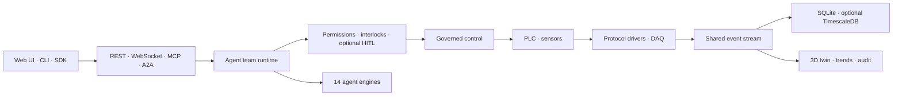

<div align="center">


# AgentWorkShop

**Agent teams, industrial data, and governed control in one runtime.**

[](https://www.npmjs.com/package/agentworkshop)
[](https://github.com/kingdol666/AgentWorkShop/releases)
[](./LICENSE)
[](https://nodejs.org)
[](https://kingdol666.github.io/AgentWorkShop)

[简体中文](./README-zh.md) · [Documentation](https://kingdol666.github.io/AgentWorkShop) · [Releases](https://github.com/kingdol666/AgentWorkShop/releases) · [Contributing](#contributing)

</div>

> [!IMPORTANT]
> **Supervisory system, not a safety controller.** AgentWorkShop operates at second-level soft real-time. Keep interlocks, safety functions, servo loops, and every hard real-time control path inside the PLC or dedicated safety system. Agent-proposed setpoints are checked against configured bounds; human approval is required when a binding uses `manual` mode. Plant-side logic remains authoritative.

## What is AgentWorkShop?

AgentWorkShop is an open-source industrial agent runtime. It connects multi-agent teams to production-line data and workflows, while keeping telemetry, permissions, control, and audit history in one configurable platform.

It is designed for:

- **Line and process engineers** who need a clear view of equipment, recipes, batches, alarms, and trends.
- **Industrial AI teams** that want agents to analyze real telemetry and propose bounded actions.
- **Platform developers and researchers** who need a documented runtime, simulator-friendly workflows, and extensible integrations.

## FIG.06 — Product demo

https://github.com/user-attachments/assets/241ad4e4-2645-4bef-8eb1-499739dc9ce1

<p align="center">
  <a href="https://github.com/kingdol666/AgentWorkShop/blob/c73a509c6e515d02d1290e54cab901ea9aff430b/docs/site/public/demo/agentworkshop-core-demo.mp4">Open the MP4 in GitHub</a>
  · <a href="https://raw.githubusercontent.com/kingdol666/AgentWorkShop/c73a509c6e515d02d1290e54cab901ea9aff430b/docs/site/public/demo/agentworkshop-core-demo.en.vtt">English captions</a>
  · <a href="https://raw.githubusercontent.com/kingdol666/AgentWorkShop/c73a509c6e515d02d1290e54cab901ea9aff430b/docs/site/public/demo/agentworkshop-core-demo.zh-Hans.vtt">简体中文字幕</a>
</p>

<sub>67-second interface walkthrough with English narration. It uses an isolated Mock PLC scenario; the line stays stopped, no physical PLC is connected, and no control write is issued.</sub>

## Core capabilities

| Area | What it provides |
|---|---|
| **Agent teams** | Fourteen engine adapters behind one runtime contract; lead-and-worker channels, goal/loop/pipeline tasks, scheduling, and persistent memory. |
| **Industrial data** | DAQ and control integrations across Modbus TCP/RTU, OPC UA, MQTT, HTTP, and the serial plugin; live telemetry and recipe- and batch-scoped history. |
| **Governed control** | Line-scoped permissions, safe-range and recipe-window checks, optional HITL approval in `manual` mode, PLC readback, and an attributable audit trail. |
| **Twin and modeling** | Event-driven 3D line views, the Auto-Modeling Lab (AML), ontology-backed process models, and governed optimization workflows. |
| **Integration and extension** | REST, WebSocket, MCP, and A2A entry points; a TypeScript SDK, CLI/TUI, and hot-reloadable plugins. |

## How it fits together



The runtime separates observation from action: DAQ reads and publishes telemetry; control requests cross line permissions and configured process bounds, with HITL approval when the binding uses `manual` mode; readback and audit records close the loop.

## Quick start

### Install the published package

**Requirements:** Node.js 23.4.0 or newer.

```bash
npm install -g agentworkshop
aw start
# Open http://localhost:3001
```

The global install keeps its configuration and runtime data under `~/.AgentWorkShop`. Optional agent harnesses are detected from your `PATH`; install only the engines you plan to use.

### Run from source

```bash
git clone https://github.com/kingdol666/AgentWorkShop.git
cd AgentWorkShop
pnpm install
pnpm dev
```

The source checkout serves the development UI at the configured local port. See the [getting-started guide](https://kingdol666.github.io/AgentWorkShop/guide/getting-started) for configuration and a first agent workflow.

> Start with a simulator or a non-production environment. Before connecting a real line, review node bindings, line permissions, safe ranges, recipe windows, and HITL mode settings.

## Documentation

| Start here | Learn more |
|---|---|
| [Getting started](https://kingdol666.github.io/AgentWorkShop/guide/getting-started) | Install, configure, and run a first session |
| [DAQ protocols](https://kingdol666.github.io/AgentWorkShop/guide/daq-protocols) | Protocol drivers, telemetry, and node setup |
| [Write control and HITL](https://kingdol666.github.io/AgentWorkShop/guide/dcw-read-write) · [HITL approvals](https://kingdol666.github.io/AgentWorkShop/guide/hitl) | Permission checks, optional approval, write, and readback |
| [Plugin development](https://kingdol666.github.io/AgentWorkShop/plugins/) · [SDK](https://kingdol666.github.io/AgentWorkShop/sdk/) · [CLI](https://kingdol666.github.io/AgentWorkShop/cli/) | Extend or automate the platform |
| [Multi-harness architecture](./docs/multi-harness-architecture.md) · [TUI](./docs/tui.md) | Runtime contracts and terminal workflows |
| [Audit and benchmark records](./docs/audit/) | Acceptance evidence and reproducible reports |

## Development

```bash
pnpm dev
pnpm lint
pnpm typecheck
pnpm docs:build
pnpm test:unit
```

Add or update documentation alongside behavior changes. The documentation build checks links and generated pages before publication.

## Contributing

Issues and pull requests are welcome. For a useful contribution:

1. Describe the user problem and expected behavior.
2. Link the relevant guide or runtime contract.
3. Include a focused test or reproducible example for behavior changes.
4. Run the relevant checks above and note any environment requirements.

## Security

Please report vulnerabilities through [GitHub Security Advisories](https://github.com/kingdol666/AgentWorkShop/security/advisories/new), not a public issue. When working with hardware, test against a simulator first and keep safety-critical logic in the PLC.

## License

AgentWorkShop is licensed under the [Apache License 2.0](./LICENSE). It is independent software and is not an official product of any LLM or model vendor.
