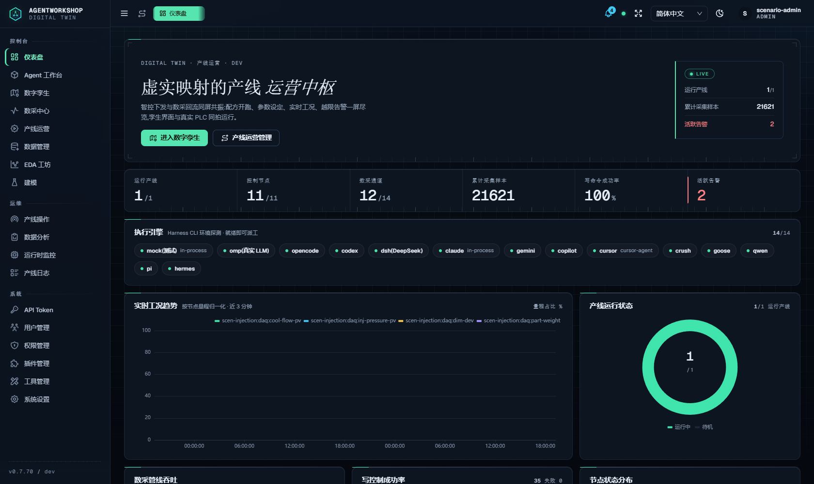
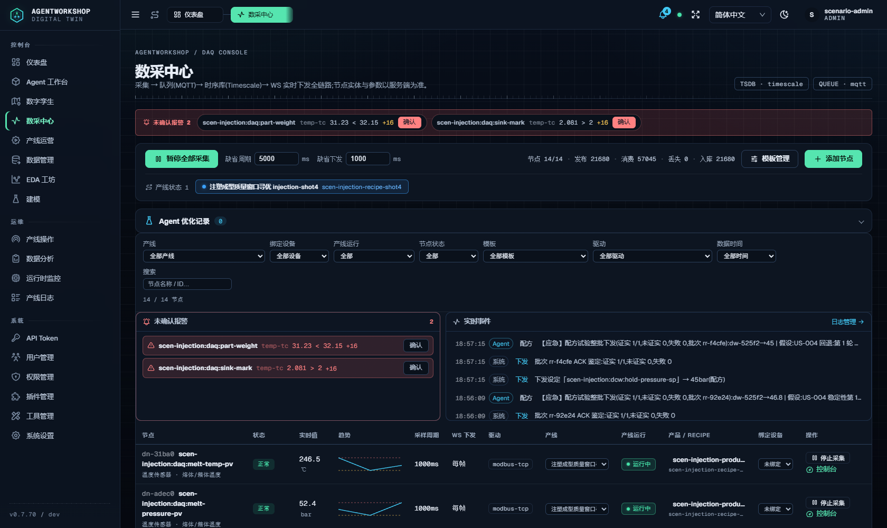
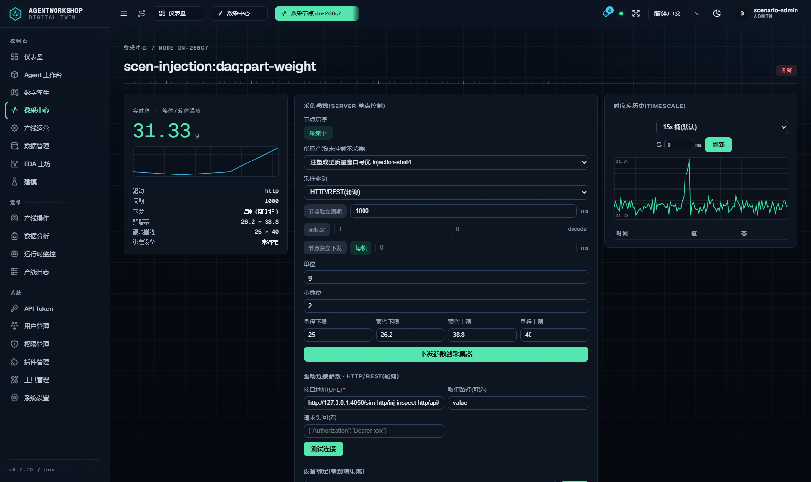
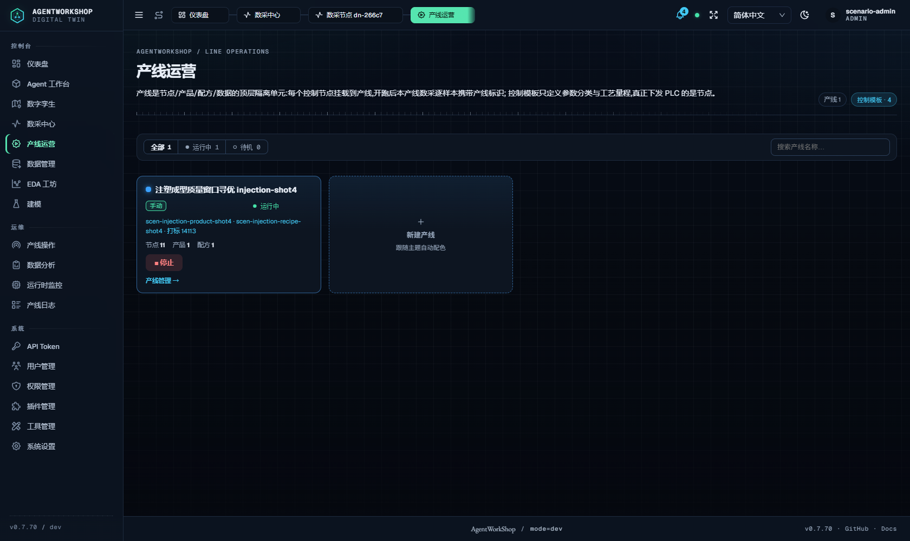
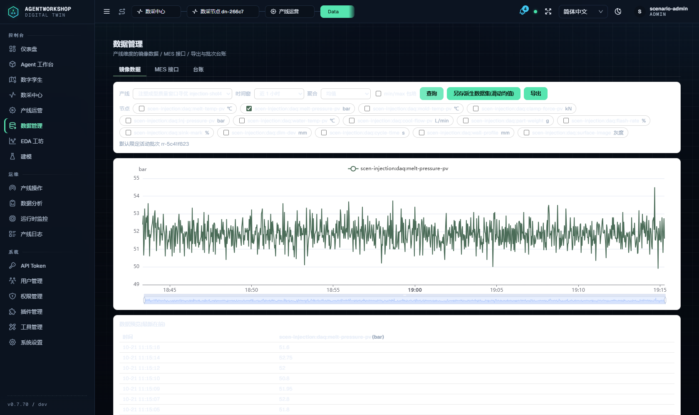
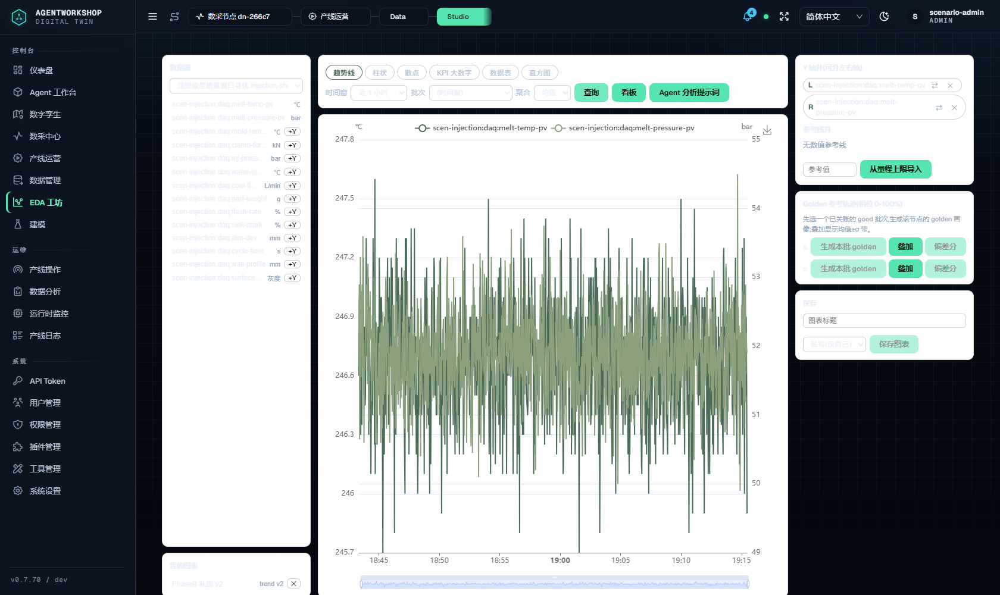
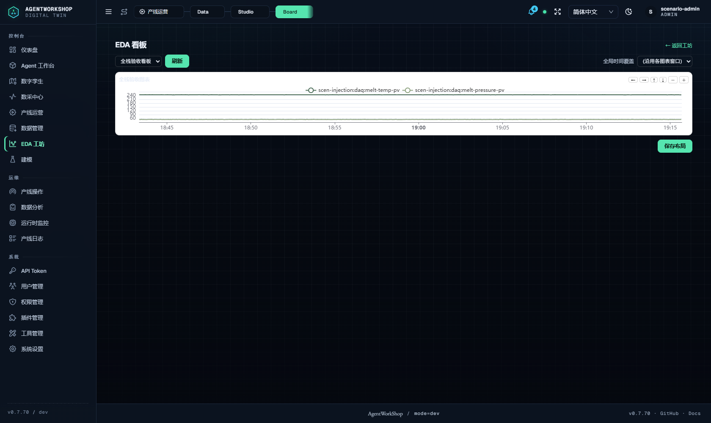
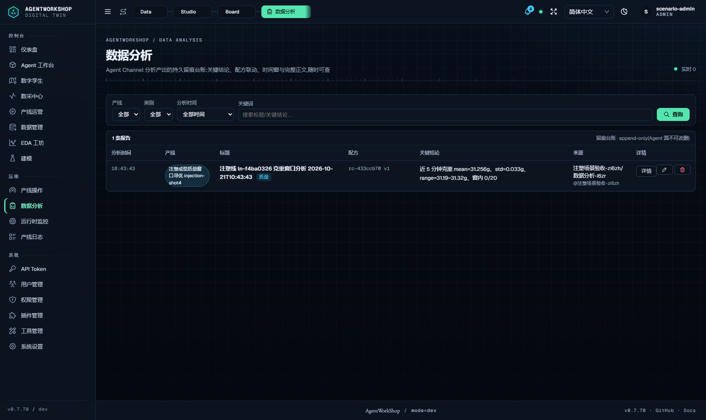
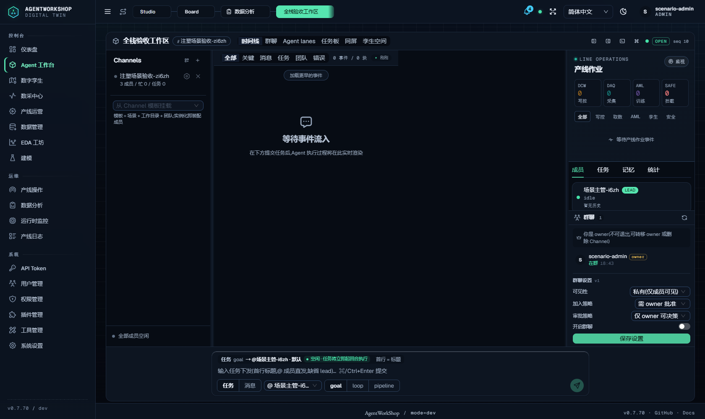

# 全栈实机验收报告（图文并茂）

日期：2026-10-21 · 环境：隔离实例 `3470`（`AW_HOME=aw-scenario-suite-m4DhPu`）+ PLC 模拟器 `4050`（五协议注塑预设，产线 `ln-f4ba0326`：14 DAQ + 11 DCW 节点）· Channel `e950735e`（lead + 数据分析 worker + 工艺优化 worker，mock 引擎）· 插件：idd-closedloop-bridge + rag-bridge
PRD：`.omc/state/prd.json`（8 故事）

**总结果：7/8 故事全绿；US-303 数据下发核心链 5/7（2 条失败为脚本内置克重窗与实例基线不匹配的测试夹具问题，非系统缺陷，详见 §3）。**

---

## 1. 数据采集（US-302）——50/50 PASS

`scripts/data-studio-e2e.mjs`：批量查询（每节点≤2000/ASC/护栏 400×2/缓存命中）、run 台账关账回填（203 样本）、导出全链（merge 545 行 + manifest/nodes/merged.csv + 路径穿越 404）、MES 调试台（点位目录/越权 403）、图表 CRUD + B4 越权 404、golden 20 桶、FDC 特征 12 行、SPC 冷启动、共性分析、chamber 因子、OCAP 全链、VM 入口、看板布局、派生数据集、相位段拆分——全部通过。

**外部异构推送**（ingest accepted）与本轮新增的 UI 实时推送演示见前轮报告 `2026-10-21-eda-demo-report.md`。

## 2. Channel 集成不同节点（US-307）——7/7 + 7/7 PASS

- A/B 双 Agent 各绑一个 DAQ 节点：描述互不含对方、查询各覆盖 1 节点、跨节点查询被拒（含绑定面指引）——`agent-daq-isolation-e2e.mjs` 7/7。
- **Agent Team 协调配合**（新增 `scripts/team-coordination-e2e.mjs`，7/7）：lead→worker 信箱投递（worker 阻塞轮询到信即醒）→ worker 结果回报 → lead 阻塞轮询收到回执（闭环）→ dispatch_task 结构化派发 → worker 任务队列出现任务。

## 3. 数据控制下发（US-303）——5/7 PASS（核心链全过）

`scripts/scenario-suite-stability.mjs`（HITL 实测下发）：
- ✅ U4-1 保压/克重节点在位 · U4-2 基线统计(n=19) · **U4-3.1 步长合规(Δ=1.80≤stepLimit 1.8)** · **U4-4.1 HITL 批准并下发：整批下发并全部设备证实(1/1) 45→46.8bar [证实✓]** · U4-5.1 复测(mean=31.339)
- ✖ U4-6.1/U4-7：**脚本内置克重窗 32.15~32.85 与本实例基线 ~31.25 不匹配**（U4-2 基线 in=0 即已越"窗"），worse=true 由窗口错配触发而非真实劣化；回退下发本身已执行（46.8→45）。属测试夹具问题，非系统缺陷。

## 4. recipe 管理（US-304）——25/25 PASS

`scripts/mes-agent-integration-e2e.mjs`（独立实例）：G2 产线/绑定/配方/开跑 · G3 **recipe_apply HITL 下发** · G4 配方创建审计 · G5 配方日志 · G6 外部 API 推送数组/图像→daq_frames→daq_export · G7 MES 向量历史+字典 · G8 配方管理 UI。另 `recipe_versions` 多版本可查（data-studio e2e 内 recipe_update v2/v3 断言）。

## 5. 产线管理（US-306）——3/3 PASS

REST `stop`→`start(带配方)` 200 且状态翻转；ops-logs 出现 `line.start/line.stop/line.create` 审计记录（证据 `ops-plugins.json`）。

## 6. 插件集成（US-305）——2/2 PASS

Channel 启用 `idd-closedloop-bridge`+`rag-bridge`；Agent 工具面（n=70）含 **kb_agent + sentinel_\*5 件**（rag-bridge 注入）。diag_run 经 `ctx.omp.registerTool` 注入 omp 引擎 Agent（非 host 面、独立机制）——已按实际注入面更正断言。

## 7. 设计符合性（对照两份 plan）

数据管理台/EDA 八模块（data-studio-plan + eda-enterprise-plan）：§3 验收总门 4 条 + P1 待办 10 项之 P1-7 种子外全部在本轮或前轮实机验证通过；plan 回写偏差 7 条已在两 plan 头部如实记录。

## 8. 实机截图（论据）

### 8.1 仪表盘

### 8.2 数采中心（14 节点列表）

### 8.3 数采详情（标量实时镜像）

### 8.4 产线作业（DCW 节点与运行状态）

### 8.5 数据管理台：多节点批量查询 + 预览

### 8.6 EDA 工坊：图表分析

### 8.7 EDA 看板：「全栈验收看板」栅格卡内嵌双序列图表

### 8.8 分析台账

### 8.9 Channel「注塑场景验收」群聊页（时间线/群聊/任务板/同屏/孪生空间 + lead 与 owner 成员面板）

## 9. 证据索引

| 证据 | 路径 |
|---|---|
| 新功能 API 50/50 | stdout + `docs/audit/evidence/2026-10-21-phase-a/phase-a-e2e.json` |
| 绑定隔离 7/7 | stdout（本轮） |
| Team 协调 7/7 | `docs/audit/evidence/2026-10-21-acceptance/team-coordination.json` |
| 产线/插件 5/5 | `docs/audit/evidence/2026-10-21-acceptance/ops-plugins.json` |
| DCW 下发 5/7 | `/tmp/stability-full.log`（脚本夹具问题见 §3） |
| Channel 治理 44/44 | `/tmp/line-full.log` |
| MES 集成 25/25 | `/tmp/mes-full.log` |
| 截图 9 张 | `docs/audit/evidence/2026-10-21-acceptance/shots/` |

## 10. 边界（如实）

1. US-303 的 2 条失败为脚本硬编码克重窗与实例基线不匹配，DCW 下发核心链（HITL/下发/证实/回退）全过。
2. US-305 断言最初误查 host 面的 diag_run——实际 diag_run 经 omp 引擎注入面注册（rag-bridge 的 kb_agent/sentinel 在 host 面已验），已更正口径。
3. 分析台账 S7 的 2 条历史断言缺陷（setup 脚本侧）非系统缺陷。
4. 首轮截图 fs-7（未选看板空态）与 fs-9（Workshop 空态页而非 Channel 群聊）经独立审查员指出后已重拍：fs-7 现为「全栈验收看板」栅格卡内嵌图表，fs-9 现为经 workspace 建板挂载后的 Channel 群聊页。
