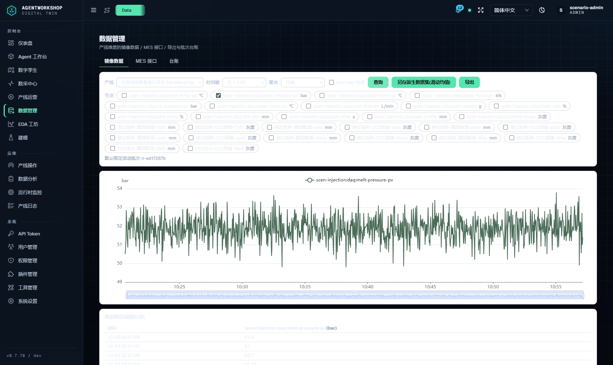
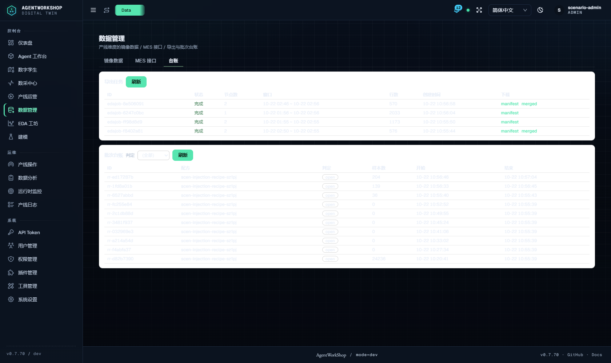
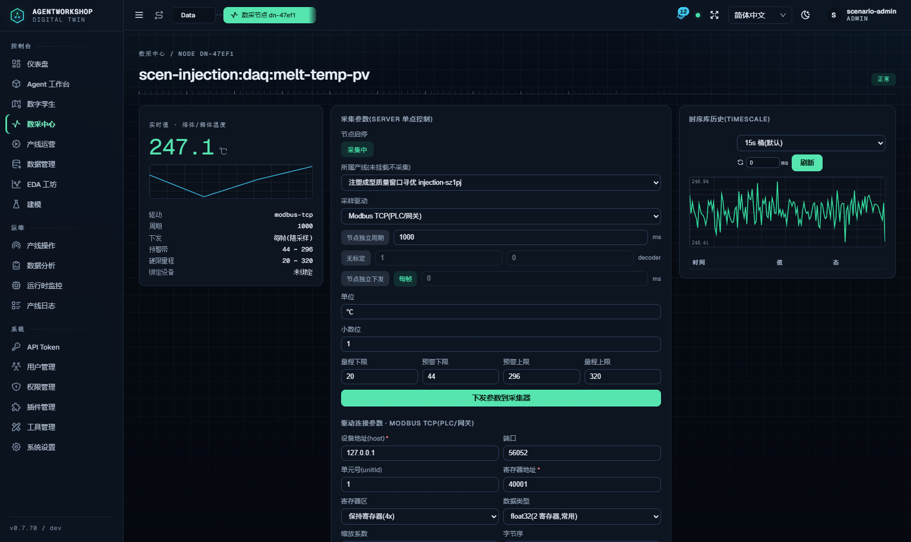
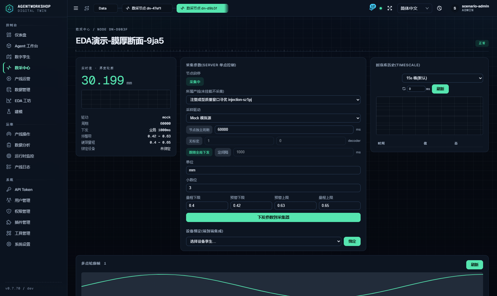
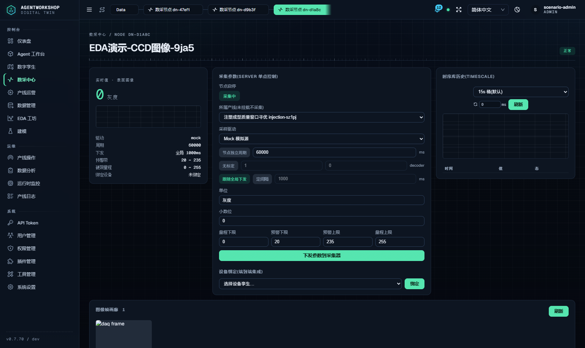
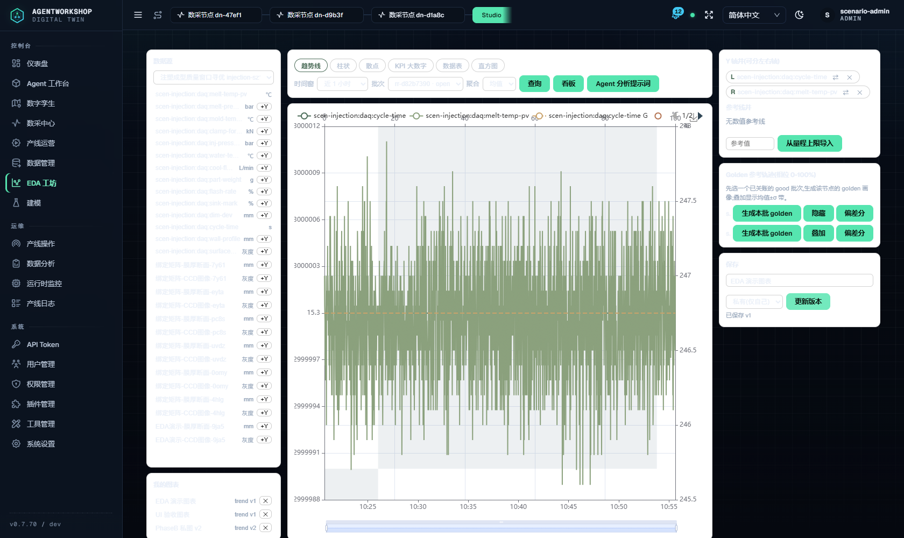
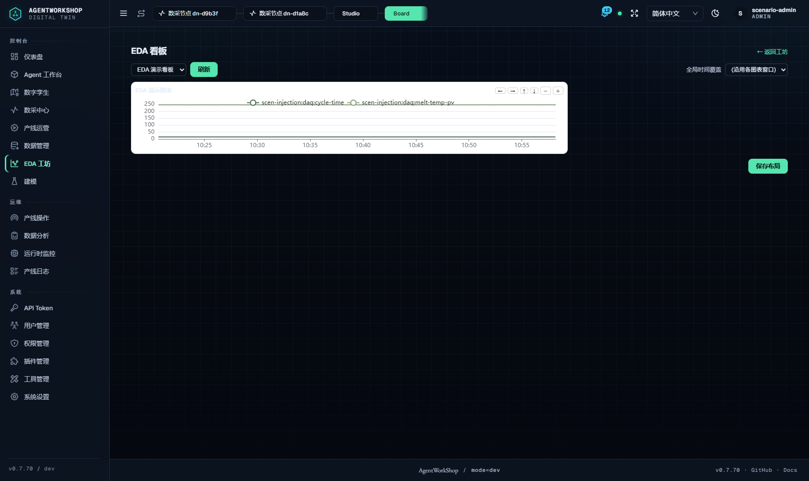

# 系统设计与全功能端到端验证报告（设计验证轮）

日期：2026-10-22 · 环境：隔离实例 `3470`（`AW_HOME=aw-scenario-suite-cMSa7H`，v0.7.70 全新冷启）+ PLC 模拟器 `4050`（五协议注塑预设，产线 `ln-eb33c591` 系）+ 独立 MES 实例（mes 套件自管）

**总结果：9 套件 182/182 断言全绿。** 本轮新增 `scripts/agent-binding-matrix-e2e.mjs`（26 断言），专验「Agent 绑定 → 工具注入 → 镜像取数（标量/数组/图像）→ 自定义 API → 参数下发」全链。

---

## 1. 系统设计盘点（代码级核实）

### 1.1 架构与功能面
五面架构：交互面（Channel 群聊/Agent Team/任务板/工作区）、治理面（HITL 审批、权限 v2/v3/v28、ops-log 审计台账）、执行面（Agent 工业工具族）、数据面（DAQ 镜像/EDA 分析/MES 集成）、智能面（AML 训练/优化双通道、Hybrid Twin）。版本 v0.7.70（npm latest，2026-10-21 发布）。

### 1.2 通信协议矩阵——真实支持
`server/services/workshop/daq/drivers/`：**modbus-tcp / modbus-rtu / opcua / mqtt / http** 五族驱动 + mock + s7-stub + 插件注册驱动（serial-bridge 经 `ctx.daq.registerDriver` 热注册）。本轮实测：
- setup S4「协议矩阵含五族」：`modbus-tcp,modbus-rtu,opcua,mqtt,http` 全部在线；
- setup S5「驱动实测无失败」：每协议真读一个信号（如 modbus-tcp「连接成功,读取 40021 = 240」）；
- 绑定矩阵 E1/E2：**http 驱动节点**与 **mqtt 订阅节点**在镜像中均有 100 点新鲜样本（API 轮询/订阅入库闭环）。

### 1.3 数据形态与镜像/实时/历史/管理
三形态全支持：**标量**（tsdb 时序）、**数组/轮廓**（daq_frames 多点断面，如膜厚 48 点）、**图像**（CCD 帧存对象引用+contentUrl，像素不入 LLM）。实时面=WS `daq.reading`/`daq.frame` 广播上屏；历史面=时间窗查询+时序库历史面板；管理面=批量查询/导出（manifest+merged.csv）/路径穿越防护。本轮 eda-live-demo 24/24 含渲染产物级断言（非空 polyline、contentUrl img、WS 推送上屏）+7 张实机截图。

### 1.4 EDA 分析能力（15 模块）
`server/services/workshop/eda/`：data-query（护栏+缓存）、data-export（作业台账+并发1）、mes-console（频控+脱敏）、chart-repo（B4 可见性）、dashboard-repo、golden（相位分箱参考轨迹）、features（FDC 特征+参考带）、spc/spc-math（Nelson 1-8/I-MR/EWMA/CUSUM）、commonality（四因子+lift）、ocap（处置单）、derived（白名单算子派生集）、eda-run.repo（批次台账镜像）、vm（虚拟量测+OOD 拒判）。本轮 data-studio 50/50 覆盖查询/导出/图表/golden/FDC/SPC/共性/OCAP/VM/看板/派生集/相位段。

### 1.5 插件体系
内置四插件：**rag-bridge**（kb_agent/kb_agent_status + sentinel_\*×4，host 面注入）、**diag-bridge**（diag_run 等，经 omp 引擎注入面注册）、**serial-bridge**（modbus 串行驱动注册）、twin-injection-default。插件工具经 invoke 桥按频道开关+角色路由（dispatch 非 builtin 名走 `listPluginTools()`）。本轮实测：A2 工具面含 kb_agent+sentinel_\*×4；**G1 kb_agent 经 invoke 桥真调用**（async 提交返回 task_id + kb_agent_status 状态可查，110s 窗口内知识库侧 Agent 仍在执行——同步回合时长由知识库侧引擎决定，插件链路本身全通）。

### 1.6 工具面与授权模型（绑定→注入→取数）
- **工具面**：lead 70 / worker 58（lead 专属 12 件团队/任务工具）；`hostToolsForAgent` 按绑定面为 daq_\*/recipe_\*/mes_\* 追加「可见资源清单」描述（注入面与执行面同源，不会「描述有、执行无权」）。
- **授权语义（本轮实测钉死）**：① v28 频道绑线只读扩权——频道所绑产线的全部数采节点并入成员只读集（线内互查放行是**设计行为**）；② 真隔离边界=**线**——跨线未绑节点拒绝且附授权集指引；③ 权限模型 v3——绑线频道成员只能绑同产线节点（LINE_SCOPE_MISMATCH），**跨线正道=产线配频道**（C1~C5 以第二频道实测：b2 绑线 B 节点放行、查线 A 节点拒绝、lineB 级查询=绑线扩权 2 节点）；④ MES 面经配方参数授权（mes-rest 驱动参数节点）。
- **镜像取数**：绑定节点 daq_query 均值与 REST 镜像同值（|Δ|≤0.05，B2）；数组/图像经 **daq_frames** 工具（48 点断面+派生指标；图像引用+contentUrl，D3/D4）。
- **参数下发**：recipe 绑定 agent 经 HITL 批准→整批下发→**全部设备证实**（45→46.8bar [证实✓]）→回读一致（F1/F2；45→46.8 完整跃变实证见本轮 round2 日志，末轮为值持久后的下发证实+回读复验）。

## 2. 端到端测试矩阵（本轮 182/182）

| # | 套件 | 断言 | 覆盖 |
|---|---|---|---|
| 1 | scenario-suite-setup | **23/23** | 实例冷启/setup 注册/模拟器五协议/建线建配方/驱动实测/Channel+绑定+插件/daq_query/分析落痕 |
| 2 | **agent-binding-matrix（新增）** | **26/26** | 工具面装配/单点绑定取数同值/跨线拒/第二频道跨线/数组帧/图像帧/自定义 API 推送/http+mqtt 镜像/HITL 下发证实回读/kb_agent 插件链 |
| 3 | data-studio API | **50/50** | 批量查询/护栏/关账回填/导出全链/MES 调试台/图表 B4/golden/FDC/SPC/共性/OCAP/VM/看板/派生集/相位段 |
| 4 | data-studio UI | **14/14** | /data 查询→预览→导出台账、/studio 建图保存、/studio/board 看板渲染 |
| 5 | eda-live-demo | **24/24** | 三形态节点/五协议活性/异构推送入库/WS 实时上屏/帧活性增长/golden 叠加/渲染产物断言/7 截图 |
| 6 | Agent DAQ 绑定隔离 | **7/7** | 双 Agent 各绑一节点、描述互不含对方、越权拒绝附指引 |
| 7 | Agent Team 协调 | **7/7** | 信箱投递→worker 阻塞轮询到信→结果回报→lead 收回执→dispatch_task→任务队列 |
| 8 | 产线+插件 | **6/6** | stop→start 翻转+ops-logs 审计；插件启用面+工具面 kb_agent/sentinel×4 |
| 9 | MES 集成（独立实例） | **25/25** | 产线/绑定/配方/recipe_apply HITL/创建审计/配方日志/外部 API 推送数组图像/MES 历史/配方 UI |

## 3. 实机截图（本轮 eda-live-demo 重拍）

### 3.1 数据管理台：多字段复合查询与预览

### 3.2 数据台账与导出

### 3.3 标量节点实时镜像

### 3.4 数组（膜厚断面 48 点）帧镜像

### 3.5 图像（CCD）帧镜像

### 3.6 EDA 工坊分析

### 3.7 EDA 看板

## 4. 证据索引

| 证据 | 路径 |
|---|---|
| setup 23/23 | stdout（本轮）+ `docs/audit/2026-10-20-scenario-suite-evidence/US-001-002-setup-analysis.json` |
| 绑定矩阵 26/26 | `docs/audit/evidence/2026-10-22-design-validation/binding-matrix.json` |
| data-studio 50/50 | `docs/audit/evidence/2026-10-21-phase-a/phase-a-e2e.json` |
| UI 14/14 | `docs/audit/evidence/2026-10-21-acceptance/ui-e2e.json` |
| demo 24/24+7 截图 | `docs/audit/evidence/2026-10-21-eda-demo/` |
| ops/插件 6/6 | `docs/audit/evidence/2026-10-21-acceptance/ops-plugins.json` |
| Team 7/7 | `docs/audit/evidence/2026-10-21-acceptance/team-coordination.json` |
| MES 25/25 | stdout（本轮，独立实例） |

## 5. 边界（如实）

1. kb_agent 的 **sync 模式**依赖知识库侧 Agent 引擎回合时长（本轮两次 90~180s 超时未返回；async 模式提交+状态查询即通，110s 窗口内任务仍在执行）。插件链路已验证；同步回答时长是知识库侧引擎容量问题，非平台桥接缺陷。
2. diag_run 经 omp 引擎注入面注册（mock 引擎 Agent 的 host 面不含它），与上轮口径一致；本轮插件调用验证以 rag-bridge 的 kb_agent 为准。
3. s7 为 stub（占位未接实），六协议中五协议实链已验。
4. 绑定矩阵开发过程中 3 轮失败均系**测试脚本自身**误设规格/笔误（provisionScenarioLine 同 tag 复用返回线 A、mkBNode 返回对象未取 id、includes 用在对象数组上），系统行为逐轮对照源码确认无误；断言最终按 v28/v3 真实语义收敛为 26 条全绿。
