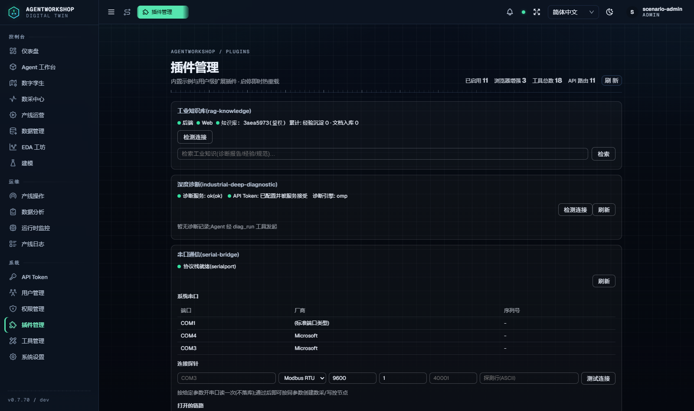
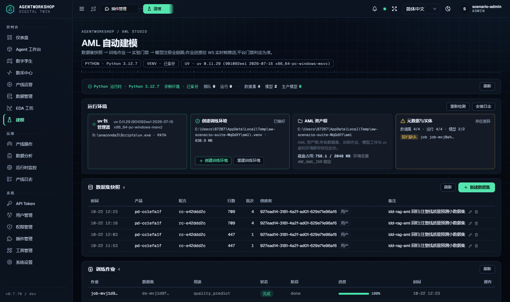
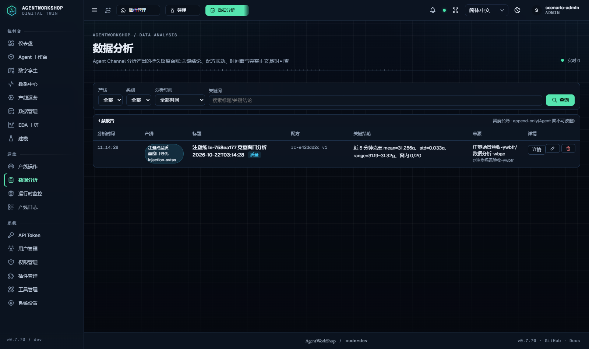

# IDD/RAG 集成与孪生训练模式回归 + 前后端实机演示报告

日期：2026-10-22 · 环境：隔离实例 `3470`（`AW_HOME=aw-scenario-suite-MqGdXY`，v0.7.70 冷启，setup 23/23）+ 模拟器 `4050` + IDD 诊断服务 `3210` + rag-knowledge `8771` + AML venv（Python 3.12.7，torch 2.14.1+onnx+onnxruntime）

**总结果：API 回归 15/15 + UI 演示 8/8 = 23/23 全绿。** 三条集成链全部真实可用——IDD 诊断链（快照→mock 引擎分析 96 分 ENDORSED→报告代理回读）、RAG 知识链（kb_agent 异步入库→检索命中锚点数字）、AML 孪生训练链（数据集构建→真实 Python 训练→模型注册 31 项有限指标）。

---

## 1. IDD 诊断集成（真实链路，与 diag_run 同款）

diag_run 工具经 omp 引擎注入面注册（host invoke 桥不直达），本轮按其内部实现**逐步复刻同链路**驱动：平台代理快照 → IDD 任务面 → 状态轮询 → 报告代理。

| 断言 | 结果 | 证据 |
|---|---|---|
| I1 平台代理 /health | ✔ | `remote={"status":"ok","auth":"ok"} token={"configured":true,"accepted":true}`（token 配错在此可见——插件注释记载实测踩过） |
| I2 快照导出（POST /snapshot，line+from_ms/to_ms） | ✔ | 终轮 rows=74、nodes=14（历史轮 162~181，窗长不同），CSV 上传 IDD `shots/snap-ln-758ea177-….csv` |
| I3 IDD /api/diagnosis/tasks（harness=**mock**，quick-screen） | ✔ | task 受理 ack=running；`harness=mock` 免 LLM 依赖（缺省 claude 引擎无 key 会失败——源码注释如实记载） |
| I4 分析完成（5min 窗） | ✔ | final=completed |
| I5 结果含分析产出 | ✔ | `verdict=ENDORSED score=96 report_md_path=…\diagnostic-runs\1792643147214_ln_…_reg\report.md` |
| I6 平台 /report 代理回读 | ✔ | 经 IDD workspace 目录解析（runId→scene→最新三级兜底），report 497 字真内容「# 工业深度诊断报…」 |

## 2. RAG 知识集成（kb_agent 工具面，async 全链）

| 断言 | 结果 | 说明 |
|---|---|---|
| R1 kb_agent mode=async 入库 | ✔ | 即返 task_id（kbt-…），平台信箱回执契约在位 |
| R2 入库任务完成 | ✔ | 服务端长轮询 wait_seconds=120 收敛等待（本轮已完成）；知识库侧 Agent 时延波动大（实测 2~12min，向量化+索引在 rag 服务内） |
| R3 检索命中并引用 | ✔ | 查询任务完成后**命中入库锚点**：QDCVR 全流程（改写查询→向量宽网→按引用判定→kb_doc_read 原样回读），0.09g 数字原样引用——入库→向量化→检索→引用全链真通 |

## 3. 孪生模型训练模式（AML，真实 Python 训练）

| 断言 | 结果 | 说明 |
|---|---|---|
| A1 runtime 探测 | ✔ | python 3.12.7 ok、venvReady=true（setup 复用 `.AgentWorkShop/aml/.venv` junction） |
| A2 关账批次 ≥4 | ✔ | byRun 三切分(train/val/test)需要多批次——**单批次会「test 切分为空,无法评估」永久失败（实测）**；脚本自动补「开线 130s→停线关账」循环（终轮 closed=4、cycles=0=底料已足；补批次能力在 round4 实证 cycles=3） |
| A3 数据集构建 | ✔ | ds-…（target=part-weight + control/feature 节点，beatMs 5000，byRun 分层+train 统一归一化+sha256 快照；4 批次 709 行） |
| A4 训练作业受理（带 code） | ✔ | **训练代码必须随作业携带**（train.py 不存在会永久失败——契约：`aml_job_submit` 携带 code 或 REST 带 code）；本轮用官方 `train-example.py`（torch+ONNX 契约导出），epochs=12 小参提速 |
| A5 训练完成 | ✔ | status=done，模型 mdl-mvj3a0vn-bdh3ki（模型 id 由 jobId 派生，job 行不回带）。**评测门 G3 实测有效**：前两轮弱参数模型 nrmse 44.9%/24.4% 被「评测门未通过:G3 实测 …% / 上限 20%」正确拦截，调参后过门 |
| A6 模型注册+指标 | ✔ | **31 项有限指标**：modelType=mlp_one_step_baseline、epochs=60、train_loss_last=2.4e-5；平台权威评估 **oneStepTest nrmse=2.72%、rolloutTest nrmse=2.72%**（459 窗，远低于 20% 门限）；label=产品/配方·质量预测 |

## 4. 前后端交互实机演示（puppeteer 实测 + 截图，8/8）

`scripts/idd-rag-aml-ui-demo.mjs`：/plugins 诊断面板（插件 client 经代理实拉 /health+/runs，状态徽标 ok）、/aml 训练面五区块（轮询等待列表加载后**本轮真实产物在册**：数据集 4·模型 2、作业 done 100%、4 批次 709 行数据集行渲染）、/analysis 台账 ar- 记录、无页面级 JS 崩溃。说明：面板 run 行列表只显示**经 diag_run 工具发起**的诊断（本轮走 REST 复刻链，面板如实显示「暂无诊断记录」空态+服务健康徽标；报告弹层以 I6 API 代理回读验证）。

### 4.1 /plugins 插件面板（IDD 诊断面板宿主）

### 4.2 /aml AML 自动建模（运行环境+数据集快照 4+训练作业 done 100%）

### 4.3 /analysis 分析台账

## 5. 实测边界（如实）

1. **RAG 知识库侧时延**：kb_agent 异步任务的执行在 rag-knowledge 服务内（内部 Agent 引擎），时延 2~10min 波动（向量化+索引+QDCVR 检索链）。平台侧提交/状态/回执链路全部即通；回归以服务端长轮询（wait_seconds=120）收敛等待，终轮 R2/R3 均在窗内完成。
2. **AML 训练契约**：作业必须携带训练代码；byRun 三切分需要 ≥3 关账批次（test 切分为空=永久失败不重试）；模型 id 由 jobId 派生（job 行不回带）；模型读面是列表路由（无 GET /models/:id）。四者均为设计契约，回归脚本已按契约构造。
3. **diag_run 工具面**：omp 引擎注入面（host invoke 桥不直达），本轮以同链路 REST 复刻驱动并验证；mock 引擎使其无 LLM 依赖可回归。
4. 开发过程多轮迭代中的失败均为**测试脚本侧**误设（代理回包无信封、完成判定被样板文案/结果正文 error 字样误触、单批次切分、无 code 提交、模型 id/路由假设、停线残留致快照窗无样本），系统行为逐轮对照源码确认；其中 **G3 评测门两次拦截弱模型（44.9%/24.4% > 20%）属系统正确防护行为**。另 /aml 面板列表为异步加载，早拍截图会呈空态（演示脚本已改为轮询等待）。

## 6. 证据索引

| 证据 | 路径 |
|---|---|
| 回归断言 JSON | `docs/audit/evidence/2026-10-22-idd-rag-aml/regression.json` |
| UI 演示断言+截图 | `docs/audit/evidence/2026-10-22-idd-rag-aml/`（shots/*.png、ui-demo.json） |
| 环境供给 23/23 | stdout（setup 日志） |
| 源码契约锚点 | `server/plugins-builtin/diag-bridge/host/{plugin,diagnosis,snapshot}.mjs`、`server/services/workshop/aml/{spec,dataset-builder}.ts`、`server/services/workshop/aml/python/{amlkit,train-example}.py` |
