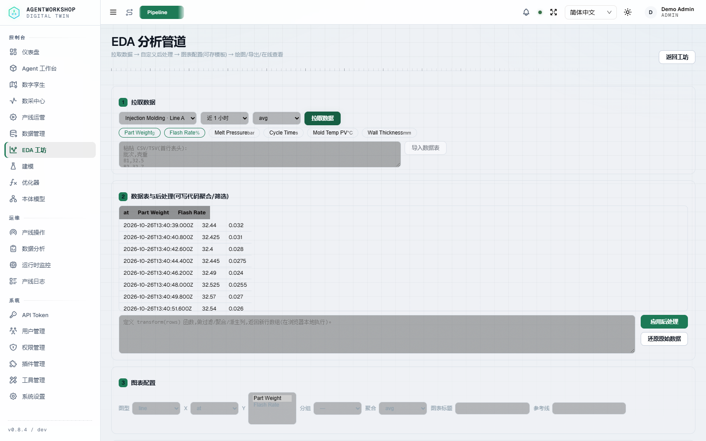
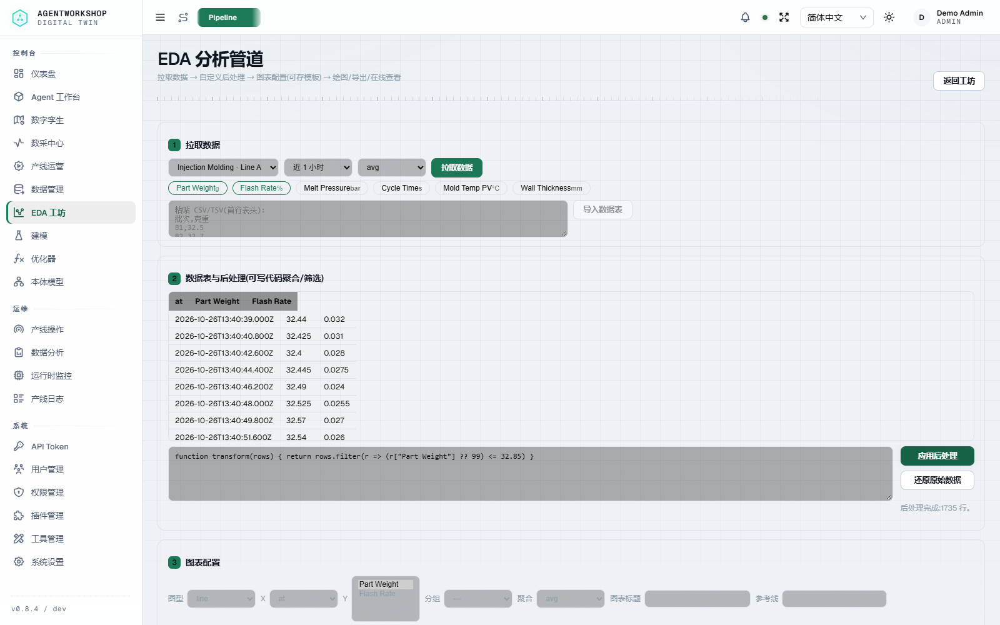
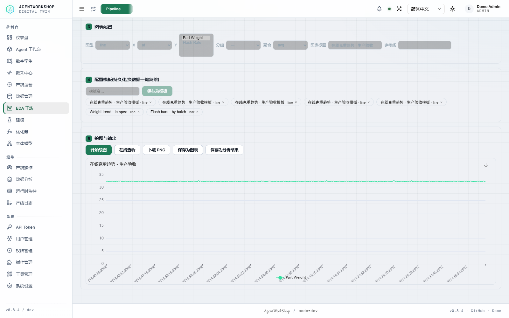
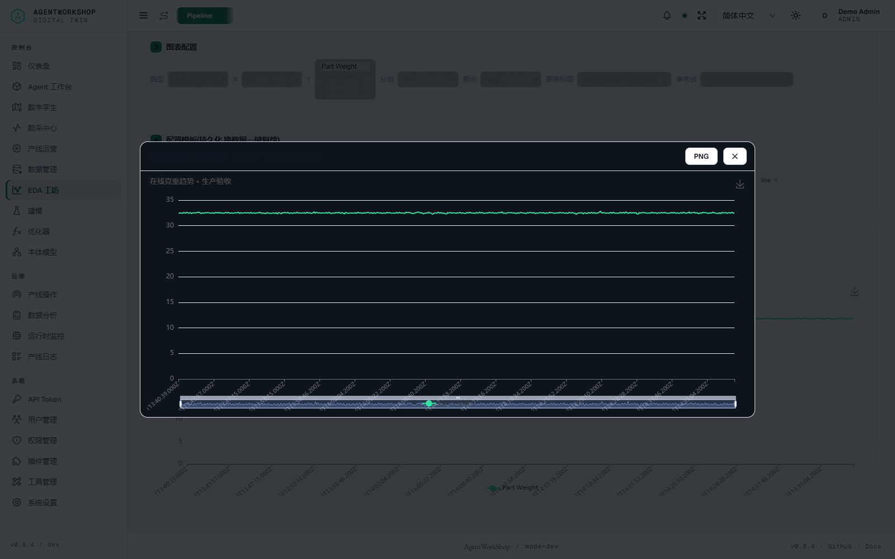
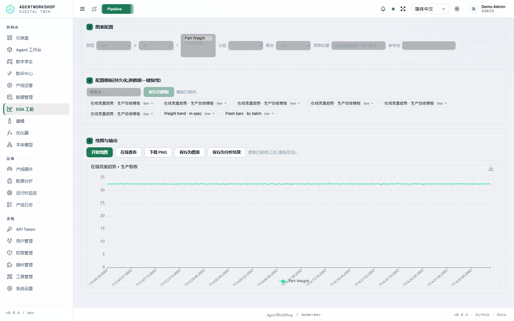
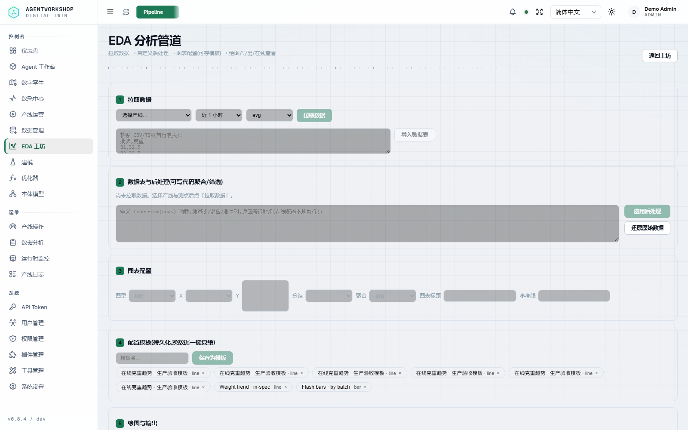
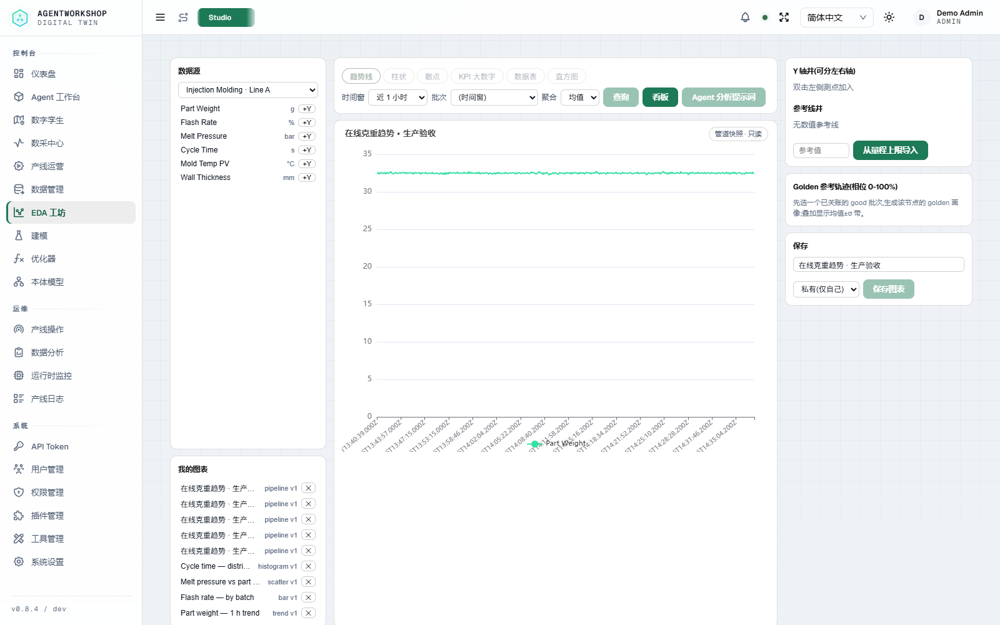
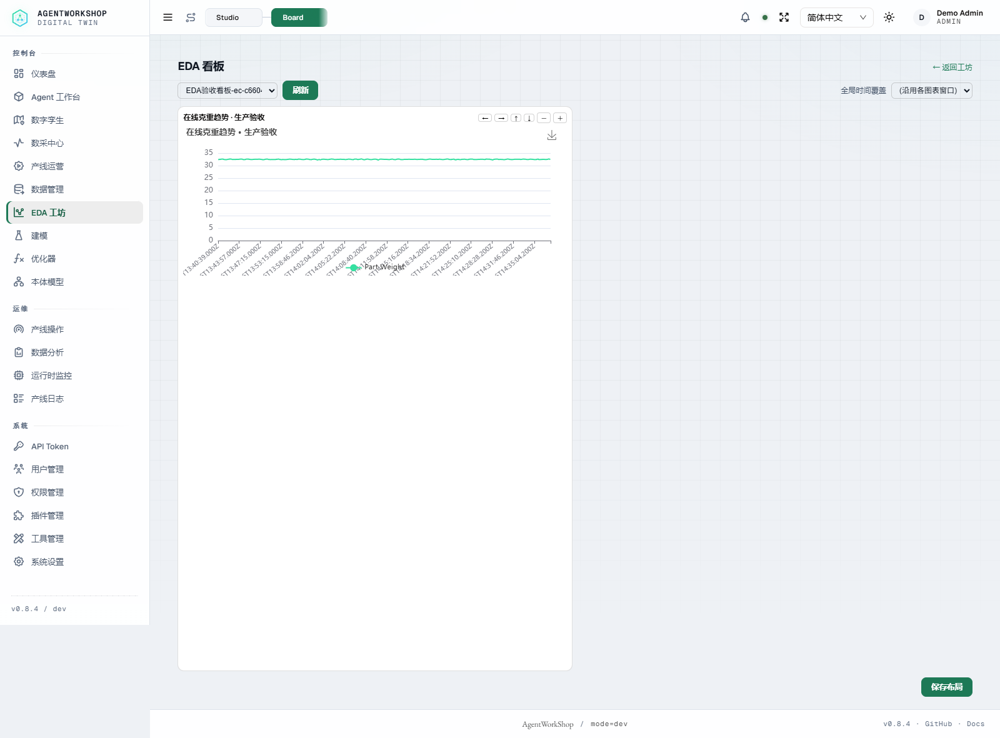
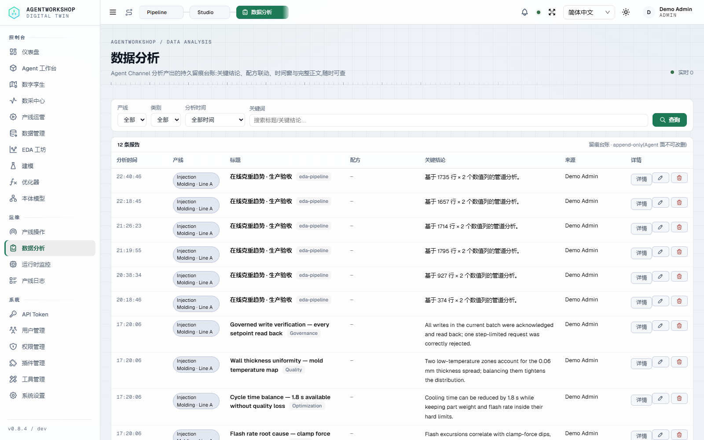

# AgentWorkShop — 全功能验收与生产就绪评估（2026-10-26）

> 结论先行：**功能面验收通过（本轮覆盖的 T0/T1/T2 核心/T3 REST 全绿）；真实工业加工场景的生产集成是“有条件就绪”，不能直接宣告可投产/已认证。**
> 平台治理链、单咽喉 + 交集限界、HITL 与审计是明显强项；真实 PLC/FAT-SAT、安全认证、HA/容量与 Mimosa 安全收口仍是上线前置条件。

## 1. 验收矩阵（本轮实测）

| 层 | 套件 | 结果 |
| --- | --- | --- |
| T0 | lint / typecheck / docs:check / i18n / readme lint | 全通过（docs 91/91，i18n 3149/3149） |
| T1 | 单元测试 | **582/582，0 fail** |
| T1 | MCP / 插件生命周期 / SDK / Twin / Skills | 14/14 · 22/22 · PASS · 5/5 · 124 PASS |
| T2 | 本体真机 L1–L7 | **87/87**（Chrome 六 tab、图/表、1/2 跳邻接） |
| T2 | 模型闭环 | 54/54 |
| T2 | 优化器 | 104/104 |
| T2 | 产线治理 | 44/44 |
| T3 | REST API live | 64/64 |
| EDA | `scripts/e2e-eda-pipeline.mjs` | **24/24** |
| EDA | 本地实机管道演示（模拟产线；在线拉数→代码→图表→查看器→模板/保存） | **10/10** |
| EDA | Studio/Board 管道快照回放（含几何/只读断言） | **4/4** |
| 文档 | VitePress build | 通过 |

未纳入本轮通过口径：IDD 结果库/RAG（外部后端未启）、注塑闭环（需要专用注入产线与 fixture）、Mimosa（见第 4 节）。

## 2. EDA 系统本地实机演示（模拟产线）

演示实例：当前 main 构建（`0.8.4`；本地实例 footer 标记 `dev`）+ 隔离 home（`D:/tmp/aw-video/home-en`）+ Mock/PLC 模拟产线；在线取数走真实 REST（不是仅 CSV）。截图来自本地实例与模拟数据，不代表真实工厂运行。

### 2.1 在线拉数 → 代码后处理 → 图表

在线选择产线与 `Part Weight`/`Flash Rate` 两个 DAQ 节点，拉取最近 1 小时数据；表格直接呈现宽表。随后在浏览器本地执行用户代码：

`transform(rows)` 过滤后得到 1735 行，图表配置选择 line / x=at / y=Part Weight，绘图成功：

### 2.2 在线查看器、模板与结果保存

在线查看器外壳内是真实 ECharts canvas（不是静态截图），支持缩放与 PNG：

模板保存后刷新页面仍在；保存为图表、保存为分析结果均有成功回执：

### 2.3 Studio 图库、管道快照、看板与台账

保存的管道图表在 Studio 中作为 `pipeline` 快照打开（含保存时的配置/数据快照），在 Board 中同样能渲染：

分析结果进入台账：

### 2.4 EDA 本轮修掉的真实缺陷

1. **在线拉数解析不匹配**：`daq/query` 返回 `{at,v}`，管道页按 `{x,y}` 解析，导致在线拉数无表/报错；已抽到 `chart-pipeline.seriesToRows` 兼容两种形状并加单测。
2. **保存图表必然 400**：页面发送 `viz_type: pipeline-line`，而服务端白名单只接受 `pipeline`（不是接受所有 `pipeline-*` 变体）；已统一为 `pipeline`，并保存 `chartType/cfg/rows` 快照。
3. **管道图表无法在 Studio/Board 回放**：已加入 Studio/Board 的 pipeline 快照渲染分支，保存后两处都能画出来；快照以只读徽章标识，Studio 不允许直接覆盖。
4. **E2E 测试自身 bug**：多选 Y 字段用 `select.value=` 未触发真实多选；已改为逐 option `selected` 并派发 change，并新增两个 B4 负例（无快照 rows、datasource.line_id 与 line_id 不一致均必须 400）；套件恢复到 **24/24**。
5. **快照图表挤在左上角**：`AwChart` 在 grid/flex 容器里可能以 0 宽完成首次初始化；已加入 mount/option/resize-observer 显式 resize，Studio/Board 均恢复为全宽绘图。
6. **大样本刻度重叠**：1735 个时间桶时全量 x 轴标签重叠；已按目标约 16 个标签抽稀，并保留 `hideOverlap`。
7. **B4 边界**：管道快照是 B4 的显式例外——仅 `private`、最多 2000 行、必须带 `line_id` 且 `datasource.line_id` 一致；`rows` 由保存者客户端提供，是保存视图而非服务端代理数据，读取只按 chart owner 可见性。普通图表仍只存查询参数，取数按 `/daq/query` 鉴权。

§ 评价：EDA 的“拉数/导入 → 表格 → 浏览器代码 → 图表 → 模板 → 查看器 → 保存/台账 → 图库/看板”主链已经闭合，完成度高。边界：用户代码在浏览器执行（不服务端 eval）；快照有 2000 行上限；大规模数据/并发未做负载测试；模板是配置模板，不是定时任务编排。

## 3. 系统设计与生产就绪判断

### 已经具备的生产级要素

- **单咽喉 + 交集限界**：写动作收敛到统一写控入口，参数基准/产品窗/配方窗/节点量程取交集；拒绝会点名约束层。
- **fail-closed 治理链**：绑定 → 二级认证 → 运行门 → HITL → 写控 → 设备回执/回读 → 审计；异常路径关闭而不是放行。
- **作用域收敛**：Agent 节点绑定/配方绑定、Channel 绑线、工具注册表与角色面、跨线拒绝均有真机断言。
- **可追溯**：ops/audit/recipe/analysis 台账 + 本体证据链 + 优化器/模型闭环的哈希与采纳记录。
- **本体/优化器/模型闭环**：L7 87/87、optimizer 104/104、model loop 54/54，非演示壳。

### 真实工业加工场景的上线前置条件

| 项目 | 当前状态 | 结论 |
| --- | --- | --- |
| 真实 PLC/机床/传感器 | 本轮全部为 Mock/PLC 模拟器；Modbus TCP/RTU、OPC UA、MQTT、HTTP、串口驱动已实现 | **需现场 FAT/SAT 与协议一致性测试**；不能用本轮结果替代真机验收 |
| 功能安全 | 平台是监督层，不是安全 PLC；E-stop/安全联锁应留在 PLC | **不能承担 SIL/ISO 13849 安全功能**；需风险评估与安全边界文件 |
| 信息安全 | Mimosa deep scan 已完成但 **inconclusive**；46 条静态提示（38 high/6 medium/2 low），SSRF/path-traversal 待收口 | **未通过安全认证**；上线前须修复/复核并复扫 |
| HA/容量/SLO | 单实例 SQLite/TimescaleDB；有备份/保留策略；无集群/故障切换/大规模压测 | **需部署架构与容量验证**（含双机/反代/DB 备份恢复演练） |
| Bench 保真度 | v2 写路径已迁移，四场景能真实下发；attainment 仍红（模拟器 PV 映射/时延与场景假设不符） | **不能作为生产性能/收益承诺**；需模型校准 |
| 外部集成 | IDD/RAG/MES 有适配层；本轮外部后端未纳入 | 上线前按现场接口逐项联调 |
| 安全审计 | 本报告只裁决功能面 | 不构成安全认定 |

### 建议的真实产线落地路径

1. **只读影子期**：真实产线接 DAQ（只读），验证采样/时区/批次归属/断链恢复，不写入。
2. **单线人工写入试点**：一条线、一个配方，`controlMode=manual` + HITL，逐笔核对回执与回读；保留回退。
3. **安全与部署收口**：SSRF/路径穿越整改、Mimosa 复扫、反代/备份/恢复演练、容量与故障注入。
4. **FAT/SAT**：按设备厂商协议做真机矩阵，记录时延/重连/量程/异常码；形成投产 SOP 与变更审批。
5. **再评估 bench/ROI**：模拟器模型校准后再把优化收益纳入生产 KPI。

## 4. 如实边界

- **Mimosa**：扫描已执行并归档（scan `2026-10-26T10-50-32.541Z-fee2a4898ff1`，seal `sha256:503fa147…`），状态 **inconclusive**；详见 `docs/audit/2026-10-26-mimosa-triage.md`。不宣称安全。
- **Bench**：v2 驱动迁移完成、写入已通，但四场景 attainment 红；详见 `bench/V2-MIGRATION.md`。
- **未跑套件**：IDD 结果库/RAG、注塑真实闭环（需外部后端/专用注入产线与 fixture）。这些不计入本轮 PASS。
- **生产结论**：**功能面通过 ≠ 可无条件投产**。在真实加工场景中集成，必须完成真机 FAT/SAT、安全评估、安全整改与 HA/容量验证。

## 5. 证据与入口

- EDA 本地演示证据：`docs/audit/evidence/2026-10-26-eda-production-review/`（12 张截图 + report.json + snapshot-checks.json）
- EDA E2E：`docs/audit/evidence/2026-10-26-eda-pipeline/`（24/24，`e2e-24.txt`）
- 最终 T0/T1 门禁：`docs/audit/evidence/2026-10-26-postfix-gates/gates.txt`（lint/typecheck/unit 582/docs/i18n/readme/docs:build/MCP/plugin/SDK/twin/skills）
- 本体 L7：`docs/audit/evidence/2026-10-24-ontology-live/`（87/87）
- 优化器：`docs/audit/evidence/2026-10-23-optimizer-live/`（104/104）
- 模型闭环：`docs/audit/evidence/2026-10-24-model-loop-live/`（54/54）
- Mimosa：`docs/audit/2026-10-26-mimosa-triage.md` + `docs/audit/security/2026-10-26-mimosa/`
- Bench：`bench/V2-MIGRATION.md`
- 可视化报告：`docs/audit/evidence/2026-10-26-production-readiness/report.html`

## 6. 一句话答复

当前系统**功能验收通过、治理架构达到可试点水平**；但面向真实工业加工场景，仍应判定为**有条件就绪、未认证**：先做只读影子 + 单线人工写入试点，同时完成真机 FAT/SAT、安全整改/复扫与 HA/容量验证，再谈生产投产。
