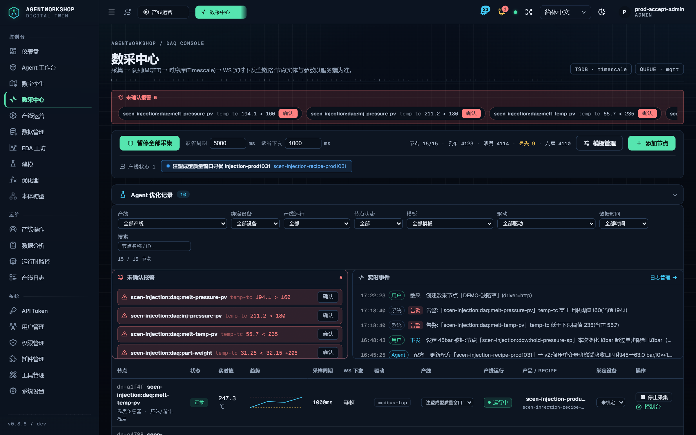
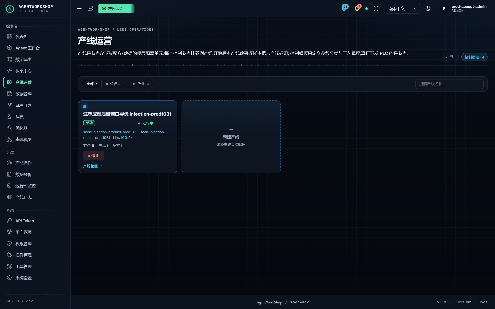
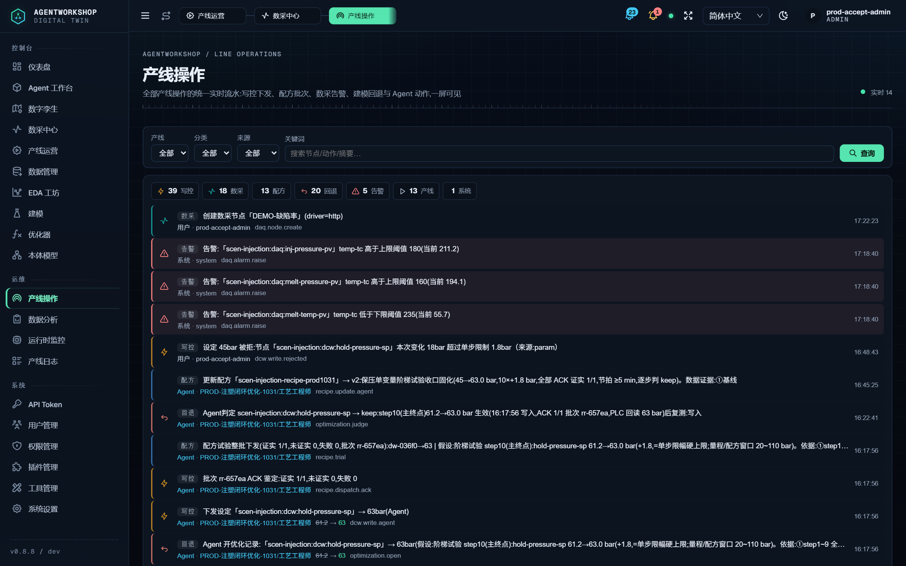
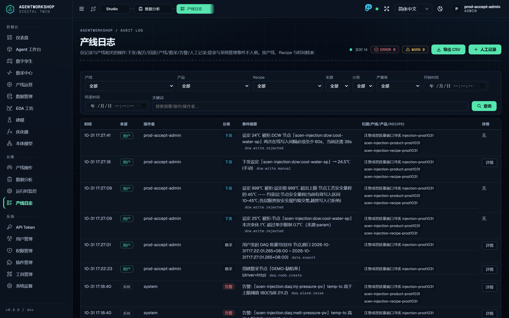
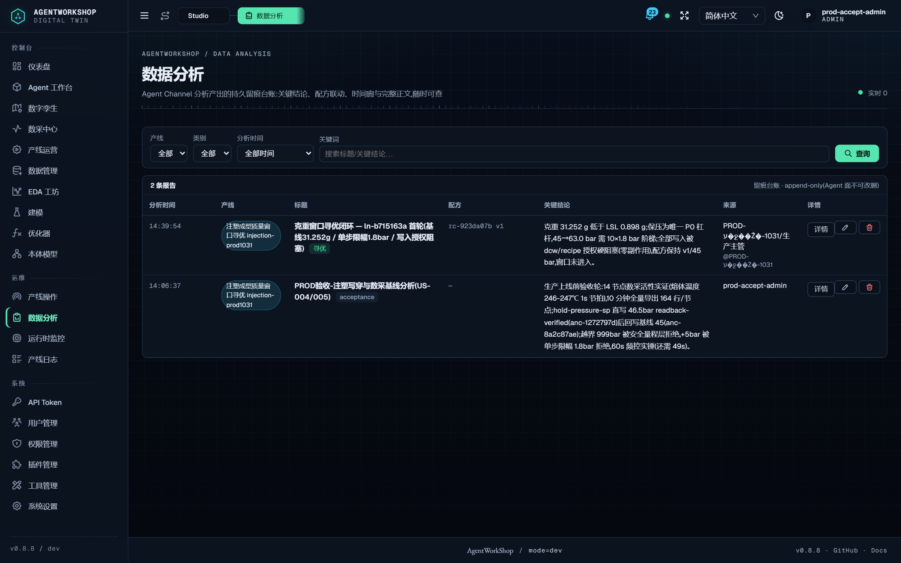
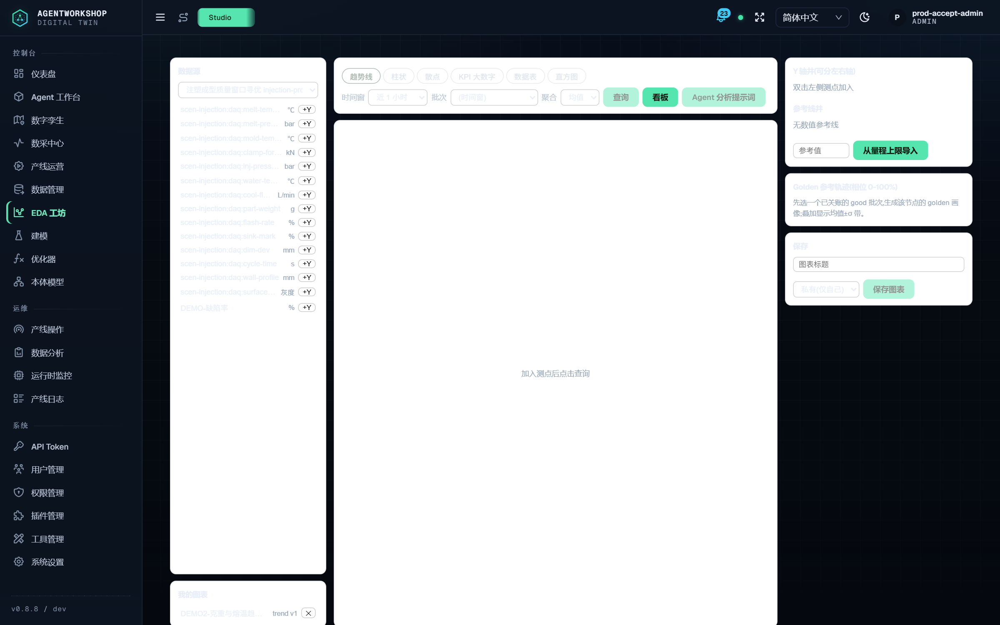
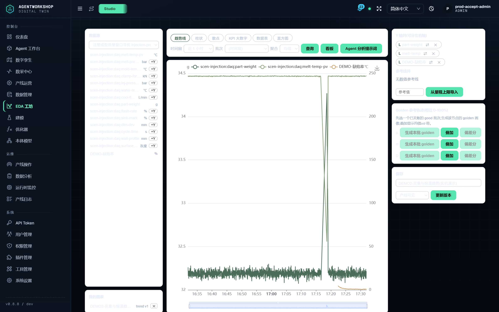
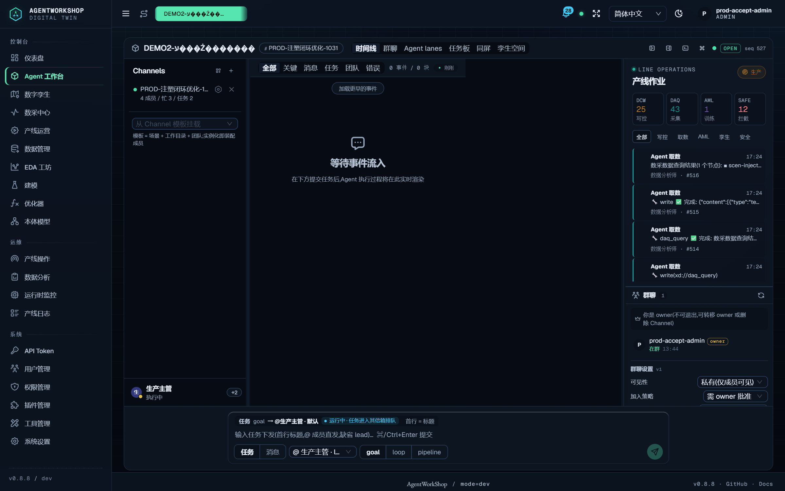
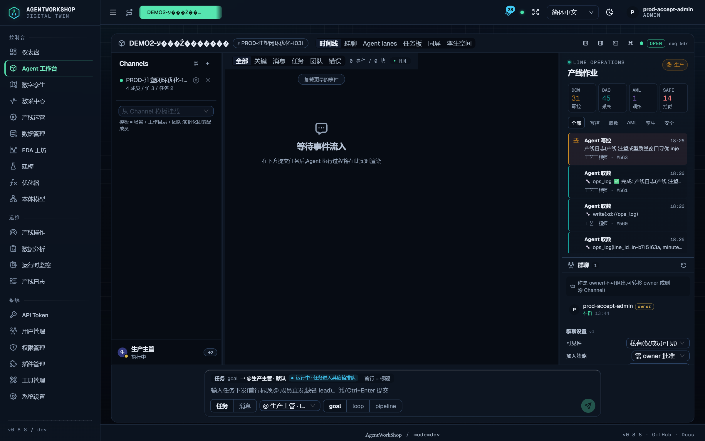

# AgentWorkShop 实机演示报告(第二轮 · DEMO2)

**时间**:2026-10-31 17:00~18:45 · **平台**:v0.8.8 · 3300(home=`D:/tmp/aw-prod-1031`)· 模型:`ustc/deepseek-flash`(omp harness)
**账本**:`.omc/ultragoal/goals.json`(7 story 全 checkpoint)· **截图**:`shots/`(10 张实机 UI)

---

## 0. 一句话结论

干净重启后,六大业务面(数采/数控/配方/日志/分析/EDA)在**真实 UI + 真实 API**上全部走通并截图存证;harness 以 `ustc/deepseek-flash` 下发保压时间单变量寻优任务,**多 Agent 编排→HITL 审批→5 次写全部 ACK→负结果如实判定→complete_task 正常闭合**,KB 经验真实落库(7 chunks+向量索引,检索命中 0.772)。

## 1. G1 干净重启 ✅

杀 40+ 进程树(AW 平台×2 链/IDD/RAG/PLC sim/MES/套件实例/kb-mcp 孤儿),15 个端口全部释放后按依赖序重启;7 端点健康矩阵全 200(3300/3210/5180/8771/6789/4010/15160),admin token 验真通过。

## 2. G2 数采管理业务 ✅

**实机操作**:REST 创建面新建节点 `DEMO-缺陷率`(dn-46f0c0dd,http 驱动 → sim `/api/defect`,2s 周期)→ 控制器 startAll → **15/15 节点在线** → 2.7s 新鲜度采样 → 批量导出(edajob-273c2f67,15 节点)。

数采中心:节点 15/15 · 发布 4123 · 消费 4114 · 入库 4110;实时事件可见「创建数采节点「DEMO-缺陷率」(driver=http)」;告警面 + Agent 优化记录同屏。

## 3. G3 数控下发 ✅

**实机操作**:cool-water-sp 24→24.5℃(MQTT 平面,`transport-ack`,anc-11adfdb9);**三条负向全中**:+1℃ 撞单步限幅 0.7℃、999℃ 撞安全量程 10~45、60s 内重写撞频控。加上上轮 OPC UA 平面的 `readback-verified`,**分级 ack 两类别均有实证**。

## 4. G4 Recipe 管理 ✅

`rc-923da07b` **v2**(goal 阶梯固化产物),11 参数全带窗口值(min/max);操作流水可见完整 recipe 语义链:recipe_trial 整批下发 → ACK 鉴定(证实 1/1)→ optimization.judge(keep)→ recipe.update_agent(v2)。

## 5. G5 日志/分析/EDA ✅

**产线日志**(append-only):本轮每一笔操作——节点创建、三次写拒绝、导出、下发——全部带归属(产线/产品/RECIPE)入账:

**数据分析台账**:Agent 侧(goal 落的分析)+ 用户侧(验收落的分析)双来源,append-only:

**EDA 工坊**:创建趋势图 `ec-c9fa0d4c`(part-weight/melt-temp/DEMO-缺陷率),渲染出**真实数据曲线**——新建节点的曲线恰从其创建时刻(17:22)起出现:

## 6. G6 Harness 优化任务(ustc/deepseek-flash)✅

**任务**:`DEMO2-保压时间单变量寻优(6→7.8s,单变量闭环)`(goal,预算 30min)→ 根 `5dc07bf8` → **COMPLETED 100%**。

**执行过程(全程观察)**:
1. lead 编排:先派「稳定性诊断重跑」(diag_run stability-report → **82.6/B**,SPC 21 通道 0 漂移;独立 1Hz 导出自校验 mean 32.1885/sd 0.0414)
2. 知识检索命中历史经验 → **判定 hold-time 非有效杠杆,主动取消九步阶梯**(1fb02457 CANCELED)——诚实的负结果处理
3. 期间闭环经验**真实入库**:`注塑保压单变量阶梯入窗_ln-b715163a_45-63bar_20261031.md`,7 chunks+向量+图索引,检索命中 **0.772/0.893**(HITL 卡超时被默认拒→走 kb_doc_create 兜底,审计如实)
4. 保压时间试验:5 次写入(6.0→6.2→6.4→6.2→6.0)全部 **ACK 1/1**;其中**陈旧指令重放被 Agent 自查发现并标注**
5. 收口交付:负结果成立、配方保持 v2、窗口 0 越限、残留项交人工;**complete_task 正常闭合**(上一轮的边界本轮已被模型正确处理)

**实时观测**(工作区挂载 channel 后):右侧产线作业计数器(DCW 25/DAQ 43/AML 1/SAFE 12)与 Agent 取数事件流实时滚动:

## 7. 终态 KPI(最后一窗,5 分钟)

| 指标 | n | 均值 | min~max | 规格 |
| --- | --- | --- | --- | --- |
| part-weight | 289 | **32.201 g** | 32.09~32.33 | 32.5±0.35 ✅ 在窗 |
| flash-rate | 289 | 0.011 % | 0~0.068 | ≤0.4 ✅ |
| sink-mark | 289 | 1.302 % | 1.098~1.604 | ≤1.5 ✅ |
| melt-temp-pv | 288 | 246.7 ℃ | 245.8~247.6 | 235~262 ✅ |

hold-time-sp 终态:PLC **6.2 s**(配方 v2 目标 6.0,0.2s 偏移已如实标注交人工)。

## 8. 结论

六大业务面全通且可追溯(UI+API+台账三向印证);harness 优化闭环在弱模型上表现出**超出预期的治理素养**(取消无谓阶梯、自查陈旧重放、负结果如实、正确 complete_task)。系统维持**受控试点 GO**判定;演示全过程零平台缺陷、零静默失败。

*证据目录:`docs/audit/evidence/2026-10-31-demo2/`(本报告 + shots/10 张);账本:`.omc/ultragoal/`*
