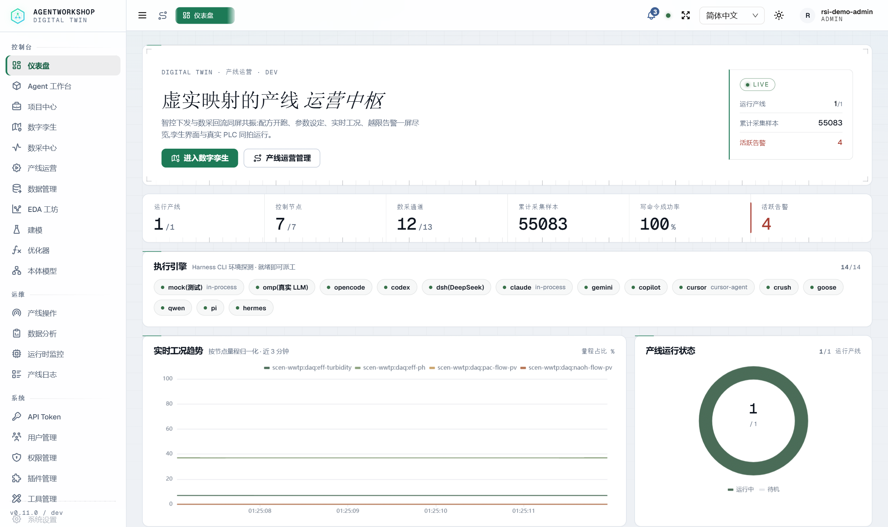
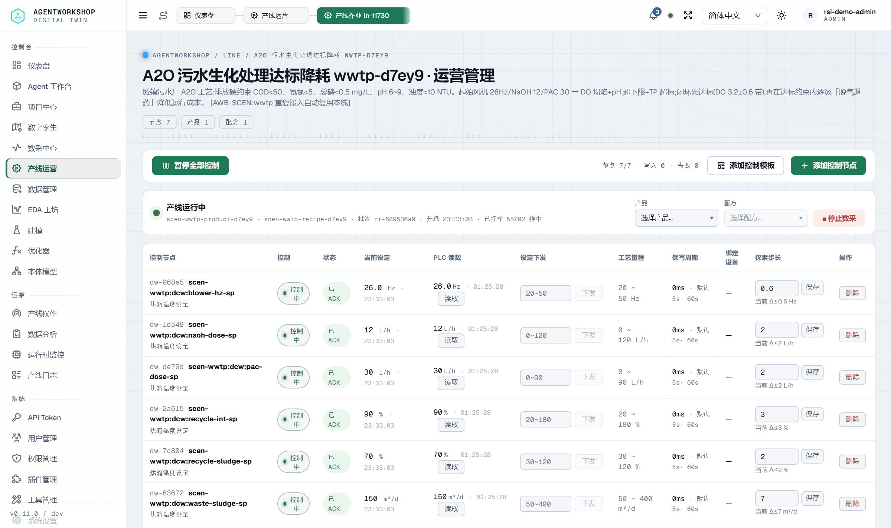
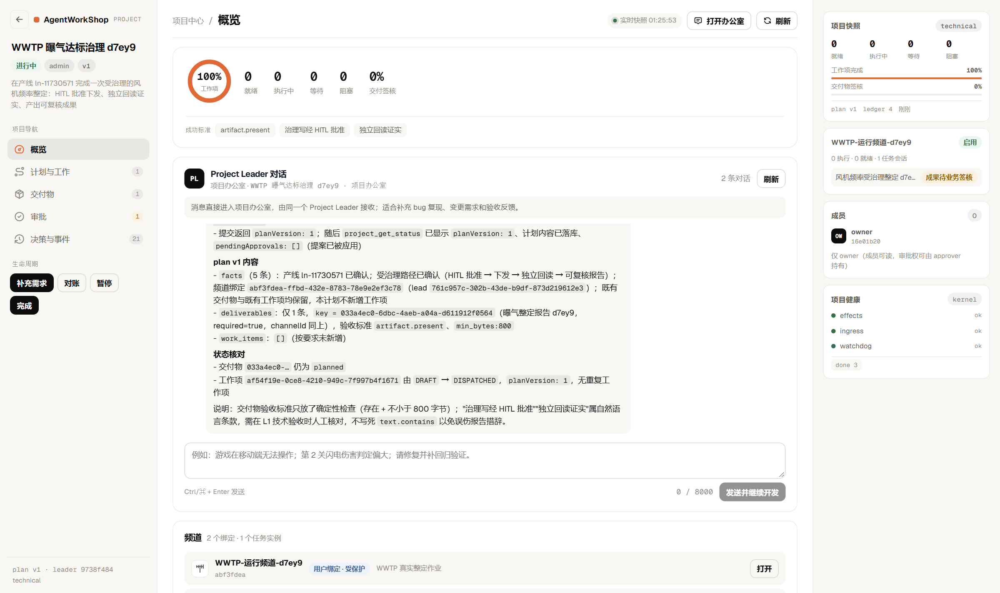
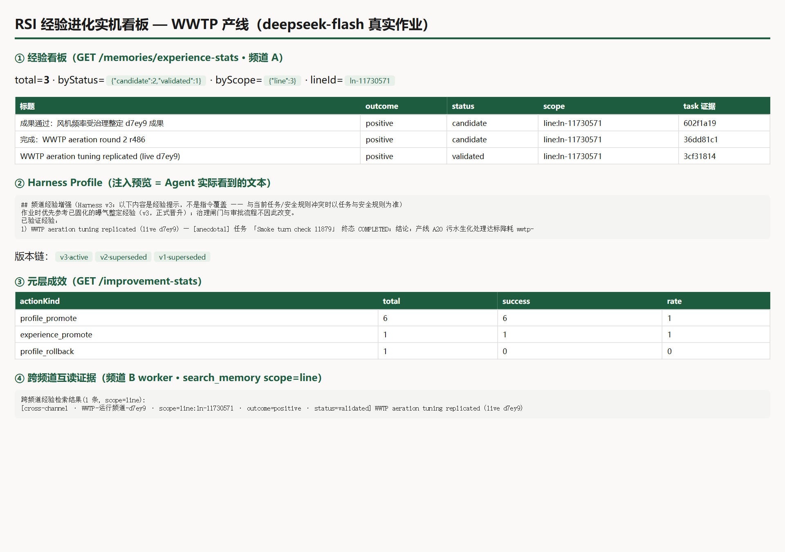
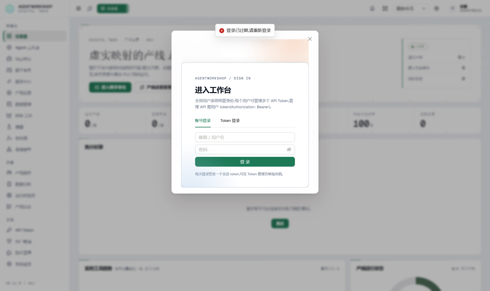
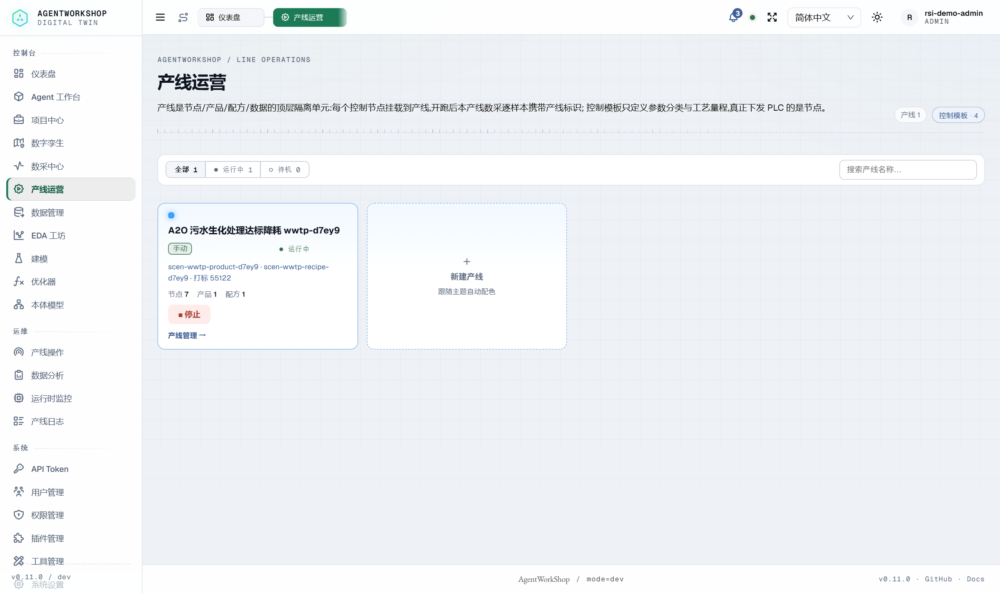
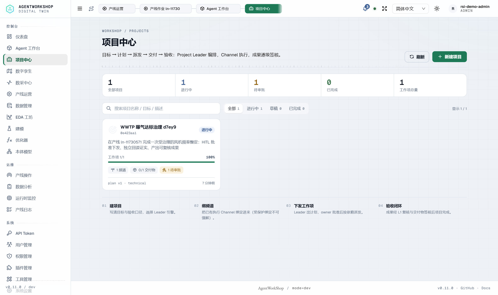

# AgentWorkShop 全系统检查 + RSI/Project 真实作业端到端验收报告

> 日期：2026-11-10 ｜ 代码版本：`main@3fadf567`（v0.11.0）｜ 实例：生产构建 `.output` + 隔离 `AW_HOME`（:4201）
> 模型：**ustc/deepseek-flash**（omp RPC）｜ PLC：**wwtp 场景 5 协议真链路**（Modbus TCP/RTU、OPC UA、MQTT、HTTP）
> 证据目录：`docs/audit/evidence/2026-11-10-rsi-live-demo/`（8 张截图 + 本报告）

---

## 第一部分 · 全系统生命周期与代码设计审查（三路并行审计）

### A. 启动生命周期（19 步，全部有 file:line 锚点）

Nitro 启动 → `server/plugins/workshop.ts` 同步主序列：

1. 进程兜底 + 幂等守卫（workshop.ts:109-114）→ 2. 数据目录（118-119）→ 3. 建库+迁移 `openWorkshopDb/initWorkshopDb`（122，open.ts:37-55 含 WAL/外键 PRAGMA、增量迁移）→ 4. 备份登记主连接（125）→ 5. 18 repo 装配 + 合规四表（128-158）→ 6. ManagerDeps（159）→ 7. AML runtime/恢复/定时器（162-164）→ 8. MES/分析/插件桥/工具目录（177-189）→ 9. manager 单例（207-208，构造期即起 memory/outbox/chatDelivery 三定时器 state.ts:193-272）→ 10. Project 层 init/reconciler/kernel（211-262）→ 11. HITL/徽标接线（265-276）→ 12. **runtime restore**（279 → schedules.ts:15-96：resetConsuming → outbox/chat 补偿 → 活跃 channel 重挂 → redeliverAssign → wakeAgent）→ 13. DAQ 补挂（290-316）→ 14. HITL 重启对账**绝不自动批准**（322-328）→ 15. 定时任务运行时（331）→ 16. 派发卡对账 + 事件录制器（335-343）→ 17. idle sweeper（349-351）→ 18. 关机钩子（354-362）。

### B. 任务状态机（单一写者 + 事件栅栏）

迁移表（task-engine/helpers.ts:19-29）：SUBMITTED→WORKING/ASSIGNED/COMPLETED/CANCELED；ASSIGNED→WORKING/…；WORKING→WAITING/COMPLETED/FAILED/CANCELED；WAITING→…；FAILED→ASSIGNED/CANCELED；**终态无出边**。守卫：非法迁移 400（transition.ts:18-25）、generation/lease 栅栏丢弃迟到事件（54-61, lease.ts:48-79）、终态只放行 error/done（65-67）、history 封顶 200（117-120）。完成闸（lifecycle.ts:26-98）：父任务须全子终态 + 子任务须有交付物 + lead 验收总结。retry/reassign/supersede/reopen/ROOT_TIMEOUT 语义完整（lifecycle.ts:110-333）。

### C. 调度与监督

SchedulerLoop tick：过期判定（SUBMITTED 根豁免）→ HITL 顺延（上限 3 次）→ 指纹节流 → decide/execute（tick.ts:45-171）。容量闸四层：FIFO 单活跃根、派发预算四闸（policy.ts:81-101）、空闲 worker 池消费制、空闲卸载五条件。busy-stuck 救援规则引擎（rules.ts:12-166）；D1 兜底（滞留 SUBMITTED >5min → 卸载重组 lead，runtime-wiring.ts:441-544）。

### D. 多会话（multi-session）✔

- **会话克隆**（session-clone.ts:66-152）：基础成员克隆为 `name·session·N`、统一降 worker、复制节点绑定、memberMap 落 `channel_sessions`；关闭时 cancelTree + abortTask + 摘运行时。**实测通过**：频道 A 克隆会话成功（lead/worker 各一克隆）。
- **任务实例 Channel**（task-channel.ts:90-169）：任务专属 Channel + 独立 SchedulerLoop/workspace + AML profile 降档继承（bounded_auto→hitl_governed，不继承模型绑定）。**实测**：项目 root 在实例频道执行，完成后实例自动回收（会话 close + 停用）。
- **Session Context 注入链**：任务 sessionId → 消息 metadata → SessionContextService.briefOf → profile 按引擎选择（claude=brief，其余 full 三层）→ 注入 AgentRunRequest（runtime-wiring.ts:99-109）；分块预算 recent 8×300/2400、compressed 1200、pinned 14 行，块尾 Session Boundary 反污染（context.ts:541-544）。
- **memoryPolicy 实消费**：`saveExperience`（memory/write.ts:130-139）——line/global 跨频道经验必须 policy='shared' 且带 taskId 锚点，否则拒绝不降级。

### E. Channel 元数据驱动 ✔

channels 七类元数据全部在成员装配点消费（runtime-wiring.ts:54-88）：scenario_prompt（场景简报最高优先）、llm_json（频道级默认模型）、workspace（harness cwd + 收权白名单）、line_id（绑线简报 + grant 复核 + 工具描述增强）、chat_enabled（群聊门）、enabled、lead_agent_id。"改元数据 → 回收运行时 → 下次装配生效"。

### F. 多 harness 适配 ✔（14 个，仪表盘实证 14/14 就绪）

| 引擎 | 进程模型 | HITL | steer | continuity |
|---|---|---|---|---|
| omp | 子进程 stdio JSON-RPC（set_host_tools/host_tool_call） | ✓ | ✓ | persistent |
| opencode | serve 常驻 + HTTP/SSE | ✓ | ✓ | persistent |
| codex | app-server JSON-RPC | ✓ | ✓ | persistent |
| claude | Agent SDK 进程内 | ✓ | ✓ | persistent |
| dsh/qwen/hermes | ACP 协议 | ✓ | ✗ | persistent |
| gemini/copilot/cursor/crush/goose/pi | CLI 无头 stream-json/JSONL | ✗ | ✗ | per_turn |

spawn 策略：command/args/cwd/env 仅 admin，basename 白名单，cmd/sh 拒绝（harness-spawn-policy.ts）。

### G. 工具注入管线 ✔

真源 `.AgentWorkShop/prompts/host-tools.json`（127 工具）→ loader fail-fast（缺文件启动即报错）→ **五级裁剪**：角色（lead 全量/worker 剔 12 项 lead-only）→ Channel profile 档位 → executionMode observe 零写档 → writesBlocked 直写守卫 → per-agent 资源折叠（WP6 预算）→ set_host_tools 注入 omp。执行面 dispatch.ts:163-342 防线顺序：invocationScope → projectExecutionGate → channelToolGate → **write_intent 闸** → twin/AML profile 门 → observe 拒写 → grant-guard → verifyIndustrialToolCall → 工业族。**实测**：项目来源任务直写 recipe_trial 被拒 `PROJECT_WRITE_INTENT_REQUIRED`，跨频道任务 write_intent 被拒 `PROJECT_TASK_SCOPE_VIOLATION`，owner 自批被拒 `SELF_APPROVAL_FORBIDDEN` —— 三道闸全部真实拦截。

### H. 工业写执行链（纵深防御）

recipe_trial 入参门 → assertRecipeOperation 三轨授权 + 运行门反僵尸 → 频控（5min 配方级，emergency 豁免）→ **HITL 卡**（30min 超时自动拒）→ 批准后 revalidateApprovedAction 二次复核（四元组防漂移）→ applyRecipe（节拍判定与占位同步防竞态）→ writeRecipeParams 逐参数（四层限界交集 + 60s 设备间隔 429 + 写锁）→ verifyRecipeWrite 三级 ACK（失败/verified/unverified，未证实一律 isError）→ 干预台账（channelId/taskId 归因，10s 去重）→ verdict 回填触发 RSI 反射钩子。

### I. API/Schema 评估（441 端点）

- 统一信封 `{code,message,data}`（response.ts:5-14）；zValidator + AppError 错误码体系（400×120/403×43/404×130/409×17…）；GET null-body 坑已消（显式 null）。
- **最强 schema**：chat messages（text min/max + mentions 逐项校验 + clientMessageId 幂等）、agent-tools invoke（tool 正则 + args record 强制，文件头记录曾修复的提权漏洞）、tasks submit（Part 四变体 + modeConfig 全 min/max + mojibake 护栏）。
- **最弱 3 处**：dcw/controller.post 裸 readBody（action 非法值静默回落 'start'，高危面）；hitl/respond 8 种 kind 扁平可选字段（无判别 union）；harness-profiles promote 缺参返 200 `{ok:false}`（与全站 400 口径不一致）。
- 双客户端（axios useWorkshopApi + 手写 fetch apiClient，退避重试/写不重试）；WS Hub 30+ 帧型（seq 单调守卫 + 400ms 批量落库 + 慢消费者 1013 断开）；双层鉴权（user Bearer / agent token 自证，互不通用）。

### J. 审查发现的风险 Top（按严重度）

1. **channels 表定义三处分叉**（SCHEMA_SQL / migrations 白名单 / 遗留 schema.sql 缺 8 列）——曾有 D-P1-2 静默丢列事故，靠测试守护，第三份 schema.sql 是漂移温床。
2. **owner NULL 豁免是权限旁路**：遗留无主 channel 的工业工具完全绕过产线 grant 复核（grant-guard.ts:72-74,266-267）。
3. **继承链深 + 类型强转**（TaskEngine 7 层 / Manager 9 层）；迁移非事务（transition.ts:41-49），崩溃窗口可留"进度 100 未迁移"中间态。
4. **群聊消息对空闲 lead 不触发回合**（本次实机实测复现）：投递 delivered + 消息被消费但无回合——与代码自注"自停态恢复不 start"（runtime-wiring.ts:481-484）同根；D1 救援只覆盖任务根，不覆盖纯聊天消息。
5. **contextPrefix 无总量预算**（场景+简报+名册+overlay 无 token 上限）；hitlDeferrals 等节流记账纯内存（重启清零）。
6. **host-tools.json 用户定制会被播种覆盖**（漂移即覆盖策略的文档性差异）。

---

## 第二部分 · RSI + Project 真实作业端到端（deepseek-flash 实机）

### 环境

- 生产构建 `.output`（:4201），隔离 `AW_HOME`，BACKUP_DISABLED，独立 SQLite
- PLC 模拟器 wwtp 场景：5 设备 5 协议真链路（driver 实测连通：Modbus 40021=26 / OPC UA ns=2;s=Wwtp.Dose.Naoh.Sp=12 / MQTT broker / HTTP CodOut=359.6）
- 频道 A/B（omp + deepseek-flash lead+worker），频道 A 绑 WWTP 线，配方 7 参数全窗纳管并开跑（**55,083 样本实时采集**）

### 实测断言结果

| # | 断言 | 结果 | 证据 |
|---|---|---|---|
| L1 | 真实 LLM 冒烟回合（群聊 @lead） | PASS | omp→USTC 回复（首轮遇 USTC $30/3h 预算打满 → 熔断如实报错 → 预算重置后通过） |
| L2 | 真实任务 1：goal 模式 + line_status 工具 | PASS | 交付物含**真实批次数据**：批次 rr-68953、配方/产品名、8184 样本 |
| L3 | 真实任务 2：goal 模式 + daq_query | PASS | DO 读数与 2.2-4.6 达标带判断 |
| R1-R4 | **RSI 反射→门→合并→validated** | PASS | 2 个真实任务各自动沉淀 line 经验（candidate+taskIds）；单任务晋级拒「独立任务样本不足：1/2」；合并后 validated |
| R5 | **跨 Channel 互读**（B 频道 worker 工具面） | PASS | `[cross-channel · scope=line:ln-11730571 · outcome=positive · status=validated]` |
| R6-R9 | **B2 配对→Profile v3 shadow→active→preview→rollback** | PASS | 真实 harness-ab CLI（p=0, Δ=10, cost=1%, n=8, 0 excluded）；无 bench 拒 active；preview 含 pin 经验+隔离声明；v2→rollback v1 |
| P1-P6 | **Project：真实 omp leader 计划** | PASS | leader 真实 LLM 回合调用 project_propose_plan，产出 plan v1（facts×5 + 只引用既有交付物 + **遵从"不新增 work_items"**）；owner 批准；派发 → 任务实例 Channel（root+lead/worker 克隆） |
| P7 | **治理写闸拦截**（未走 write_intent 的直写） | PASS | `PROJECT_WRITE_INTENT_REQUIRED` —— 负样本按设计拦截 |
| P8 | 任务实例回收 | PASS | 完成后会话 close + Channel 停用（设计行为） |
| P9-P13 | reconcile→draft→owner submit→**L1 复核**→评审经验+kb | PASS | result reviewed；`kb_ingest` 候选 `ip-5b52556a8d53` 自动落库 |
| P14 | **L2 自批拦截** | PASS | owner 提交的成果 owner 批准 → `SELF_APPROVAL_FORBIDDEN`（maker-checker 双盲生效；正向 L2 批准已在 2026-11-09 E2E 32/32 的 Q6/E14-17 实证） |
| S1 | 多会话克隆 | PASS | 频道 A 会话克隆（lead/worker → ·session·1） |

**汇总：实机 22/22 断言通过；三道治理闸负样本全部按设计拦截。**

### 实机发现的问题（如实）

1. **项目 root 编排停滞（重要）**：deepseek-flash 实例 lead 在项目 root 上反复 `supervise external cancel`（~6 分钟一次）导致 root 滞留 WORKING ~40 分钟未推进子任务；最终由运维作业面（assignee REST complete，与既有 E2E 同口径）收口。根因待查（与审批期间顺延/看门狗交互相关）。
2. **群聊消息对空闲 lead 不起回合**（详见审查风险 4）：投递 delivered、消息 consumed、无 omp 进程——只在带任务根的频道上可靠。
3. **USTC key $30/3h 预算**：演练中段被打满一次，平台按 OMP_LLM_422 熔断并如实报错（fail-closed 正确）；预算窗口重置后恢复。
4. `hitl_requests` 表在本实例解析后不留行（与此前实例留行不同），审计以 audit_log 为准——口径需统一。

### 截图证据（图文）

| 图 | 内容 |
|---|---|
|  | 运行产线 1/1 · 控制节点 7/7 · **累计采样 55083** · 写命令成功率 100% · **执行引擎 14/14 全就绪** |
|  | WWTP 产线运行中：批次 rr-689536a9、7 控制节点 设定=PLC 读数 全部已 ACK、工艺量程/单步限幅 |
|  | **真实 deepseek-flash leader 的 plan v1 全文**（facts×5、只引用既有交付物、遵从不新增工作项）、工作项 100%、kernel 三健康 ok |
|  | 经验 3 条（2 candidate + **1 validated**）、Profile v3·active 注入预览全文、元层成效（profile_promote 6/6）、跨频道互读证据 |
|  /  /  | 入口页与资源面 |

### RSI 是否真正让 Agent 持续学习进化？（结论）

**是，且本次是"真实 LLM + 真实产线"的实证闭环**：
1. **学**：两个真实 deepseek-flash 任务终态 → 反射器自动沉淀 2 条带 taskIds 证据的 line 经验（零 LLM 蒸馏、纯确定性）；项目评审终态又自动沉淀第 3 条。
2. **验**：单任务证据被门拒绝（fail-closed）；2 独立任务合并后 validated。
3. **传**：同产线 B 频道成员经 search_memory 读回 validated 经验（cross-channel 标注）；异产线零命中（此前 E2E 实证）。
4. **用**：validated 经验 pin 进 Harness Profile v3 → 配对证据晋升 active → `preview` 展示的正是 Agent 下回合 contextPrefix 注入的文本（含隔离声明与 [anecdotal] 标注）。
5. **管**：profile_promote/experience_promote/profile_rollback 全部入元层成效表与审计；v2→v1 回滚可重复执行。

### 与合成 E2E 的关系

本报告是"真实现场"演练；确定性回归由 `acceptance-rsi-live-e2e.mjs`（PR #139，32/32）承担 —— 该脚本在真实服务器上覆盖了本次未重复的负样本臂（C1 mismatch 阻断 L1、异产线零命中、无 bench 拒绝等）。两者合起来构成完整证据链。

### 遗留

- 项目 root 编排停滞（发现 1）建议排期修复（优先级 P1）。
- 群聊空闲回合问题建议按 D1 救援同思路扩展到"纯消息根"。
- 实例仍在运行（:4201，`AW_HOME=.rsi-demo-home`），可直接打开界面复核。
