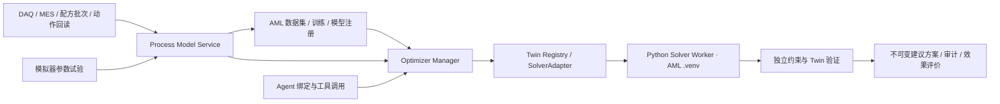

# Optimizer Manager 与 Process Model Service 系统开发计划

日期：2026-10-22。版本：**v2，含后文v3/v3.1实施补遗**。当前状态（2026-10-23复核）：**已部分实施并完成本轮局部修复，仍有集成出口待补齐**；见[实现复核报告](../audit/2026-10-23-optimizer-implementation-review.md)及[后续计划](2026-10-23-optimizer-integration-followup.md)。
本文件前半部分保留原设计阶段的范围和决议；实施事实以末尾记录及2026-10-23复核为准。原设计轮仅核查/规划，本轮已按用户新指示修复局部业务代码，未安装依赖或操作真实设备。
用户已确认：**先在模拟器做参数试验；真实产线首阶段仅提供建议**。
工作流：按用户要求只交付 plan；不启动 ultragoal 执行循环。下列 G1–G6 可在后续执行时转为持久任务。

## 1. 结论与价值边界

**现有系统能够集成，推荐扩展已有 AML/Twin/Agent/DCW 主链。真正的收益取决于过程模型能否识别参数变化的响应，单独接入求解库不能保证优化有效。**

用户所需能力分为两条链：

- 建模链：场景/工况配置 → 参数试验或历史数据 → Process Model Service 构造与审查数据 → AML 辨识/训练与晋级。
- 优化链：Optimizer Profile → Agent 绑定 → runtime 加载模型与求解器 → 获取真实历史状态 → 数值求解 → 独立验证 → 建议与效果跟踪。

通常训练的是过程预测模型；OSQP、SciPy 等求解器通过计算使用模型，无需训练。贝叶斯优化中的代理模型属于另一类可学习组件。

### 源码核查证据

以下路径相对仓库根；这些结论为静态源码核查，不等同于现场运行验收。

| 现状 | 已核实实现与实际缺口 |
|---|---|
| AML 可复用 | `server/services/workshop/aml/runtime.ts:103` 已集中管理资产和共享 `.venv`；`model-registry.ts:64` 已有训练谱系、模型注册及晋级。不要新建平行 Model Registry。 |
| 环境可复用 | `aml/python-runtime.ts:349,378,498,572` 已有 uv 下载、托管 Python、共享环境与白名单子进程环境；当前 requirements 并非完整版本锁。新增模块统一走原环境管理器。 |
| Solver 插件只有基础接口 | `aml/twin/provider-contracts.ts:57` 的 solve 输入输出仍为 unknown；`provider-registry.ts:382,398` 可注册、列举，但缺统一求解调度及 Solver 租约；现有 Physics Provider 的代际机制可复用。 |
| 当前工具不是完整 MPC/BO | `agents/industrial/twin-tools.ts:557-566` 枚举小步候选，每个候选恒值展开；`:649-717` 为邻域搜索与 UCB 式评分。尚未调用成熟 Python QP/GP 后端。 |
| 数据格式已有基础 | `aml/dataset-builder.ts:264,331,394` 已有历史/未来控制/目标滑窗、按 run 切分与 f32 工件；`:175` 使用完整 run 窗口，需落实 spec 的 fromMs/toMs。 |
| 现有数据门不足 | `aml/gates.ts:99` 的样本/批次数门与 `aml/stats.ts:103` 的互相关，不能证明控制输入可辨识。 |
| 动态初态需修复 | `aml/twin/model-backed-provider.ts:156` 复制单快照作为历史；`model-registry.ts:183,191` 的一步预测和未来 feature 持末值，需显式历史与扰动假设。 |
| Agent 集成可复用 | `agents/host-tool-bridge/catalog.ts:168` 已按角色/profile 装配工具；`per-agent.ts:90` 主要增强资源描述，尚未按 Agent 的优化器绑定裁剪工具。 |
| 绑定需补强 | `aml/twin/channel-profile.ts:88-111` 主要检查模型阶段、产线与门禁，尚未完整核对产品/配方；需逐次求解重校验。 |
| 已有探索与治理写入 | `agents/industrial/optimization-tools.ts:37,106-164` 已有真实探索与记录；`dcw-tools.ts:108`、`dcw/dcw-controller/write.ts:107-191` 有治理、限界与节流。推荐证书不是执行授权；完整 WriteGrant 链目前未证实实现。 |

### v2 复核：必须新增的真实接入工作

上一版对扩展面的描述不足，以下均为待实现任务，不能视为现成能力：

| 断点 | 源码证据与必需改动 |
|---|---|
| 配置无法直接启动新训练器 | `aml/twin/provider-loader.ts:24` 的 TrainingAdapter/Objective 注册仅返回 accepted；`training-plans.ts:194,210` 强制 hybrid_residual；`job-orchestrator/start-job.ts:51-64` 其他类型要求 train.py。须实现真实注册/解析，内置新训练器并贯通计划训练/重训。 |
| 非 ONNX 不能只扩注册表 | `start-job.ts:130`、`python/aml_eval.py:48,70`、`gates.ts:93`、`predictor.ts:177,182`、`twin/model-backed-provider.ts:117` 分别强制 ONNX、ORT、one_step 或 hybrid 工件；全部按版本化模型能力分派。 |
| 新字段可能丢失或未计入摘要 | `python/amlkit.py:33-37` 只读 x/u/y；`model-registry.ts:171-191` 固定生成 v1 IO；`dataset-builder.ts:498` 只 hash 四个旧文件。须同步 Python reader、IO builder、工件清单/摘要、实体读取/导出。 |
| 成功状态可能没有可用模型 | `job-orchestrator/stages.ts:71-82,122` 先完成作业，注册失败仅 warn，仍回执可用；须把工件验证及注册纳入成功终态。 |
| 数据端口并无分页/完整质量 | `daq/storage/tsdb-port.ts:49-69` 无 cursor；两种 adapter 的 queryTagged 对多节点共用 limit，raw 丢 state；须新增有界、稳定排序、保留质量的逐节点分页接口。 |
| 动态工具 Schema 刷新不完整 | `server/harness/aw-mcp-bridge.mjs:39,51` 签名未含 inputSchema 且忽略空表；`agents/pi-agent.ts:72-83` 每回合装配；须按 Harness 能力刷新，执行侧立即校验 revision。 |
| 工具发现也需要资源授权 | `server/api/workshop/agent-tools/list.get.ts:15-26` 用户路径只检查登录；须与 invoke 一致核验目标成员/Channel。 |
| Twin 评分与新问题不同口径 | `aml/twin/trial-service.ts:56,117-125` 旧评分只看末拍，缺 UQ 时有默认乐观值；新 Profile 必须使用同一问题定义的全时域代价/约束，并提供真实校准证据。 |

**可配置的边界**：首版承诺在内置模型/问题家族内，仅通过配置完成新场景训练和求解；新物理方程、全新模型家族或新求解算法需要扩展已注册 Adapter，不能承诺任意场景描述均自动变成有效模型。

## 2. 架构决策



- **Manager 是组合与治理层**：管理场景优化配置、兼容性、Agent 绑定、部署、运行和收益；Solver 的能力来源继续是 Twin Registry。
- **Process Model Service 是训练/求解共用的数据与模型接口层**：不替代 DAQ/EDA，不复制 AML 数据集与模型仓库。
- **Python Worker 是受管理计算进程**：首版选择本地长驻子进程 + 版本化 JSONL 协议，模型缓存、请求 ID、取消和硬超时由 TS 管理。无须额外常驻 HTTP 服务或新端口。未来远程 Worker 通过 Adapter 扩展。
- **模型注入 runtime 是加载有版本的模型句柄**：包含工件/特征/单位/工况/状态估计契约；Agent 获得可用工具和说明，数值模型由 Worker 实际执行。
- **首版真实产线只产生建议**：新增 Profile 不获得写权限；已有探索/控制功能保持既有授权语义。模拟试验通过现有治理执行接口，并校验目标确属模拟环境。

备选：独立优化微服务可隔离部署，但首版会重复环境与注册治理；把数值计算继续写在 TS 工具里难以复用算法和控制生命周期。因此采用原平台扩展 + Python Worker。

### 最小持久化对象

| 对象 | 内容与归属 |
|---|---|
| ProcessModelSpec | 新增版本化定义：line/product/recipeVersion、工况、变量与单位、时序、延迟、模型能力、有效域。 |
| Dataset/ModelArtifact | 复用 AML；扩展 manifest/io_spec 与资格报告，引用 ProcessModelSpec 版本。 |
| OptimizationProfile | 新增版本化问题：模型精确版本、目标/约束、策略、Solver 精确版本、快照与运行预算。 |
| OptimizerBinding | 新增 `(workspaceId, channelId, agentId, profileVersion)`、能力授权、有效期与 revision；agentId 明确为 `channel_agents.id` 成员实例，不能使用 templateId/name；支持多个绑定，调用时显式 bindingId。 |
| OptimizationRun / Plan / Outcome | 新增请求与版本摘要、求解诊断、不可变候选、验证结果、审计和延迟后的实际效果。 |
| ExperimentPlan / Intervention | 新增模拟参数试验计划；动作明细连接既有探索/DCW 记录，不再制造另一套写设备账本。 |

以上沿用现有数据库迁移与 Repo/Service 模式。AML `experiment` 表示训练实验，参数干预使用独立名称，避免混淆。新增外键、唯一性与版本冲突检查；发布版本不可修改，修改产生新版本。删除成员撤销其绑定，引用中的模型/配置拒绝物理删除；扩展 AML retention/entity 的引用检查，在途模型租约阻止工件清理。保留历史运行的版本摘要，重启后从数据库恢复绑定与队列，不能依赖全局内存保存配置。

## 3. Process Model Service：处理“自然波动不等于调参效果”

### 3.1 用户配置与工况

配置表单/JSON 共用 Schema：可调设定值 MV、实际生效/回读值、质量目标 CV、可测扰动 MD、配方/原料/阶段等 context；声明 sourceNode/field、输入语义、源/模型单位及显式仿射换算(scale/offset)、采样周期、时间戳来源、变量顺序、作用延迟/保持窗、边界及 maxStep。单位不可换算或字段缺失时发布失败，不猜测补齐。

模型支持 AML 训练产物与已注册的用户模型/机理 Provider。自定义工况首版采用枚举等值/数值区间，必须 exactly-one 匹配；发布检查重叠，运行时再次检查重叠、无匹配与有效域；不依赖隐式优先级选模型。每个工况固定模型/Profile 版本，切换后重新装配状态并失效旧计划。配方版本引用已有 RecipeView.version，并冻结参数/节点映射内容 hash；不能只按 recipeId 认定同一工况。

**历史配方版本不能从当前值反推**：现有 `daq/storage/tsdb-port.ts:15-25` 与 `dcw/line-run.ts:18-27` 只保留 recipeId/runId，绑定传递也未保留版本。优先复用 `dcw-recipe.repo.ts:404-426` 已冻结的 RecipeRun.paramsSnapshot 计算内容hash并引用原快照，不能依赖仅保留有限历史的paramsHistory，也不逐样本复制整份配方。G2 持久化 `process_context_segments`：line/run、半开时间段、recipeId/version/contentHash、工况来源及确认状态，接入批次冻结与已确认应用/切换事件，并贯通采样打标、host-bindings 与构数。运行中切换拆段，训练窗口不得跨版本；只有仓库编辑事件时只触发配置重校验/计划失效，不能当作产线已应用新版。生效不明或旧样本无版本证据保持 unknown，不回填当前版本，也不计入指定版本的优化资格。

### 3.1.1 首版纯配置能力清单（拟新增契约）

| 模型/问题家族 | 用户配置 | 平台内置实现及输出 | 使用路径 |
|---|---|---|---|
| `linear_arx@1` | 变量映射、beatMs、每输入延迟、AR/输入阶数、正则项、工况/有效域、资格策略 | NumPy/SciPy 辨识；编译为含滞后寄存器的 `linear_state_space@1`，导出 A/B/C/D、缩放、偏置、状态初始化规则与残差校准包 | 真实历史初始化 → OSQP 线性 MPC |
| `static_response@1` | 稳态/批次样本聚合窗、MV/扰动/质量映射、1或2阶响应面、正则项、工况/有效域 | 内置响应面训练器，导出系数、特征展开顺序、缩放/偏置与留出残差；不要求伪造 ONNX/hybrid_manifest | 当前工况 + 候选参数 → SciPy 有界参数优化 |
| 现有 ONNX/hybrid | 保留旧输入与训练方式；新 Profile 需另外满足优化资格与后端能力 | 原训练/预测链按旧 manifest 解释；不隐式转换模型含义 | 旧功能兼容；不能直接绑定 OSQP |

ProcessModelSpec 包含 `trainerRef/config + datasetPolicy + featurePipelineVersion + gatePolicyRef + modelInterface`，OptimizationProfile 包含 `problemTemplateRef/config + modelRef + solverRef`。UI、REST、Agent 使用同一 Schema；服务端从固定训练器生成 job，普通用户无须提交 Python。扩展 Twin Registry 的 TrainingAdapter 与 Objective/ProblemTemplate 注册/resolve/版本生命周期，不另起同类注册中心；运行期不能仅返回 accepted。

### 3.2 两种输出，共用一个特征定义

1. `buildDataset(spec)`：按权限从底层 TsdbPort/批次/配方和动作账本分页取数，裁切时间窗、对齐延迟、分段、清洗、生成不可变 AML 工件与 hash。不得使用 EDA 图表的最多 2000 点展示数据作训练源，也不得静默截断。
2. `getRuntimeContext(spec, asOf)`：提供真实 `history + timestamps + dt + qualityMask`、当前实际输入、状态估计及扰动预测/持值假设。历史不足明确拒绝，取消单快照复制的伪历史。

底层新增逐节点 raw-page 读取接口及 SQLite/Timescale 双实现：cursor 绑定查询范围与节点、稳定按时间/唯一键排序、返回 nextCursor/done/state；每页限额且重试不漏不重，不修改原图表接口语义。同时间戳不同节点不能互相截断；同节点重复点按源唯一键/既有存储规则明确处理。分页使用同一可见性快照或先固化原始导出，再生成工件。

现有时序库只有测量时间，不能直接证明历史时刻已经收到数据。G2 同步扩展 DaqSampleRow/raw-page 与双适配器，新增平台入库生成的 ingestedAt/水位（不信任调用方自报），新 ContextSnapshot 固定 capturedAt、eventAsOf 和 availabilityWatermark。迟到点只有在实际入库后才可见；严格在线回放只使用当时已固化的 ContextSnapshot，不从后续已改写原表“还原过去”。旧记录到达时间为 unknown，可按声明用途训练，但不能作为严格在线回放证据。缺失质量字段同样为 unknown，不能自动视为 ok。向量/图像首版通过已注册、固定版本的特征提取器转换成数值，未配置提取器的原始帧拒绝训练/求解，不承诺直接优化图片像素。

推荐 AML manifest v2 保留 `x/u/y.f32` 兼容出口，并增加：

- 动态数据：历史 X `[N,H,F]`、历史样本中已实现的未来输入 U `[N,P,M]`、目标 Y `[N,P,C]`；可用时附 D、mask、timestamps/dt、episodeId、conditionId、actionId。在线求解的 U 是候选轨迹，两者必须遵循同一 inputSemantics。
- 静态数据：每个稳定段/批次一条 `[N,F] → [N,C]` 记录及输入条件，不强套动态 H/P 张量；manifest 按 dataKind 判别，Python reader、评价器与 IO builder 同步识别。
- metadata：字段顺序/单位、归一化训练统计、延迟配置、train/val/test 划分、来源 real/sim、采集时间与版本/hash。
- 动作样本：request/ack/effective/readback 时间、请求/实际值、观察窗、扰动、成功/失败/未知。transport ACK 不能直接算参数生效。
- 按独立 run/episode/时间块切分，单长 run 时使用带隔离区的时间划分；重叠窗口不得跨集合。预处理仅在 train 拟合；在线用不到的未来扰动/反馈不得泄漏给验证模型。

v2 的文件清单覆盖 D/mask/dt/episode/干预 sidecar 与预处理定义，全部参与完整性 hash，v1 继续沿用原 hash 算法；新增内容摘要排除生成时间/任务 ID 等易变封套，避免相同输入因创建时间而改变语义摘要。

**输入和时间语义必须冻结**：首选把生效设定值作为模型输入、实际过程量作为状态/观测，响应模型包含执行器滞后；若模型输入是实际过程量，在线候选设定值必须先经已验证的执行器模型转换，不能直接代入。缺少映射时拒绝发布。约定历史末点为 k，u[k] 为下一控制区间的已生效/候选输入，x[k+1]=Ax[k]+Bu[k-d]、y[k]=Cx[k]+Du[k]（d 按输入显式定义，并按实现接口统一索引）；延迟扩充状态与直接馈通项的时序须有 oracle。观测时间/物料对齐、模型输入延迟分别记录，禁止数据预移位后又在模型中重复施加同一延迟。首版固定采样周期，显式重采样；支持范围外的 dt/缺口拒绝，不声称通用变步长 MPC。ARX 状态初始化由真实输入/输出滞后寄存器生成；显式状态空间模型需指定已注册估计器。

request/ack/readback/effective 证据必须在 G2 接入既有动作账本与设备/指定 DAQ 回读，不能全部留给未来自动执行阶段；effective 为有出处的观测/估计和容差，不把 ACK 时间当物理生效。历史缺证据保留 unknown，关联失败的窗口不能进入干预资格样本。

### 3.2.1 模拟器先决条件

复用现有 `plc-node-simulator/src/server/engine/plant-model.ts` 的薄膜与 `anneal-model.ts` 的连续退火模型；后者已有质量/产能量，首版不为不存在的能耗指标额外造数据。先检查物理响应 oracle：薄膜延迟队列未到达时不得提前输出新厚度（`plant-model.ts:185` 当前赋值路径有此风险），初态、噪声、扰动与时间推进可重复。若 oracle 失败，先修复并固定模拟器依赖版本，不能带病生成训练/收益证据。

协议端到端首版固定 `timeScale=1`，因为 `plant-runtime.ts:192,249,257` 的物理时间加速与导出墙钟未形成统一数据时钟。离线算法测试可显式按 simStep/physicalTime 推进，分别记录模拟时间与墙钟；不能把加速过程生成的延迟当真实秒数。Solver/训练只读取 exposed；truth 和参数真值仅供独立验收，不得进入模型特征或在线优化目标。

### 3.3 独立资格与证据

`predictionEligible` 与 `optimizationEligible` 分开；资格带 simulation/real 作用域、工况和证据版本，均不代表设备执行授权。

优化资格至少检查：MV 有效变化量/独立变化次数、各参数与联合输入覆盖、共线性/激励矩阵条件、变化后的可观测延迟响应、已知扰动与闭环反馈混杂、留出段多步响应质量、不确定性/OOD。报告覆盖的是哪个已观测局部区间，不能把统计相关宣称为因果证明。

- **U 恒定、Y 自然波动再大也不能通过优化资格**。
- U 变化与外界扰动混杂或多个参数始终同步变化时，输出辨识不足；可继续预测训练，禁止宣称已识别各参数独立作用。
- 历史人工调参如有可核验实际输入和时间线可利用；动作来源不明的段降低证据等级。
- 不足时返回具体缺口与模拟试验建议；禁止通过复制、加噪声或随机改标签伪造激励样本。
- 模拟样本用于开发/预训练/回归；仅靠模拟样本不能晋级真实产线的优化资格。原有模型标记为 legacy/unassessed，不追认资格。

### 3.4 模拟试验与建模

首批采用阶跃/多水平、随机化顺序与重复试验，必要时增加受限多变量设计；配置稳定时间、响应观察窗、扰动标签、中止条件与预算。将既有 `optimization_explore` 的“等待后均值差”升级为持久异步采集任务；原工具可作为兼容入口，不能把均值差当因果结论。

优先落地带延迟的线性 ARX/状态空间辨识与静态响应模型，AML 统一训练和验证。线性模型输出矩阵/缩放/延迟与有效域；神经模型保留 ONNX。扩展 AML 当前强制 `model.onnx` 的工件契约，增加类型化 `linear_state_space` 包；旧 ONNX 作业保持兼容。

### 3.5 训练到 runtime 的完整接入清单

由 `modelInterface/artifactKind + schemaVersion` 判别，依次贯通：

`配置校验/TrainingAdapter resolve → AML submit/TrainingPlan → 训练模板 → manifest v2 reader → 工件导出/完整性检查 → 平台权威 evaluator → gate policy → 注册与晋级 → predictor/runtime loader → rollout/静态 evaluate → Solver`。

必改范围含 `aml/{spec,dataset-builder,entity,model-registry,predictor,gates,retention}.ts`、`python/{amlkit,aml_eval}.py`、`job-orchestrator/{submit,start-job,stages}.ts`、`twin/{provider-contracts,provider-registry,provider-loader,training-plans,model-backed-provider}.ts`，以及调用上述契约的 API/工具/UI。未知类型一律拒绝；不通过放宽旧 ONNX 验证兼容新工件。

评价分派：动态模型检验多步/阶跃响应；静态模型检验独立稳定段/批次的留出误差；按 run 或合法隔离时间块分别计算证据数，不能用旧 minRuns 门误杀新切分，也不能把重叠窗口当独立试验。预测性能门、优化辨识门、适用工况门分别记录，资格不能仅靠 Agent 自报。

成功语义：平台评估与工件验证通过，且模型登记成功后，才将 job/TrainingPlan 标为 done 并回执 modelId；注册失败为明确失败状态，可幂等重试，不产生重复模型或“训练成功、模型不存在”的假成功。数据库注册与成功状态在同一事务收口；文件先完整写入再登记，遗留临时工件可回收。重训产生 candidate，不自动替换已绑定的生产版本。

## 4. Optimizer、runtime 和 Agent 注入

### 4.1 求解后端与兼容性

| 首版后端 | 用途 | 发布门槛 |
|---|---|---|
| SciPy Optimize | 有界静态/批次参数优化；SLSQP 等由 Profile 明确选择 | 目标/约束可计算，独立校验可行性；只报告局部解，不承诺全局最优。 |
| OSQP | 已验证线性动态模型的线性 MPC | 编译为凸 QP，检查权重半正定、单位、维度、状态/输入/Δu 约束；优化完整序列，MPC 仅取首步建议。 |
| 后续扩展 | BoTorch 的昂贵实验优化；CasADi/acados 非线性 MPC | 首版保留 capability/Adapter 扩展契约，不将原启发式工具标为已完成这些算法。 |

ONNX 黑箱不能直接交给 OSQP；不兼容返回 `UNSUPPORTED_MODEL_SOLVER`。控制节拍由过程延迟、测量周期与现有 DCW 规则决定，不能把 Agent 回合或 Solver 耗时当采样周期。首版无无人值守 MPC 控制循环。

配置问题必须可以编译：首版提供 `linear_mpc_quadratic@1`（全时域跟踪误差、终端代价、Δu惩罚、线性状态/输出/输入/速率约束）与 `steady_response@1`（响应面上的目标跟踪/线性经济代价、上下界/质量约束）。使用类型化系数/变量引用 AST，维度/单位/凸性在发布时检查，不 eval 用户公式。自定义非模板目标走注册插件；“custom expression”不能作为未经实现的通用能力放行。

编译产物 `ProblemIR@1` 固定变量序、时间索引、缩放、目标与约束语义/hash；Solver、候选验证、baseline 与 Outcome 使用相同问题版本。不同代码路径独立重算残差，但不得各用不同目标函数。静态候选走静态评价适配器，动态候选走 rollout；不能强套现有 hybrid Provider。扩展 Twin Trial/证书适配时显式传入 UQ/OOD 校准证据与有效期，缺失返回未验证；新 Profile 禁止使用旧 coverage=1/distance=0 的缺省乐观值。

### 4.2 装配和调用

1. 发布 Profile 时解析模型/Solver、检查工况/目标/约束、固定工件与特征 hash；新增 Solver 的 acquire/release、代际 drain、健康与取消能力，兼容旧插件签名。
2. Agent 节点设置中选择 Profile，Channel 限定可用范围；有效权限取用户/Agent 资源权限、Channel 范围和 Binding 的交集。绑定优化器不会授予额外 DAQ/DCW 权限。
3. 在 host-tool-bridge 注入 `optimizer_capabilities/solve/status/cancel/plan_get` 等工具及该绑定的输入 Schema、使用条件和错误处理说明；多绑定显式选择，唯一绑定可默认。绑定变更广播携带 revision，Schema 签名覆盖完整 inputSchema/能力/hash，允许刷新为空工具表。OMP 在支持的能力入口热更，Pi 在下一回合装配；MCP 发 list_changed 并在客户端支持时重列举，不假设所有客户端即时热更。展示层可滞后，旧调用自服务端撤权提交后立即拒绝。
4. 所有 Harness/native/MCP 入口经过同一个服务端 dispatch 校验。list/capabilities/status/plan_get/cancel 与 solve 同样核验目标成员、所属 workspace/Channel 与资源归属；用户登录不等于可读取任意 Agent 模型说明。每次调用重新核对绑定 revision、模型阶段、line/product/recipe/scene 版本、数据时效与有效工况；提示词不承担权限保证。
5. runtime 用冻结的 `ProcessModelHandle + SolverLease + ContextSnapshot` 构建问题，Worker 不读取生产数据库、不持设备凭据，不接受未注册模型路径/任意代码字符串。
6. 输出统一 SolveResult：runId/status、输入/版本摘要、候选序列/预测、代价、约束残差、耗时与 backend diagnostics；`optimal/feasible/infeasible/unbounded/timeout/cancelled/numerical_error/unsupported` 明确区分。Solver 成功仍须独立重算约束与有效域。
7. 生成有有效期的不可变建议；审批等待期间若工况/配方/权限/状态变化，旧建议失效。旧 `mpc_optimize` 等优化别名走同一服务：无 Profile 或真实优化资格不足返回绑定/辨识引导，不再返回可操作调参方案；可保留明确隔离的 simulation 兼容模式。旧预测/历史诊断保持兼容，既有控制权限与独立探索工具不因绑定新 Profile 自动扩权或被全局重写。

`status` 与 `executionMode` 分离：Profile 使用 draft/validated/published/retired；Binding 首版 mode=shadow/recommendation，模拟试验走独立权限。证书、模型晋级、Profile 发布均不能自动打开设备控制。

### 4.3 共享 AML .venv 与 uv

复用 `getAmlRuntime().venvDir`、uv 自举、托管 Python、环境设置/镜像和 `jobEnv`，不创建 Optimizer 第二套 `.venv`。新增依赖使用经过兼容验证的统一完整锁文件；对支持的 Python/OS 组合生成锁定产物，记录 Python/平台/lock hash。

统一环境读写租约：AML 训练/评估与 Solver 运行持使用租约；安装/重建持跨模块、跨进程独占锁，先停止接新任务并等待所有使用者释放。Windows 先终止受管理 Worker 再替换环境。首版在环境未清空时返回忙，不强删占用目录。安装失败标记不可用并可重试/按原锁恢复；求解任务绝不临时 pip 安装。限制并发与 BLAS 线程，避免训练抢占求解预算。

Worker 首版为有界进程池、每进程同时一个 solve；协议 stdout 仅 JSONL，日志走 stderr。同步数值库运行时不能依赖同一 stdin 循环及时 cancel：TS 可直接终止该任务独占进程，确认退出后释放租约并重建缓存；其他进程任务不受影响。队列等待与计算 deadline 分开，取消/结果竞争由持久终态 CAS 决定；终态后的迟到响应丢弃。请求幂等键与 binding revision 绑定，Worker 重启后在途任务标 interrupted，不自动重放参数试验；模型缓存键包括 artifact/feature/environment hash。应用维护锁记录 owner/heartbeat，仅确认旧进程已退出才回收遗留锁。

## 5. 开发阶段与落点

| 顺序 | 任务和主要文件 | 阶段出口 |
|---|---|---|
| G1 契约与兼容地基 | 新增 `server/services/workshop/process-model/`、`optimization/contracts.ts`；定义3.1.1/3.5全链分派、ProblemIR与训练/目标Adapter真实注册；数据库迁移/引用保护、manifest v1/v2、模型谱系；统一 AML 环境锁/使用租约 | 旧 AML 工件/作业可读取，新增判别类型不会误走 ONNX；配置/迁移/注册失败与环境互斥有确定性测试；固定两个模型家族与所有基准。 |
| G2 数据与模拟辨识 | process-model 的 spec/dataset/context/eligibility/experiment；TsdbPort raw-page、ingestedAt/水位与双adapter迁移；process_context_segments与run/配方版本事件、host-bindings打标贯通；扩展既有动作证据；模拟器oracle；两个内置训练器与3.5全链；修时间窗/历史/AML成功终态 | 无用户Python代码完成动态和静态配置→数据→训练→权威评估→注册/晋级→runtime预测；恒定输入/混杂/失败动作反例及注册失败注入通过。 |
| G3 Python Solver | `optimization/manager.ts`、problem-builder、worker-client、run.repo；`optimization/python/` 协议、SciPy/OSQP；Solver租约；Twin Trial/证书的同口径代价/约束与显式UQ适配 | 真Python求解，静态/动态均可验证；取消/超时隔离且不留运行进程；优化序列与约束报告一致；版本热更新不替换在途任务。 |
| G4 Agent runtime | binding.repo/service、industrial/optimizer-tools；host-tool-bridge、tool-verify、agent-tools list/invoke授权、aw-mcp-bridge schema/空表刷新、各Harness刷新策略；Channel设置及旧别名迁移 | 不同成员/Channel绑定隔离；用户工具发现不可越权；Schema-only更新与全部解绑可见；撤权执行即时拒绝，旧真实优化入口不能绕过。 |
| G5 Manager UI | 按现有页面组织新增 Optimizer 入口：场景模型/工况数据配置、资格报告、Profile/Solver 管理、Agent 绑定、运行/建议/收益；同步 i18n | 用户经 UI 完成配置→模拟试验→AML 训练→绑定→求解；能解释为何数据不够、为何不兼容；UI 与 Agent 共用服务。 |
| G6 系统验收 | 新增确定性 Python/TS 测试与 `scripts/acceptance-optimizer-process-model.mjs`；复用 plc-node-simulator 和现有 AML/Twin/DCW 回归 | 下列验收矩阵全部有机器可读证据；独立 reviewer/verifier 复核。 |

依赖：G1→G2→G3→G4→G5→G6；G1 后可并行做 G3 的独立数值基准和 G5 的表单骨架，端到端验收必须等待数据资格与动态模型就绪。

## 6. 验收标准

下列数值是**拟定的模拟工程基准，不是已实现结果或现场收益承诺**。在 G1 固定基准机/版本、fixture、阈值与随机种子，失败后不得通过放宽阈值报通过。

| ID | 必须通过的机器断言 |
|---|---|
| A1 数据正确性 | 已知时间窗/动作/延迟fixture下窗口数与数值符合oracle；分页超限、断点续读、同时间戳多节点无遗漏/重复；state坏点剔除、unknown不冒充ok。注入测量早但入库晚的点：旧ContextSnapshot不变、后续快照才可见；旧无到达证据数据不得标严格在线回放。mask/单位/来源正确，无跨集合泄漏；sidecar篡改使hash失败，内容摘要可重现；SQLite/Timescale各跑同fixture。 |
| A2 资格反例 | U 不变且 Y 大波动、U 与扰动完全混杂、多输入共线、动作失败/仅 ACK/时间未知，均不能获得 optimizationEligible；返回可定位原因。独立有效试验覆盖 fixture 通过，资格仅限批准域。 |
| A3 动态模型有效 | 对用户配置延迟的独立测试plant，模型阶跃响应起点误差≤1个采样步；留出多步RMSE比持值基线降低≥20%，方向正确；首版不承诺自动发现未知延迟。真实历史不足/OOD/工况未匹配时拒绝寻优。 |
| A4 求解正确 | SciPy已知解析解fixture目标差≤1e-4；凸QP与独立参考解目标差≤1e-5、约束残差≤1e-5（归一化定义）。MPC fixture需产生非恒值序列并满足Δu/边界；Solver/Twin/baseline在同一ProblemIR上重算代价一致，动作成本和全时域项不得丢失；缺UQ/OOD证据的新Profile不得签已验证推荐。 |
| A5 异常可控 | 不可行、无界、不兼容、NaN、超时、取消、Worker退出有明确状态；运行A取消不影响B，超时进程在5s内确认退出且租约释放；终态后迟到结果丢弃；重启标interrupted且不自动重放试验动作，幂等重试无重复任务/方案。 |
| A6 绑定与失效 | 同Channel两Agent不同绑定、同模板部署到两Channel均隔离；成员删除撤销绑定；跨线/跨用户list/plan/status/cancel负例拒绝。recipeVersion/模型降级/撤权即时阻止调用；Schema-only修改和解绑至空表触发更新。OMP≤5s热更、MCP bridge≤15s通知/重列举（支持客户端），Pi下回合刷新；不支持热更的客户端明确提示，执行侧仍立即拒绝旧调用。 |
| A7 环境与性能 | 净环境经 uv 自动供给成功；AML 与 Optimizer 报告同一解释器路径/lock hash，重复供给幂等；训练/求解期间环境重建被阻止。模型≤4 MV/8状态、horizon=20 的预热本地求解 p95≤1s（含 IPC，100次）；冷启动与训练单独报告。 |
| A8 确有模拟收益 | 两种现有模拟场景：带延迟薄膜质量稳定（OSQP）与连续退火质量约束下提高产能（SciPy）。先通过模拟器延迟/时钟oracle，再用每场景至少20条固定、配对的扰动轨迹，与保持当前方案、原启发式对照；三组初态/节拍/预算一致，MPC只应用首步，静态方案等待稳定窗。训练与评测plant参数/扰动不同；对保持方案中位质量误差/预注册经济代价改善≥15%，95%配对区间下界>0。执行边界/动作硬约束零违反；质量目标的起始偏差、带噪越界率与最差值按预注册阈值另报，不能把目标窗与可保证硬约束混淆；同时报告相对旧工具收益，失败不算通过。 |
| A9 用户流程与隔离 | UI从变量/工况配置到绑定求解全链可操作，以实际接口载荷、持久状态、曲线数据断言验收；非截图即通过。真实产线recommendation流程按runId/bindingId追踪的DCW写入计数=0；模拟试验目标误指真实线时拒绝。该断言不冒充全平台其他已授权作业的停写保证。 |
| A10 回归与证据 | 相关现有 AML/模型身份/Provider/绑定/Twin/DCW 测试通过；新增 Python 后端、数据资格、工具隔离集成测试通过；lint/typecheck 与双语完整性通过。证据含 commands/exit codes、版本、资格报告、数据/模型hash、性能与收益原始结果，独立审查无阻塞项。 |
| A11 纯配置通用性 | 固定同一平台构建，通过UI/API分别创建ARX和静态响应新场景完成无代码训练→评估→注册→晋级→Agent求解；再运行G1冻结的第三个留出场景（新ID/变量名/单位换算、不同MV/CV数、两个互斥工况），核心TS/Python文件hash不变、无sceneId特判、未传用户训练代码；重启后同配置仍能使用。模板外离散开关/混合整数/跨阶段策略在发布时明确unsupported。 |
| A12 训练与工件事务 | 线性状态空间/静态响应/旧ONNX各走正确evaluator/loader；修改mask/delay/condition后旧摘要失效。注入注册失败或收口崩溃：无done成功回执、无半成品可绑定；幂等恢复只产生一个modelId。单长run合法隔离切分走对应证据策略；旧v1模型/数据hash保持兼容。 |
| A13 物理输入与工况谱系 | 同一执行器有已知滞后：实际量训练模型缺SP映射时拒绝发布，有映射时符合oracle；延迟不得双计，历史末点/首步索引一致。相同recipeId升版、运行中确认切换须拆段，窗口不跨版本；仅编辑仓库不假定已应用，历史未知版本不伪造。工况无匹配/重叠/切换均有确定结果且旧计划失效。 |
| A14 生命周期与回归迁移 | 发布版不可原地修改；绑定引用中的模型不可删除，retention不清在途工件；新candidate不自动替换绑定。无Profile/无真实优化资格的旧别名不能返回现场调参方案；旧预测诊断及原有控制授权语义的回归通过。 |

历史回放只证明数据/预测/流程正确，不能单独证明“换参数后收益”；模拟闭环提供软件与算法证据。真实收益需后续现场独立对照和工艺验收，未包含在本轮首版承诺中。

## 7. 风险、范围与后续确认

- 无足够激励/扰动不可测：保留预测能力、明确优化不可用，输出缺失工况和模拟试验设计；不能承诺换算法自动解决。
- 模型通过预测门却不能用于控制：增加多步/动作响应资格，优化限制在已验证输入域；模拟资格不冒充真实资格。
- 自定义工况/模型能力不匹配：发布前静态检查，运行时重查；首版支持声明式配置与已注册模型，任意代码通过现有受控插件/训练入口扩展。
- 训练占资源或共享环境损坏：统一锁与运行租约、并发/线程预算、失败后恢复，绝不在活跃任务中重装依赖。
- 未来受控执行阶段：再补全不可变方案到 HITL/DCW 的执行授权、控制资源租约及 fencing、真实回读、有效期、幂等/重启未知态处理；所有写入来源共用仲裁，不能另开 Solver 写设备入口。该阶段须单独计划与现场验收。

本计划默认用薄膜与连续退火两个模拟fixture加第三个配置留出场景验收通用性；不是把场景写死。G1 固定可用节点、单位/映射、延迟与工况、静态稳定判据、辨识证据阈值、基线/种子、质量允许越界率；这些工艺相关数值由fixture确定，不能套用统一“变化三次就可辨识”的门槛。未来接真实线时再由用户提供允许调节范围与现场收益阈值。首版连续数值MV，明确不含混合整数/离散切换、跨阶段策略控制、acados编译链、正式BO、自主现场激励或无人值守自动控制。

## 8. 官方算法与环境依据

- [OSQP 线性 MPC 示例](https://osqp.org/docs/examples/mpc.html)：有限时域线性二次优化与滚动求解，支持本计划的模型/QP分层。
- [SciPy Optimize 官方文档](https://docs.scipy.org/doc/scipy/reference/optimize.html)：约束及非线性优化能力；实现时按统一锁定版本复核 API，不直接升级当前 scipy。
- [uv 环境锁定官方文档](https://docs.astral.sh/uv/pip/compile/)：锁定依赖与同步环境；平台运行租约/维护锁由 AgentWorkShop 负责实现。

## 9. 计划审查记录

- v1 曾获独立审查通过；本轮更细的源码反证发现其扩展范围不完整，**v1的“无阻塞项”不作为v2实施依据**。
- v2 已补：真实训练/目标Adapter、模型工件全链分派、数据分页质量/动作证据、注册成功事务、问题评分一致性、Agent实例身份/发现授权/Schema刷新、旧入口迁移、同步Worker取消、模拟器因果/时钟先决条件与第三场景纯配置验收。
- v2 独立复审：**APPROVED，无剩余阻塞项**。复审重新通读并定向核对训练入口、注册桥、TSDB双实现和批次配方快照；审查中追加修正了到达时间证据、延迟验收口径及历史配方版本归属。A1–A14编号完整性与引用路径已检查。所有源码核查均为只读；本轮未执行新增功能测试，功能尚未开发。此结论仅表示计划可作为实施依据，不表示性能/收益指标已经实现，也不代表启动开发。

---

# 第二部分：源码复核结论与可执行化补充（v3，2026-10-22）

> **本部分不改变第一部分的方案范围、阶段顺序（G1→G6）与验收编号（A1–A14）。**
> 它做三件事：① 用独立复核修正原文中不精确的代码引用；② 指出原文未覆盖、但会直接卡住实施的**设计冲突**并给出决议；③ 把每个阶段细化为「文件级任务 + 机器可判定出口」，使开发可按图施工。
> 复核方式：5 路只读代码核查（AML 训练链 / Twin·Solver / DAQ·配方版本 / Agent 注入·授权 / 模拟器·DB 惯例），基线 HEAD `eb613ed5`，工作区干净。所有行号为当前实际行号。

## B.0 复核结论摘要

原文的**方向性判断全部成立**：AML/Twin/DCW 可扩展、不要新建平行 Model Registry、Solver 只有接口没有调度、MPC/BO 是 TS 启发式而非数值求解、FDC 式数据门不能证明可辨识、动态初态是伪历史、AML 工件契约强制 ONNX、作业存在假成功风险、MCP 工具面刷新不完整、工具发现缺授权、旧评分与新问题不同口径。

同时逐条核对了 **12 处引用/事实，其中 10 处需修正、2 处确认属实**（不影响方案方向，但会误导实施）：

| # | 原文 | 实测 | 修正后口径 |
|---|---|---|---|
| 1 | `aml/runtime.ts:103` 集中管理资产/venv | `runtime.ts:82-108` 装配；`venvDir` 声明 `:35-36`、赋值 `:95`；`:103` 是写 `.gitignore` | 引用改为 `runtime.ts:82-108,110-115` |
| 2 | `python-runtime.ts:378` 有托管 Python | `:378` 是 JSDoc；uv 二进制下载在 `:466,471`，安装入口 `:382` | 引用改为 `:349-359,382-471,498-561,572-598` |
| 3 | requirements 未完整锁 | 属实，且只有 `scipy==1.14.1` 锁定，其余 `>=` | 保持结论，G1 需产出完整锁 |
| 4 | `training-plans.ts:194,210` 强制 hybrid | 强制点在 `:210`；`:194` 是取 `trainingSpec.modelId` | 引用改为 `:204,210` |
| 5 | `gates.ts:99` 是样本/批次数门 | 样本/批次数门在 `:82-90`（G4）；`:99` 是局部变量 | 引用改为 `:82-90` |
| 6 | `stats.ts:103` 互相关 | 属实；调用点 `dataset-builder.ts:440-441`，仅首个 train run、maxLag=20 | 保持，补调用点 |
| 7 | `provider-registry.ts:382,398` 注册/列举 | `:382` 注册；列举在 `:449-451`；`:398` 是 `resolveProvider`（返回 Provider 租约，不是 Solver） | 引用改为 `:382,449-451`；明确无 Solver 租约 |
| 8 | `trial-service.ts:117-125` 乐观默认 | 属实；`inputDistance ?? 0` 在 `:126` | 引用补 `:121,125,126` |
| 9 | 旧工具名 `twin_trial` | 实际为 `twin_trial_run` | 全文统一 |
| 10 | v0.7.63 有「旧别名迁移」先例 | 不实。`38debc49` 移除的是 `dcw_read/param_read`；`param_control/dcw_control/dcw_rollback` 更早（`387f6e74`）移除定义、handler 留失败关闭桩；仓库无别名迁移层，唯一别名是 `line_log` → `ops_log` | **G4 迁移机制改为「摘定义 + fail-closed 桩」**，不假设已有别名层 |
| 11 | 存在 `optimization_plans` 表 | 不实。现存相关表：`optimization_explorations`(schema.ts:570)、`aml_channel_profiles`(546)、`aml_training_plans`(591)、`twin_trials`(678)、`twin_recommendations`(692)、`twin_update_runs`(703) | 新表全部为**新增**，无历史包袱 |
| 12 | `TOOL_META` 注册框架 | 服务端无。工具定义在 `.AgentWorkShop/prompts/host-tools.json`（86 条，全部带 `parameters`），处理器在 `host-tool-bridge/tools/industrial.ts:21-90`；`TOOL_META` 仅前端图标映射 | G4 的 schema 改造对象是 host-tools.json + 处理器表 |

**补充事实（原文未写、但影响实施）**：`schema.sql` 只是过期文档（23 表 vs `schema.ts` 45 表），运行时只执行 `schema.ts` 的 `SCHEMA_SQL`（`db/database/open.ts:35`）；新建表**不需要写 migration**（`migrations.ts:445` 注释），只有给既有表加列/索引才写（`migrations.ts:42`）。

## B.1 必须解决的架构冲突（C1–C18）与决议

这些是原文与现有系统真实语义**相抵**或**未定义**的点。每条给出「冲突 → 决议 → 影响文件」，决议均为**最小改动且不降低原文标准**。

### C1 表落点：不要复制 EDA 的独立连接模式

- **冲突**：EDA 的 `eda-db.ts` 看似「独立库」，实际是同一 `workshop.sqlite` 上的第二条连接（`eda-db.ts:16-17`）；`backup.ts:18` 只备份三库、retention 只扫四表。若新模块照抄该模式，引用保护/备份/保留会全部落空。
- **决议**：`process_model_*`、`optimizer_*` 全部进主 `schema.ts` 的 `SCHEMA_SQL`；既有表加列/索引写 `migrations.ts`。同时把新表纳入 `db/retention.ts` 的目标清单（新增 `retention.optimizer_days`，默认 365）与备份覆盖。
- **影响**：`db/database/schema.ts`、`db/database/migrations.ts`、`db/retention.ts`、`settings.ts`。

### C2 「多绑定」的作用域必须钉死，否则实现必然走偏

- **冲突**：`channel_agents.channel_id` 是单值（`schema.ts:32-44`），`resolveAgentByToken` 只返回一个 channel（`runtime/manager/host-tools.ts:167-171`）。原文字面「支持多个绑定」若被理解成「一个 Agent 绑多个 Channel」，结构上做不到。
- **决议**：绑定作用域 = **(workspace, channel, channel_agent, profile)**。Agent 实例天然只属一个 Channel；「多绑定」= 同一实例绑多个 Profile（可用于不同目标/工况）。`workspaces` + `workspace_channels` 是既有 M:N 表（`schema.ts:168-194`），binding 必须校验 channel 确属该 workspace。
- **影响**：`optimizer_bindings` 表 DDL、`binding.repo.ts`、`binding.service.ts`。

### C3 `agentId` 语义冲突（模板 id vs 实例 id）——必须先立命名纪律

- **冲突**：`POST /channels/:id/agents` 的 `body.agentId` 是**模板 id**（`channels/[id]/agents/index.post.ts:37`），而 `/agent-tools/invoke|list|bindings` 的 `agentId` 是**实例 id**。两者同名不同义，新人必踩。
- **决议**：新 API 一律用 `agent_instance_id`（= `channel_agents.id`）；旧 API 不改名，但在 OpenAPI/错误文案中注明「实例 id」。`binding.service` 对传入值做双重解析：命中 `agents.id`（模板）→ 明确拒绝并提示改用实例 id（`SELECT id FROM channel_agents WHERE channel_id=?`）。原文「agentId 明确为 channel_agents.id」由此落地为可判定断言。
- **影响**：`optimizer/*` 全部 REST/工具入参、`tool-verify.ts` 的引用解析、UI 表单。

### C4 `binding_id` 只进新工具，不污染既有 86 条 schema

- **冲突**：`RpcHostToolDefinition`（`omp-rpc-client/types.ts:38-43`）无 binding 字段；dispatch/grant/verify 只按 `agentId + node_id/recipe_id` 解析。给全部工具加 `binding_id` 是高风险大改。
- **决议**：仅 `optimizer_solve/status/cancel/plan_get/capabilities` 携带 `binding_id`；唯一绑定时可省略（服务端按 agent_instance 解析唯一解，多个绑定则报 `BINDING_AMBIGUOUS`）。既有工具语义、schema、注入路径一律不动。
- **影响**：`.AgentWorkShop/prompts/host-tools.json`（仅新增条目）、`optimizer-tools.ts`。

### C5 数据质量字段 `state` 现在被丢弃——原文 A1 的前提不成立

- **冲突**：`queryTagged` 的 raw 分支只 SELECT `node_id, ts, value`（`sqlite.adapter.ts:200-203`、`timescale.adapter.ts:208-209`），`TsdbPoint.state` 恒 undefined。后果：`aml/clean.ts:38-41` 的 `state !== 'ok'` 过滤**是空操作**，EDA 导出的 state 恒回落 `ok`。任何基于「state 坏点剔除」的验收都会假通过。
- **决议**：G2 第一步把 `state` 补进两个 adapter 的 raw SELECT（bucket 分支不加，聚合 state 语义未定义）。这是向后兼容修复，不改响应类型（`TsdbPoint.state` 本就可选）。A1 的「state 坏点剔除」必须在此修复后才可判定。
- **影响**：`sqlite.adapter.ts`、`timescale.adapter.ts`、`tests/tsdb-ordering.test.ts`。

### C6 `ingestedAt` 单独加列**不足以**实现原文的到达时间语义

- **冲突**：`daq_samples` PK 是 `(node_id, ts_ms)` 且写入为 `INSERT OR IGNORE` / `DO NOTHING`（`sqlite.adapter.ts:45,110`；`timescale.adapter.ts:37,133`），即**首写胜出**。同一 `(node,ts)` 的更正帧会被静默丢弃，`ingested_at` 永远不会更新；而保留策略按事件时间 `ts_ms` 清理（`sqlite.adapter.ts:89`、`timescale.adapter.ts:103-108`），早于保留期的迟到样本会被下一次 sweep 清掉。
- **决议**（明确的语义选择，不是含糊「加个字段」）：
  1. **保持首写胜出**；`ingested_at` 只记录**首次入库**时间，用于「当时是否已可见」的判定与证据审计。
  2. 同键更正帧本期**明确 unsupported**：写入时若检测到同键已存在且值不同 → 记 `daq_correction_dropped` 计数（可观测），不静默。原文「迟到点只有在实际入库后才可见」严格解释为「首次入库」。
  3. `ContextSnapshot` 固定 `capturedAt / eventAsOf / availabilityWatermark`，其中 watermark = `max(ingested_at)`，而非事件时间；旧数据 `ingested_at IS NULL` → `availabilityWatermark = unknown`，不得用于严格在线回放（与原文一致）。
  4. 保留策略：样本清理改为 `ts_ms < cutoff AND (ingested_at IS NULL OR ingested_at < cutoff)`，避免「迟到但新鲜」的数据被事件时间误删；该项写入 A1 断言。
- **影响**：两 adapter DDL+INSERT、`tsdb-port.ts`、`daq-controller/state.ts`、`db/settings`（新增开关）、`tests/tsdb-ingest-time.test.ts`（新增）。

### C7 多节点 limit 是既有契约，不能就地改语义

- **冲突**：`queryTagged` 的 `limit` 是「nodeIds 集合总量」（`sqlite.adapter.ts:183-184` 注释明示）。`dataset-builder.ts:179-183`（500k）与 `dcw-controller/lines.ts:201-211` 依赖该语义；改成「每节点配额」会让内存/耗时行为突变。
- **决议**：**新增** `queryTaggedPage(nodeId, { afterTs, limit, withState })`（单节点、稳定 ASC、返回 `nextCursor/done`），`queryTagged` 默认行为一字不改。`dataset-builder` 改调新接口实现逐节点分页。原文「新增逐节点 raw-page 接口」由此落为「新增方法」而非「改旧方法」。
- **影响**：`tsdb-port.ts`、两 adapter、`dataset-builder.ts`、`tests/tsdb-paging.test.ts`（新增）。

### C8 配方版本谱系：现有三个断点，原文的「优先复用 paramsSnapshot」要收窄

- **冲突 A**：`ActiveLineRun` 无 version/hash（`dcw/line-run.ts:18-28`）。
- **冲突 B**：`eda_runs.recipe_version` **列存在但恒为 NULL**——镜像输入类型无 version（`eda-run.repo.ts:30-38`），INSERT 写 NULL（`:68-71,79-82`）。所以**不能**把 eda_runs 当版本来源。
- **冲突 C**：`RecipeRun.paramsSnapshot` 冻结的只是 `RecipeParam[]`（nodeId/templateRef/value/min/max/stepLimit），**不含 `daqWindows` / `access` / `version`**（`dcw-recipe.repo.ts:404-426`、`shared/dcw-protocol/recipe.ts:285`）。用它算「配方内容 hash」会漏掉影响采集窗口与权限的部分。
- **决议**：
  1. `createRun` 时从当前配方取 `version` 并写入 `ActiveLineRun`，同时修 `eda-run.repo` 的镜像输入类型与 INSERT（把 `recipe_version` 真正写进去）——这是 E1 台账既有字段的缺陷修复。
  2. `process_context_segments.content_hash` 的 hash 范围**显式定义**为：`paramsSnapshot`（参数与量程）+ `daqWindows` + `access` + `recipe.version` + `recipe.id`，用稳定序列化后 sha256；写进 G2 的 spec 与 A12 断言。不得声称等同于「整份配方定义」。
  3. 仅仓库编辑（`recipe_log` 有编辑事件但无「产线已应用」事件）→ 只触发重校验/计划失效，不拆段（与原文一致）。
- **影响**：`dcw/line-run.ts`、`dcw-recipe.repo.ts`、`eda-run.repo.ts`、`process-model/context.ts`。

### C9 模拟环境判定机制原文缺失——A9「误指真实线拒绝」无法执行

- **冲突**：仓库没有「这条线是模拟器」的一等标志。bench 用 line description 标签 `AWB-SCEN:<id>`（`bench/lib/scenarios.mjs:225-228,296-300`）复用线；`dcw_lines` 只有 JSON 字段。
- **决议**：`dcw_lines` JSON 增加显式 `simulated: boolean` 与 `simSceneId?: string`（JSON 无需迁移）；模拟试验写入前 `assertSimulatedLine(lineId)`，真实线返回 `SIM_ONLY_VIOLATION`。bench/seed 脚本在建线时置 `simulated:true`。**这是 A9 与原文「模拟试验目标误指真实线时拒绝」的唯一可执行落点**。
- **影响**：`dcw/dcw-line.repo.ts`（JSON 结构）、`optimization/experiment.ts`、seed/bench 脚本、UI 显示横幅。

### C10 证书与 UQ：旧值是乐观默认，新 Profile 必须走独立证据通道

- **冲突**：`trial-service.ts:121,125,126` 在缺 UQ 时给 `coverage=1 / calibrationFresh=true / inputDistance=0`，UQ 门几乎必过；`evaluateEnsemble` 的 `distance` 直接复制调用方输入（`uq-ood.ts:41`），`diagonalMahalanobis`（`:59`）无调用方。现有 `twin_recommendations` 因此可能带「看似已验证」的证书。
- **决议**：
  1. 新 Profile 只走 `optimizer_recommendations`（新表），必须有 `problem_ir_hash + model_artifact_hash + evidence_source + uq_evidence(可空) + status`；缺 UQ/OOD 证据 → `status='unverified'`，UI 与工具回执都必须显示「未验证」，禁止出现「已验证推荐」字样。
  2. 旧 `twin_recommendations` 行标记 `legacy=twin_v1`（加列），**不追溯重算、不重新签发**；旧 `mpc_optimize` 保留但回执明确「旧口径（末拍代价）」，且不得用于新 Profile 的 A4 一致性断言。
  3. `inputDistance` 若调用方未提供 → 视为 `unknown` 并令 UQ 判 `unverified`，不再用 0 冒充「离训练分布很近」。
- **影响**：`twin/trial-service.ts`、`twin/uq-ood.ts`、`optimizer/recommendation.service.ts`、`schema.ts`。

### C11 作业成功语义：文件与 DB 无法跨介质事务，必须定义两阶段

- **冲突**：`stages.ts:71` 先 `job.finish(done)`，`:78-83` 注册失败只 `log.warn`，`:125` 文案固定「模型已登记可用」——即使 `registeredModelId` 为空。原文要求「数据库注册与成功状态同一事务收口」，但工件在文件系统、元数据在 SQLite，不存在跨介质事务。
- **决议**（把原文要求落为可实现的两阶段）：
  1. **阶段一（文件）**：工件写入 `staging/<jobId>/`，逐文件校验（大小+hash+必需文件清单），全部通过后 `rename` 到 `models/<modelId>/`（同盘原子）；失败 → 清理 staging，job=`failed(retryable)`。
  2. **阶段二（DB）**：单事务内 `INSERT aml_models` + `UPDATE aml_jobs SET status='done', model_id=?`；任一步失败 → 回滚，job=`failed(retryable)`，已 rename 的目录保留为孤儿（由 `entity.ts` 的 `orphan_dir` 对账回收，不静默删）。
  3. 回执文案改为读实际状态，禁止固定「已登记可用」。
  4. 幂等：以 `(job_id, artifact_hash)` 为幂等键；重试命中已存在模型 → 返回同一 `modelId`，不产生第二份。
- **影响**：`job-orchestrator/stages.ts`、`model-registry.ts`、`aml/entity.ts`、`aml/retention.ts`。

### C12 AML 作业状态机无守卫——终态 CAS 是新要求

- **冲突**：`setState/finish/fail` 接受任意 status（`aml.repo.ts:28-30` 仅类型联合，无流转校验）。原文「取消/结果竞争由持久终态 CAS 决定」需要显式守卫。
- **决议**：引入 `ALLOWED_TRANSITIONS` 表 + `UPDATE ... WHERE status IN (...)` 条件更新（返回 `changes=0` 即竞争失败）。终态集合 `done/failed/cancelled/timeout/interrupted` 不可再迁出；`done` 仅允许从 `evaluating` 进入。**不改既有 retry 语义**（retry 走新 job 行，不是把终态改回 queued）。
- **影响**：`aml.repo.ts`、`job-orchestrator/{submit,start-job,stages,control,tick}.ts`、`tests/aml-fsm.test.ts`（新增）。

### C13 引用保护与保留：既有两处空档 + 新表接入

- **冲突**：`models/[id].delete.ts:19-25` 只拦 `production`，**不查** `aml_channel_profiles.bound_model_id`（schema.ts:560）与 `aml_training_plans.last_model_id`（:611）；`db/retention.ts` 只清四张表，AML/EDA/optimization 全不在内。
- **决议**：删除模型前做引用扫描（channel profile / training plan / **optimizer profile.model_ref** / 在途租约），命中任一 → `409 MODEL_IN_USE` 并列出引用者；新增 `retention.optimizer_days` 与 `retention.process_model_days`，清理时同样做引用检查；在途 Solver/Training 租约阻止工件 GC。
- **影响**：`api/workshop/aml/models/[id].delete.ts`、`aml/retention.ts`、`db/retention.ts`、`optimization/run.repo.ts`。

### C14 工具面刷新：三处真实缺陷，可提前修

- **冲突**：① `aw-mcp-bridge.mjs:38-40` 签名只含 `[name, description]` → schema-only 变更不通知；② `:43,51` 以 `length>0` 为前提 → **空工具表永远被旧表掩盖**；③ `registry.ts:26-40` 的 `HarnessCapabilities` 无刷新能力位，且 `mcp` 不是 harness（它是 12 个引擎共用的桥）。
- **决议**：
  1. 桥签名改为 `[name, definitionHash]`，`definitionHash` 复用 `tools/registry.ts:121-133` 的既有算法（已覆盖 name/label/description/parameters）；per-agent 动态描述部分（`per-agent.ts:106-113`）纳入 hash，保证绑定变化也触发。
  2. 空表：区分 HTTP 失败与合法空数组；用独立 `baselineReady` 布尔替代 `lastToolSignature` 真值判断。
  3. `HarnessCapabilities` 增加 `toolRefresh: 'native' | 'list_changed' | 'per_turn'`（omp=native、pi=per_turn、其余=list_changed）；对 `list_changed` 但引擎不响应的持久会话，策略变更时触发 session recycle（复用 `admin-channel.ts:236-241` 的回收路径）。
  4. 原文「MCP ≤15s」改写为「桥轮询 10s + 客户端重列举 ≤15s（支持者）」；不支持的客户端明确提示。
- **影响**：`server/harness/aw-mcp-bridge.mjs`、`agents/registry.ts`、`agents/host-tool-bridge/{catalog,per-agent}.ts`、`api/workshop/channels/[id]/tools/index.put.ts`。

### C15 工具发现授权泄漏（安全缺陷，建议 G1 顺手修）

- **冲突**：`agent-tools/list.get.ts:11-25` 用户路径只 `resolveUser`，随后对任意 `agentId` 返回工具面；工具描述含该 Agent 绑定节点名/ID（`per-agent.ts:96-104`）。
- **决议**：用户路径要求「该 Channel 的 owner/admin 或成员」；token 路径不变（自证已足够）。与 invoke 的授权口径对齐。加负例单测。
- **影响**：`api/workshop/agent-tools/list.get.ts`、`tests/tool-face-authz.test.ts`（新增）。

### C16–C18 三项工程纪律（非架构冲突，但不做会导致门禁形同虚设）

- **C16 i18n 门禁不失败**：`scripts/_i18n-verify-keys.mjs:50` 只打印 `PARITY OK/FAIL`，不设非零退出码；仓库也没有 npm script。**决议**：脚本失败时 `process.exitCode=1`，并在 `package.json` 增加 `i18n:check`，G5 出口调用它。
- **C17 计划自身未入库**：`.omc/` 被 `.gitignore:113` 忽略，本计划不在版本控制内。**决议**：G1 第一步把本文件镜像到 `docs/plans/2026-10-22-optimizer-process-model-plan.md`（受跟踪，权威副本），`.omc` 保留工作稿；两者内容以 docs 版为准。
- **C18 模拟器两处先决条件**（原文已指出方向，此处补可执行口径）：
  - `plant-model.ts:183-188`：`h = hExit` 在「延迟队列是否到达」判断**之前**赋值，冷启动/空队列/零到达步会绕过输送滞后。**必须**改为「默认沿用上一有效输出，只有队列弹出段到达时才更新」，并新增启动瞬态单测（原文 A8 的 oracle 前置）。
  - `plant-runtime.ts:249,257`：WS 帧与 truth 行用墙钟，truth meta 只有 `timeScale/dtMs/startedAt`，**无模拟时间字段**。**必须**给 truth 行加 `tSim`（由 step × dt 派生），并在首版强制 `timeScale=1`；否则 A3/A8 的「按秒」断言无依据。

## B.2 落地架构（目录、命名、数据流）

```text
server/services/workshop/
  process-model/                 # 新增：训练/求解共用的数据与模型接口层（不替代 DAQ/EDA/AML）
    contracts.ts                 # ProcessModelSpec / ModelInterface / ArtifactKind 判别联合 + 版本常量
    spec.repo.ts                 # process_model_specs CRUD + 发布不可变 + 引用检查
    dataset.ts                   # buildDataset(spec) → AML 工件（调 queryTaggedPage 分页）
    context.ts                   # getRuntimeContext(spec, asOf) → ContextSnapshot（含 ingestedAt 水位）
    context-segments.repo.ts     # process_context_segments（配方版本/工况/确认状态）
    eligibility.ts               # predictionEligible / optimizationEligible + 证据报告
    experiment.ts                # ExperimentPlan / Intervention（仅 simulated 线）
    trainers/                    # linear_arx@1 / static_response@1（注册进 provider-loader）
  optimization/                  # 新增：组合与治理层（Manager）
    contracts.ts                 # OptimizationProfile / Binding / ProblemIR / SolveResult
    profile.repo.ts              # 发布/退役，版本不可变
    binding.repo.ts              # (workspace,channel,agent_instance,profile_version)
    problem-builder.ts           # ContextSnapshot + ModelHandle + Profile → ProblemIR
    worker-client.ts             # JSONL 协议、请求 ID、硬超时、取消、进程池
    manager.ts                   # 编排：resolve→build→solve→verify→persist
    run.repo.ts                  # OptimizationRun / 候选 / 验证 / Outcome
    recommendation.service.ts    # 不可变建议 + 有效期 + 失效条件
    python/                      # worker.py / problems.py / solvers.py（复用 AML .venv）
  aml/twin/provider-registry.ts  # 扩展：SolverAdapter 增加 inFlight/lease（复用既有代际 drain）
  agents/industrial/optimizer-tools.ts  # optimizer_capabilities/solve/status/cancel/plan_get
```

**新增表（全部进 `schema.ts`，并镜像 `schema.sql` 文档）**：

| 表 | 关键列/约束 |
|---|---|
| `process_model_specs` | `id, version, line_id, product_id, recipe_id, recipe_version, content_hash, spec_json, status(draft/published/retired), owner_user_id, created_at`；`UNIQUE(line_id, product_id, recipe_id, recipe_version, content_hash)`；published 行禁止 UPDATE（服务层 + 触发器二选一，优先服务层） |
| `process_context_segments` | `id, line_id, run_id, from_ts, to_ts, recipe_id, recipe_version, recipe_content_hash, condition_id, source, confirmed, created_at`；`UNIQUE(run_id, from_ts)`；半开区间 `[from_ts,to_ts)` |
| `process_model_eligibility` | `id, spec_id, scope(simulation/real), condition_id, prediction_eligible, optimization_eligible, report_json, evidence_version, created_at` |
| `process_model_experiments` | `id, plan_json, line_id, status, budget_json, created_at`（参数试验计划；动作明细**外键到** `optimization_explorations`/`dcw` 记录，不另造写账本） |
| `optimizer_profiles` | `id, version, model_ref, model_artifact_hash, problem_template_ref, problem_config_json, solver_ref, solver_version, status(draft/validated/published/retired), owner_user_id, created_at`；published 不可变 |
| `optimizer_bindings` | `id, workspace_id, channel_id, channel_agent_id, profile_version, capabilities_json, mode(shadow/recommendation), valid_from, valid_to, revision, created_at`；`UNIQUE(channel_agent_id, profile_version)`；删除成员级联 |
| `optimizer_runs` | `id, binding_id, binding_revision, profile_version, problem_ir_hash, context_snapshot_json, status, diagnostics_json, started_at, finished_at` |
| `optimizer_candidates` | `id, run_id, seq, controls_json, predicted_json, cost, constraints_json, verified, verify_report_json` |
| `optimizer_recommendations` | `id, run_id, candidate_id, problem_ir_hash, model_artifact_hash, evidence_source, uq_evidence_json, status(verified/unverified/expired), valid_until, legacy, created_at` |
| `optimizer_outcomes` | `id, recommendation_id, applied_at, observed_json, delta_json, verdict, created_at`（延迟效果跟踪） |

**不改的表**：`aml_datasets/aml_jobs/aml_experiments/aml_models` 仅**加列**（`artifact_kind`、`schema_version`、`model_interface_version`、`legacy` 等），不新建平行注册表。

## B.3 阶段任务细化（G1–G6，文件级）

> 每阶段按「任务 → 文件 → 出口断言」组织。出口断言必须是**机器可判定**，不接受截图或人工目测。

### G1 契约与兼容地基（约 5–7 天）

| # | 任务 | 文件 | 出口断言 |
|---|---|---|---|
| G1.1 | 计划入库 | `docs/plans/2026-10-22-optimizer-process-model-plan.md` | `git ls-files` 可见；与 `.omc` 版一致 |
| G1.2 | 判别联合与版本常量 | `process-model/contracts.ts`、`optimization/contracts.ts` | 单测：未知 `artifactKind`/`modelInterface` 一律 `throw UNSUPPORTED_ARTIFACT` |
| G1.3 | 新表 DDL + 引用保护 | `db/database/schema.ts`、`db/database/migrations.ts`（仅加列）、`aml/models/[id].delete.ts` | 单测：删除被 profile/plan/binding 引用的模型 → 409 且列出引用者 |
| G1.4 | TrainingAdapter/Objective 真实注册 | `aml/twin/provider-loader.ts`、`provider-registry.ts` | 单测：注册后 `resolveTrainingAdapter('linear_arx@1')` 返回实现；未注册返回 null（不再恒 accepted） |
| G1.5 | SolverAdapter 租约 | `provider-registry.ts` | 单测：acquire→inFlight=1→release；drain 期间新 acquire 被拒 |
| G1.6 | 环境锁/使用租约 | `aml/env-manager.ts`（复用）、`optimization/worker-client.ts` 占位 | 单测：训练持租约时重建环境返回 `ENV_BUSY`；同一解释器路径/lock hash 可查询 |
| G1.7 | 工具发现授权（C15） | `api/workshop/agent-tools/list.get.ts` | 单测：非成员用户索取他人 agent → 403 |
| G1.8 | 门禁脚手架 | `package.json`（`i18n:check`）、`scripts/_i18n-verify-keys.mjs`（exit code） | `pnpm i18n:check` 失败时退出码非 0 |

**G1 固定基准**（后续所有数值断言引用同一份）：模型家族 `linear_arx@1`、`static_response@1`；fixture 场景 `film-line`（薄膜）与 `anneal-line`（退火）＋第三个留出场景（G1 末尾创建，新 ID/变量名/单位换算）；随机种子、阈值、基准机写入 `docs/plans/` 的基准附录。

### G2 数据与模拟辨识（约 10–14 天，最长阶段）

| # | 任务 | 文件 | 出口断言 |
|---|---|---|---|
| G2.1 | `state` 补进 raw（C5） | 两 adapter、`tests/tsdb-ordering.test.ts` | 坏点 fixture：`cleanPoints` 实际剔除，计数 >0 |
| G2.2 | `ingestedAt` + 写策略 + 保留（C6） | 两 adapter、`tsdb-port.ts`、`db/retention.ts`、`settings.ts` | 注入「早测量晚入库」点：旧快照 watermark 不变、新快照可见；重复键更正被计数丢弃；迟到但新鲜样本不被事件时间误删 |
| G2.3 | `queryTaggedPage`（C7） | `tsdb-port.ts`、两 adapter、`dataset-builder.ts` | 分页 fixture：超限续读、无漏无重、单节点稳定；SQLite/Timescale 各跑一遍 |
| G2.4 | 批次版本与内容 hash（C8） | `dcw/line-run.ts`、`dcw-recipe.repo.ts`、`eda-run.repo.ts`、`process-model/context.ts` | 同 recipeId 升版 → hash 不同；`eda_runs.recipe_version` 非 NULL；窗口不跨版本 |
| G2.5 | 模拟器 oracle（C18） | `plc-node-simulator/src/server/engine/plant-model.ts`、`plant-runtime.ts`、`tests/plant-model.test.ts` | 启动瞬态：τ 秒内输出不跳变；truth 行含 `tSim`；`timeScale=1` |
| G2.6 | Spec/Dataset/Context | `process-model/{spec,dataset,context}.ts` | 恒定 U 的 fixture 生成数据集不报错，但资格判定为不可优化 |
| G2.7 | 资格报告 | `process-model/eligibility.ts` | A2 全部反例通过（见验收） |
| G2.8 | 两个内置训练器 + 全链分派 | `process-model/trainers/*`、`aml/{dataset-builder,model-registry,predictor,gates,spec,entity}.ts`、`python/{amlkit,aml_eval}.py`、`job-orchestrator/*` | 无用户 Python 代码完成 配置→数据→训练→评估→注册→predict；ONNX 旧链回归通过 |
| G2.9 | manifest v2 + hash | `dataset-builder.ts`、`amlkit.py`、`entity.ts` | v1 hash 不变（兼容）；v2 篡改 sidecar 即 hash 失败；内容摘要可重现 |
| G2.10 | 成功终态两阶段（C11）+ FSM（C12） | `stages.ts`、`model-registry.ts`、`aml.repo.ts` | 注入注册失败：无 `done`、无半成品可绑定、可幂等重试且只产生一个 modelId |
| G2.11 | 模拟试验计划 | `process-model/experiment.ts`、`dcw-line.repo.ts`（simulated 标记，C9） | 真实线发起模拟试验 → `SIM_ONLY_VIOLATION` |

### G3 Python Solver（约 7–10 天）

| # | 任务 | 文件 | 出口断言 |
|---|---|---|---|
| G3.1 | Worker 协议与进程池 | `optimization/python/worker.py`、`worker-client.ts`（规格见 **B.9.3**） | 请求 ID/取消/硬超时；stdout 仅 JSONL；超时进程 5s 内确认退出（exit 事件，不是「kill 已受理」） |
| G3.2 | SciPy 静态求解 | `optimization/python/solvers.py` | 解析解 fixture 目标差 ≤1e-4 |
| G3.3 | OSQP 线性 MPC | 同上 + `problem-builder.ts` | 凸 QP 与参考解目标差 ≤1e-5、约束残差 ≤1e-5；候选非恒值 |
| G3.4 | ProblemIR 编译与检查 | `problem-builder.ts` | 维度/单位/凸性检查失败 → 明确错误；不 eval 用户公式 |
| G3.5 | 同口径代价验证 | `manager.ts`、`trial-service.ts`（新路径） | Solver/Twin/baseline 在同一 ProblemIR 重算相对差 ≤1e-6 |
| G3.6 | 租约与热更新 | `worker-client.ts`、`provider-registry.ts`、`aml/python-runtime.ts`（**B.9.4**） | 版本热更新不替换在途任务；A 取消不影响 B；持租约时重建返回 `ENV_BUSY` |
| G3.7 | 建议与有效期 | `recommendation.service.ts` | 工况/配方/权限变化 → 旧建议 `expired` |

### G4 Agent runtime（约 5–7 天）

| # | 任务 | 文件 | 出口断言 |
|---|---|---|---|
| G4.1 | 绑定仓储/服务 | `optimization/{binding.repo,binding.service}.ts` | 同 Channel 两 Agent 不同 profile 互不可见；跨 workspace 拒绝 |
| G4.2 | 命名纪律（C3） | `binding.service.ts`、错误文案 | 传模板 id → `AGENT_TEMPLATE_ID_NOT_ALLOWED`（可读指引） |
| G4.3 | 新工具注入 | `.AgentWorkShop/prompts/host-tools.json`、`industrial.ts`、`catalog.ts`、`dispatch.ts`、`per-agent.ts`（**完整 17 项注册面见 B.8.2**） | 无绑定时不注入 solve；有绑定时注入且 schema 含 `binding_id`；legacy/训练 Channel 直调被拒 |
| G4.4 | 执行期逐次重校验 | `catalog.ts`、`tool-verify.ts`（新增 `binding` 类别）、`grant-guard.ts`、`manager.ts` | 撤权/降级/revision 变化 → 立即 `BINDING_STALE`；传他人 binding → `BINDING_NOT_OWNED` |
| G4.5 | 刷新策略（C14） | `aw-mcp-bridge.mjs`、`registry.ts`、`channels/[id]/tools/index.put.ts` | 空表触发清空；schema-only 变更触发；omp≤5s、bridge≤15s、pi 次回合 |
| G4.6 | 旧入口兼容 | `dispatch.ts`、`twin-tools.ts` | `mpc_optimize` 回执标注旧口径；无 Profile 时报绑定/资格引导，不返回现场调参方案 |

### G5 Manager UI（约 6–8 天）

| # | 任务 | 文件 | 出口断言 |
|---|---|---|---|
| G5.1 | 新页面与导航 | `app/pages/optimizer/index.vue`、`AppSidebar.vue`、i18n 双写 | 页面可达；key 双语言齐备 |
| G5.2 | 场景/变量/工况配置 | `components/optimizer/...` | 单位不可换算 → 表单阻断并指明字段 |
| G5.3 | 资格报告视图 | 同上 | 能显示「为何不可优化」的具体缺口（U 无变化/共线/动作失败） |
| G5.4 | Profile/Solver 管理 | 同上 | published 不可编辑；修改产生新版本 |
| G5.5 | 绑定管理 | 同上 | 多绑定可选，求解时显式选 |
| G5.6 | 运行/建议/收益 | 同上 | 未验证建议必须有醒目标识；写计数=0 |

### G6 系统验收（约 4–6 天）

| # | 任务 | 文件 | 出口断言 |
|---|---|---|---|
| G6.1 | TS 单测 | `tests/optimizer-*.test.ts`、`tests/process-model-*.test.ts` | 全覆盖 C1–C15 回归点 |
| G6.2 | 端到端验收脚本 | `scripts/acceptance-optimizer-process-model.mjs` | A1–A20 逐条，证据 JSON 落 `docs/audit/evidence/2026-10-22-optimizer-process-model/` |
| G6.3 | 回归 | 既有 AML/EDA/DCW/绑定套件 | 全绿；不因新模块改动而回归 |
| G6.4 | 独立复核 | 审查清单 | 阻塞项=0 |

## B.4 验收标准（A1–A14 保持原样，补 A15–A22）

原文的 A1–A14 **全部保留**，阈值不放宽。以下为复核后新增的、与 C1–C18 对应的可判定断言（A21–A22 见 **B.10**）：

| ID | 必须通过的机器断言 |
|---|---|
| **A15 数据质量保真** | 坏点 fixture（state=`alarm/offline`）经 `queryTagged` raw 返回后 `state` 非空；`cleanPoints` 实际剔除点数 = fixture 注入数；EDA 导出 CSV 的 state 列非恒 `ok`。（对应 C5；这是 A1「state 坏点剔除」可判定的前提） |
| **A16 到达时间与写策略** | ① 注入「测量时间早、入库时间晚」的点：旧 `ContextSnapshot.availabilityWatermark` 不变，新快照可见该点；② 同 `(node,ts)` 二次写入不同值 → 首值保留、`ingested_at` 不变、`daq_correction_dropped` 计数 +1（不得静默）；③ 早于保留期但 `ingested_at` 在期内的样本不被清理；④ 旧数据 `ingested_at IS NULL` → 回放资格为 `unknown` 而非通过。（对应 C6） |
| **A17 绑定作用域与实例身份** | ① 同一 `channel_agent` 绑 2 个 profile → 两个 bindingId 独立，`solve` 未带 bindingId 时返回 `BINDING_AMBIGUOUS`；② 传 `agents.id`（模板 id）→ 明确拒绝（`AGENT_TEMPLATE_ID_NOT_ALLOWED`）；③ 同模板部署到两 Channel → 两个实例互不可见；④ 删除成员 → binding 级联删除，且其 profile 不可被删除前仍有引用时返回 409。 |
| **A18 工具面刷新完整性** | ① selected 模式全不勾选 → MCP 侧 `tools/list` 变空且收到 `list_changed`（旧表不得残留）；② 仅改 `parameters`（名称/描述不变）→ 触发刷新（`definitionHash` 生效）；③ 绑定变化（per-agent 描述变）→ 触发刷新；④ omp ≤5s、bridge ≤15s、pi 次回合；不支持的客户端有明确提示且执行侧仍拒绝旧调用。 |
| **A19 引用保护与保留** | ① 删除被 `aml_channel_profiles.bound_model_id`/`aml_training_plans.last_model_id`/`optimizer_profiles.model_ref` 引用的模型 → 409 且列出引用者；② 在途 Solver/Training 租约阻止工件 GC；③ 新表纳入 retention 且清理时做引用检查；④ 备份覆盖包含新表（三库备份不遗漏）。 |
| **A20 门禁真实性** | ① `pnpm lint` / `pnpm typecheck` / `pnpm test:unit` / `pnpm i18n:check` 四项退出码为 0（i18n 必须**真实非零**，不得只打印 PARITY OK）；② 每个验收套件产出机器可读 JSON，含 `commands/exitCode/versions/hash`；③ 计划受跟踪副本存在于 `docs/plans/`。 |

**不可判定即视为失败**：任何断言若无法用「进程退出码 / 数据库查询 / 接口响应 / 像素或 DOM 产物」判定，一律改写为可判定形式或降级为非验收观察项，不得计入通过数。

## B.5 实施顺序与门禁（含并行）

```text
G1 ──► G2 ──► G3 ──► G4 ──► G5 ──► G6
 │      │      │
 │      └──────┴──► （可并行）G5.1/G5.2 表单骨架（只建 UI，不接数据）
 └──► G3.2/G3.3 数值基准（独立 Python fixture，不依赖 G2 数据）
```

- 每个阶段合并前必须：`lint` + `typecheck` + `test:unit` + 相关新断言全绿；阶段出口写回本计划的「实施回写」段（记录 commit、命令、结果、证据路径）。
- **不得跨阶段放宽阈值**：A3 的 20%、A8 的 15% 与 95% 区间下界为预注册值；未达标即失败，不允许「调小分母/换种子/改基线」重试。
- 真实产线能力（现场收益、设备执行授权、WriteGrant）**不在本期**；文档与 UI 措辞必须与「仅建议」一致（A9 的写计数=0 断言是硬门）。

## B.6 风险与明确不做（补充）

| 风险 | 缓解（本计划内） |
|---|---|
| `ingested_at` 让人误以为可修正历史 | 文档与 A16 明确「首写胜出 + 更正 unsupported」；更正需求走独立计划 |
| 多节点分页改造影响既有查询 | 新增 `queryTaggedPage`，旧方法零改动；A1/A15 双后端同 fixture |
| 旧 `twin_recommendations` 被当作已验收证据 | 加 `legacy` 标记；A4 只对新 `optimizer_recommendations` 生效 |
| 模拟器 oracle 未修就产出训练/收益证据 | G2.5 是 G2.8/G6 的硬前置；未通过则 G2 不出口 |
| 工具 schema 改动引发跨 Harness 不兼容 | `binding_id` 仅进 5 个新工具；旧 86 条不动；A18 覆盖 |
| 新表逃出备份/保留 | C1 + A19；新表在 `schema.ts` 且纳入 retention |

**明确不做（延续原文，并补三条）**：跨 Channel 的 Agent 多绑定；同键更正帧的 in-place 更新；`ingested_at` 回填历史；WriteGrant 执行授权链；无人值守 MPC 闭环；BoTorch/CasADi 实现；`i18n/dicts/*.json`（非运行时事实源，不改）。

## B.7 变更记录（v3）

- 2026-10-22：完成 5 路源码复核（基线 `eb613ed5`）；修正 12 处引用/事实；新增 C1–C18 冲突与决议；新增 A15–A20 验收；新增 G1–G6 文件级任务分解与门禁。**未改动第一部分的范围、阶段顺序与 A1–A14。**
- 复核中确认的三个真实缺陷（`queryTagged` 丢 `state`、`eda_runs.recipe_version` 恒 NULL、MCP 空表被旧表掩盖）已列入 G2/G4 的修复任务，不做「已知问题」搁置。

---

# 第三部分：G3 求解器与 G4 工具注入的落地补全（v3.1，2026-10-22）

> 第二部分只写到「改哪些文件」，但没有穷举**新增一个 host 工具必须触达的全部注册面**，也没有核实 **Python 长驻 Worker 的真实运行面**。本部分补这两块，并修正两处前提错误。范围与阶段不变。

## B.8 G4 工具注入：完整注册面（17 项，缺一即失效）

### B.8.1 两个必须先纠正的事实

1. **`optimizer_*` 默认会绕过所有档位门控。** `dispatch.ts:120` 的 `isTwinTool` 只认 `twin_` 前缀与 `['mpc_optimize','optimization_explore']`；新前缀既不在写族列表（`:153`）、也不在训练集（`:148`）、也不在高危集。**只改 JSON + handler 的结果是：legacy 与训练 Channel 通过 REST/MCP 直调仍可执行**（注入面隐藏不是安全边界，这是仓库既有结论）。
2. **`host-tools.json` 只有 4 个字段**：`name / label / description / parameters`。`roles` 由 `LEAD_ONLY_TOOL_NAMES` 派生、`group` 由名字前缀派生、`risk` 在 `permission-scope.ts` 的集合里。写 JSON 时不要期待 `roles/group/risk` 生效（会被静默忽略）。

### B.8.2 注册面清单（逐项打勾，作为 G4 出口）

| # | 注册点 | 必须动作 | 漏了会怎样 |
|---|---|---|---|
| 1 | `.AgentWorkShop/prompts/host-tools.json` | 新增 5 条：`optimizer_capabilities / optimizer_solve / optimizer_status / optimizer_cancel / optimizer_plan_get`；`parameters.type='object'`；描述 ≥40 字；`binding_id` 放在 properties 内 | 不被 omp/MCP/pi 注入；不进 `tool_registry`；`/tools` 与 Channel 开关看不到 |
| 2 | `server/services/workshop/agents/host-tool-bridge/tools/industrial.ts:20-90` | import handler 并加入 `INDUSTRIAL_HANDLERS` | 名字在 JSON 但 dispatch 报「未知工具」；`INDUSTRIAL_TOOL_NAMES` 不含它 → 不走 grant/verify |
| 3 | `.../host-tool-bridge/dispatch.ts:119-150` | **新增显式分支**：`optimizer_*` 要求 `twinKind ∈ {aml_optimization, hybrid_twin}` 且存在有效 binding；`legacy`/观察面拒绝 | 全部 profile 门控被绕过（最高优先级） |
| 4 | `.../dispatch.ts:148-150` | `optimizer_*` 在 `aml_training` 显式拒绝（训练面不求解） | 训练 Channel 可直调求解器 |
| 5 | `.../dispatch.ts:153-168` | 本期无写动作：**不加**进写族；若未来加 `optimizer_apply`，必须进写族 + 直写集合 + 高危集合（三处同步） | 若误加写语义而未登记，观察面/训练面写保护被绕过 |
| 6 | `.../agents/tool-classes.ts` | 本期不加 `LEAD_ONLY` / `HYBRID_TWIN_DIRECT_WRITE`；并在注释写明「optimizer 工具零写，故不入直写族」 | 误加会让 `writesBlocked` 与 observer 断言互相矛盾 |
| 7 | `.../runtime/permission-scope.ts` | 本期**不加入** `HIGH_RISK_TOOL_NAMES`（solve 不写设备）；若加，必须同步 `tests/high-risk-tool-scope.test.ts:10-31` 的精确数组 | 加了不同步 → 单测必红；不加 → 普通成员可发起计算（可接受，因零写） |
| 8 | `.../host-tool-bridge/catalog.ts:23-44` | 新增 `OPTIMIZER_TOOL_NAMES` 集合 | legacy/training 注入面带上新工具，互斥失效 |
| 9 | `.../catalog.ts:185-229` | `aml_training` 分支排除 `OPTIMIZER_TOOL_NAMES`；`legacy` 分支排除；`aml_optimization`/`hybrid_twin` 保留；observer 白名单不含 | 注入面与执行面口径不一致 |
| 10 | `.../host-tool-bridge/per-agent.ts:90-114` | **新增按绑定过滤**：`hostToolsForAgent` 在无有效 binding 时移除 `optimizer_solve/status/cancel/plan_get`（保留 `capabilities`）；多个 binding 时在描述中列出 bindingId | 所有成员都看到 solve；Agent 不知道可选 binding |
| 11 | `.../agents/industrial/tool-verify.ts:201-271` | 扩展 `VerifySpec` 新增 `binding` 类别（现有 node/line/recipe/dataset/job/model/plan/scene 都不覆盖 `binding_id`），校验 binding 属于该 agent_instance 且 revision 匹配 | `binding_id` 不被预检 → 可越权引用他人绑定 |
| 12 | `.../industrial/grant-guard.ts` | `resolveTargetLines` 增加「从 binding 解析目标 line」；`optimizer_*` 按只读要求 `readonly` | 无 node/line 参数时回退「全部绑定线」可能过严或过松 |
| 13 | `.../tools/registry.ts:77-120` | `GROUP_BY_PREFIX` 增加 `optimizer → optimization`（否则 group 显示为原始前缀） | `/tools` 分组显示为 `optimizer` 裸串 |
| 14 | `tests/host-tools-quality.test.ts:43-51` | 把 `optimizer_solve` 等加入 `BINDING_TOOLS`（描述必须含「绑定/授权/可见」） | 缺描述约束，Agent 不知道需绑定 |
| 15 | `scripts/tool-registry-e2e.mjs:232,449` | 硬编码 `86` 改为 `87` 或 `HOST_TOOLS.length` | e2e 假失败 |
| 16 | `README.md:31` / `README-zh.md:31` + 6 份审计文档 | 86 → 87（或标注为历史快照） | 文档与产品不一致；`docs:check` 口径冲突 |
| 17 | `app/composables/workshop/event-blocks/constants.ts:7`、`app/composables/workshop/operation-events.ts:29-34` | 加 `optimizer_*` 的 `{icon, kind:'industrial'}` 与分类正则 | 聊天块样式降级为 `native`；运营事件归 `other` |

**自动生效、无需逐项改**：`tool_registry` 启动同步（`server/plugins/workshop.ts:169` → `registry.ts:249-258`）、omp `set_host_tools`、MCP bridge `tools/list`、pi 每回合工具文件、`/tools` 页面与 Channel 工具设置页（服务端数据驱动）。**但**：`host-tools.json` 没有文件监听，**改完需重启实例**；只部署 `.output` 时需重新构建（`nuxt.config.ts:185-190` 复制 prompts）。

### B.8.3 外部 MCP 网关（`aw mcp`）的边界

`mcp/aw-mcp-server.mjs:693` 的 `TOOL_DEFS` 是**独立**的 38 条工具表，不随 host-tools.json 增长。**本期决定：`optimizer_*` 不进入外部 `aw mcp` 网关**，仅在 Agent 注入面（omp/MCP bridge/pi）可用；理由：外部网关是给非 Agent 程序用的粗粒度运维面，求解器需要 binding 上下文与逐次校验，暴露到外部会制造第二套授权口径。若要开放，需单独立项并复用同一 `manager.solve` 服务端校验。

### B.8.4 per-agent 裁剪的实现约束（计划原本假设有、实际没有）

`hostToolsForAgent` 当前返回 `RpcHostToolDefinition[]`，只追加描述、**不支持过滤**；`catalog-view.ts` 的可见性按 role/channel 计算，不按 agent。**决议**：
- 在 `per-agent.ts` 内过滤（返回新数组），三条注入路径自动继承；不改变返回类型。
- `/tools` 页面仍展示 role/channel 级可见性，并在描述中注明「需绑定优化器后才可调用」——**不新增 per-agent 可见性 API**（避免为 UI 透明化引入第二套权限视图）。
- A18 增加断言：无绑定时 `hostToolsForAgent` 不含 `optimizer_solve`，有绑定时含且 `parameters.properties.binding_id` 存在。

## B.9 G3 求解器：运行面补全（含 2 处前提纠正）

### B.9.1 纠正

1. **AML 作业并发默认是 2，不是 1**（`schema.json:127`、`config.yml:166`、`settings.ts:282`，范围 1–8）。Solver 若要独立预算，**必须自带池上限**，不能假设复用 AML 队列；也不要复用 `aml.job.maxConcurrent`（它只统计 AML 作业）。
2. **现有 Python 侧没有任何长驻/流式先例**：`aml/python/*.py` 全是一次性脚本，协议行是 `##AML {json}`（`amlkit.py:75-83`、`aml_eval.py:27-34`），由 `job-orchestrator/process.ts:70-101` 解析。`runPython` 在 `job-orchestrator/process.ts:18`（不在 `python-runtime.ts`），**只支持启动→读 stdout→等退出，无 stdin、无请求 ID、无 timeout 参数**。因此 Worker 客户端是新代码。

### B.9.2 可复用的运行面（写进 G3.1 的实现约束）

| 复用项 | 位置 | 约束 |
|---|---|---|
| 子进程拉起 | `agents/adapters/line-spawn.ts:86-121` | 必须走它（`shell:false`、拒绝元字符、`.cmd` 固定包装）；**不要**直接 `child_process.exec` |
| 杀进程树（Windows） | `agents/harness-process.ts:125-158` | `taskkill /pid <pid> /T /F`；**返回 true 只代表命令已受理，不代表已退出** |
| 杀进程树（POSIX） | 同上 | 现有 `kill(-pid)` 因未 `detached:true` **不可靠**；G3 需为 Worker 设 `detached:true` + 组杀，或递归枚举子进程 |
| 帧解析/超时范式 | `agents/adapters/stdio-jsonrpc.ts:83-191`、`omp-rpc-client/stdout.ts:12-40` | 可借鉴 pending 表、逐行分帧、dispose 超时；**不要**复用 JSON-RPC 语义 |
| venv 与 jobEnv | `aml/python-runtime.ts:498-598` | 复用 venv；`jobEnv` 需扩展（见 B.9.4） |
| 依赖与 marker | `python-runtime.ts:478-492` | `requirementsHash = sha256(requirements + indexUrl)[0:12]`；marker `.aml-ok-<hash>`；追加 osqp 会触发一次重装 |

### B.9.3 Worker 协议与生命周期（G3.1 的可执行规格）

- **传输**：stdin/stdout，NDJSON；**stdout 只允许协议帧**，所有日志走 stderr；**不引入新端口**（与原文一致）。
- **帧**：请求 `{reqId, op:'solve'|'cancel'|'ping', payload}`；响应 `{reqId, ok, result|error, diag}`；事件 `{type:'ready'|'heartbeat'|'log'}`。每帧带 `protocolVersion`。
- **不要复用 `##AML`**：Worker 不纳入 AML 运行态，自带请求级 `deadlineMs`；否则 600s 无 `##AML` 行会被 AML 看门狗误杀（`tick.ts:17-31`）。
- **取消**：`op:'cancel'` + `reqId`；Worker 内以协作式取消（OSQP 无中断 API，需在迭代分段间检查）实现「A 取消不影响 B」；对不响应协作取消的长计算，才允许杀该任务独占进程——本版**每进程同时只跑 1 个 solve**，所以杀进程是安全兜底。
- **退出确认**：`cancel`/超时 → 等 `exit` 事件；超过 5s 未退 → `taskkill /T /F`（Windows）或组杀（POSIX）→ 再等 2s；仍不退则记 `WORKER_KILL_FAILED` 告警并隔离该进程（标记不可复用，下次新建）。**验收要求 5s 内确认退出**（A5 延伸）。
- **崩溃恢复**：Worker 异常退出 → 该进程在途请求标 `interrupted`（不自动重放参数试验）；池内补位，最多连续 3 次退避重启（1s/2s/4s），超过则池降级为「不可用」并在 `optimizer_capabilities` 明示。
- **池**：`optimizer.solver.poolSize`（默认 1，范围 1–4）；每进程 `inFlight` 上限 1；`worker-client` 维护租约表，与 G1.5 的 `SolverAdapter` 代际 drain 对齐（版本热更新不替换在途进程）。

### B.9.4 环境：依赖、线程与租约（G1.6/G3.6 的落地）

- **依赖**：`aml/python/requirements.txt` 增加 `osqp==<锁定版本>`；G1 产出完整锁（当前只有 `scipy==1.14.1` 锁定，其余 `>=`）。安装仍走 `ensureVenv` 的 `uv pip install -r`——**它不带 `--upgrade`**，新增包可装、既有包不升级；若需升级必须在持独占锁时显式 `--upgrade-package`，**禁止用 `force:true`**（它会 `rmSync` 整个 venv，`python-runtime.ts:499-507`，会杀死在途 Worker）。
- **capability probe**：求解前 `import osqp, scipy` 探针；缺依赖返回 `ENV_MISSING_DEP`，不要等请求崩。
- **线程预算**：`jobEnv` 白名单**不透传** `OMP_NUM_THREADS/OPENBLAS_NUM_THREADS/MKL_NUM_THREADS/NUMEXPR_NUM_THREADS`。G3 新增 `solverEnv()`（复用 `jobEnv` 再注入线程变量与 `PYTHONHASHSEED`），**仍不继承 `process.env`**，避免泄漏 secrets。
- **租约**：新增环境租约（G1.6）：训练/评估/Solver 持**读租约**；`ensureVenv`/安装/重建持**独占锁**（跨进程文件锁，现有只有进程内 Promise）；Windows 上重建前必须先停 Worker 并等待 exit（否则 `rmSync` 失败）。
- **打包**：修改 requirements 后必须重新构建，使 `.output/.AgentWorkShop/aml-python/requirements.txt` 同步；仅部署 `.output` 的环境不会读源码树。
- **marker**：建议把 `lock hash + Python 版本 + 平台` 纳入 marker（现只含 requirements+indexUrl），否则「依赖相同、解释器不同」会被误判就绪。

### B.9.5 配置项登记（原文未提，漏了会被系统拒绝）

若新增 `optimizer.solver.{poolSize,requestTimeoutMs,threads}` 等设置，**必须同时改五处**：`shared/config/schema.json`（描述符：类型/范围/默认/group/labelKey）、`config.yml`（默认值）、`server/services/workshop/settings.ts`（读取）、`i18n/locales/{zh-CN,en}.ts`（标签）、README/docs 的 119 计数。否则：设置页 PATCH 与 `aw config set` 返回「未知设置项」（`system-config/mutate.ts:20-25`），`scripts/check-docs-sync.mjs:337-383` 让 `docs:check` 失败。

### B.9.6 G3 出口补充断言（并入 A5/A7 与 A22）

- 取消 A 不影响 B（同池两进程）；超时进程 **5s 内 exit 事件确认**（不是「kill 已受理」）。
- Worker 崩溃 → 在途请求 `interrupted`、无自动重放、池可补位；连续失败降级可观测。
- `osqp` 缺失时返回 `ENV_MISSING_DEP`；`requirements` 变更后 marker 变化并触发一次性重装；持有租约时重建被拒（`ENV_BUSY`）。
- 线程变量生效（求解进程内 `os.environ['OMP_NUM_THREADS']` 断言）+ 池上限生效（并发 2 时第 3 个排队）。
- 打包断言：`.output/.AgentWorkShop/aml-python/requirements.txt` 含 osqp（构建后检查）。

## B.10 验收补充（A21–A22）

| ID | 必须通过的机器断言 |
|---|---|
| **A21 工具注册面完整性** | ① `HOST_TOOLS` 含 5 个 `optimizer_*` 且 `INDUSTRIAL_HANDLERS` 全部命中（缺一即「未知工具」断言失败）；② `tool_registry` 同步后 `builtin` 计数 = `HOST_TOOLS.length`，`definition_hash` 随 `parameters` 变化；③ `dispatch` 负例：legacy 与 `aml_training` Channel 直调 `optimizer_solve` → 明确拒绝（不是「未知工具」、不是静默放行）；④ 无绑定时 `hostToolsForAgent` 不含 `optimizer_solve`，有绑定时含且 schema 有 `binding_id`；⑤ 传他人 binding → `BINDING_NOT_OWNED`（`VerifySpec` 新类别生效）；⑥ 空表刷新仍成立（A18）；⑦ `scripts/tool-registry-e2e.mjs` 的计数断言改为动态值并通过。 |
| **A22 求解器环境与生命周期** | ① 净环境 `ensureVenv` 装上 osqp，`probe` 通过，AML 与 Solver 报告同一解释器路径/marker hash；② 缺 osqp 时 `ENV_MISSING_DEP`；③ 持读租约时重建 → `ENV_BUSY`；④ 取消 A 不影响 B；超时请求 5s 内 exit 确认；⑤ Worker 崩溃 → `interrupted`、无重放、池补位；⑥ `OMP_NUM_THREADS` 等线程变量在求解进程内可见且 secrets 不可见（断言 `process.env.API_KEY` 类为空）；⑦ 池上限生效；⑧ `.output` 打包后 requirements 含 osqp。 |

## B.11 修订记录（v3.1）

- 2026-10-22：新增第三部分。基于两路定向核验（工具注册面 / Python 运行面），补齐 G4 的 17 项注册面、`dispatch` 门控规范、`binding_id` 的 `VerifySpec` 扩展、per-agent 裁剪与外部 MCP 边界；补齐 G3 的 Worker 协议、退出确认、环境租约、线程预算与配置登记；纠正「AML 并发=1」与「Python 有长驻先例」两处错误前提；新增 A21–A22。**范围与 G1–G6 顺序不变，A1–A20 不回退。**

## B.12 实施回写（2026-10-22，G1–G6 全量）

- 分支 `tii-revision-20261017`（基线 `7c8f4e7a`）；本轮未创建提交，工作区变更与证据可复核。
- 系统验收：`scripts/acceptance-optimizer-process-model.ts` → **67/67 PASS**；证据 `docs/audit/evidence/2026-10-22-optimizer-process-model/acceptance.json`（含 `gateRuns` 真实 exitCode、versions、hash、limitations）。
- 测试：`tests/*.test.ts` **344/344**；新增 10 套（契约/表/时序质量/Adapter 租约/训练器/绑定/作业成功/真实 Python 求解/环境租约/工具面授权）。
- 门禁：`node scripts/run-quality-gates.mjs`（lint/typecheck/unit/i18n/docs 逐条 exitCode 落 `gates.json`）全 0；`npm run build` 通过；设置项计数 124/19 组（40 live/84 restart）；`.output` 含 `aml-python` 与 `optimizer-python`（排除 `__pycache__`）。
- 独立评审：四轮往返，**终审 APPROVED**。首轮 CHANGES REQUIRED（12 项）→ 修复；二轮 3 项阻塞（A20 自证门禁/A14 旧别名/A13 谱系拆段）→ 修复；三轮 2 项（A14 资格按产线放行、A13 只拆段不切活动窗口）→ 修复：`aml_datasets.spec_ref/spec_version` 落库并由 `boundModelHasEligibility` 按模型→数据集→同规格资格溯源（含 simulation/real 作用域）；`applyRecipe` 同点关段+切换活动 LineRun 配方身份+开新段；验收补真实 `lineStart→applyRecipe→TSDB 落库` 与 dispatch 复核（详见报告 §4）。
- 报告：`docs/audit/2026-10-22-optimizer-process-model-acceptance.md`（A1–A22 摘要、两轮缺陷、8 项遗留边界）。
- 集成 Live 轮（2026-10-23）：`scripts/e2e-optimizer-live.mjs` 90/90 + 重启持久性 7/7——REST/Agent/UI + Channel 档位矩阵（legacy/training/exp-miner/hybrid/optimization）+ 静态响应面 + 双 MV/双 CV 单位换算 + AML Twin Gate/旧 ONNX 边界 + 12 拍闭环（误差改善 99.7%）；报告 `docs/audit/2026-10-23-optimizer-live-e2e.md`。本轮修复 5 个真实缺陷（资格作用域、useHead 顺序、UI problemConfig 形状、模板 id 错误码、静态场景被延迟门槛误杀）。自定义求解器边界：内置 2 求解器可配置；第三方求解器/问题模板需代码扩展（Twin `registerSolverAdapter` 尚未被 optimizer worker 消费）。
- 遗留：Timescale `queryTagged`/分页 state 未落地；A9 未做浏览器点击；A8 为 fixture 未耦合模拟器引擎；旧 `mpc_optimize` 未迁移；单长 run 时间块切分未实现；static 端到端未跑；A18 时序未实测。详见报告 §6。
