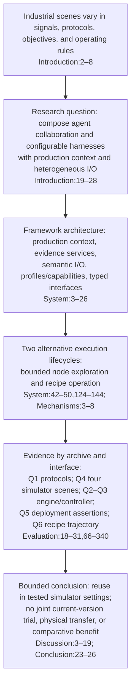

## Logic Chain Review

### Logic Chain Diagnostic

The manuscript's central chain is internally consistent: scene variability motivates a configurable integration framework; the system and workflow sections explain the components and the two route lifecycles; the evaluation then assigns separate evidence units to protocol mappings, process scenes, live-engine tasks, deterministic control, deployment assertions, and recipe operation. The Discussion and Conclusion explicitly preserve the limits of that evidence rather than treating the archives as one end-to-end or comparative experiment.

### Breakpoints (quoted)

- No high-confidence logical jump, causal inversion, or inconsistent conclusion was found in the requested Introduction → framework/workflows → experiments → Discussion/Conclusion chain.
- Contribution-to-evidence trace:
  - Contribution 1 (Introduction:30–35), “It presents an extensible architecture that combines agent-team orchestration and configurable agent-engine adapters with analysis/model services, production objects, semantic industrial I/O, and typed extension interfaces.” The architecture sections describe these elements. The experiments provide partial operational evidence across protocol, API/deployment, and agent-task surfaces; they do not empirically validate every service. In particular, the paper states, “The evaluation does not test model-assisted control response” (`sections/system.tex:116–122`). This is a scope boundary, not an overclaim in the contribution as written.
  - Contribution 2 (Introduction:36–38), “process-specific signal maps, protocols, objectives, and guards configure shared services, while bounded node exploration and recipe operation preserve their distinct execution and evidence lifecycles.” The four Q4 scenes exercise configuration-based reuse under one archived harness; Q1 exercises multiple protocol mappings; Q6 follows the recipe trial and update path. The limitation is explicit: “profile variation and current recipe integration were not tested” (`sections/system.tex:22–26`), and the recipe archive records “No `\texttt{recipe\_apply}` call” (`sections/evaluation.tex:295–299`). Thus the evidence supports distinct route behavior in the tested archives, not a current-version, jointly exercised route set.
  - Contribution 3 (Introduction:39–44) enumerates the evaluation units and says “No paired strategy comparison was run.” The Evaluation section reports those units and makes their non-equivalence explicit: “The archives are complementary implementation evidence, not one joint current-version trial” (`sections/evaluation.tex:9–13`). Q4 is one seed-42 trajectory per process (`sections/evaluation.tex:66–71`); Q5 calls its checks “deterministic assertions, not independent plant samples” (`sections/evaluation.tex:215–233`); Q6 is one simulator trajectory and explicitly says the saved version was not applied (`sections/evaluation.tex:288–319`). These support implementation/configuration claims at the stated scope, not statistical generalization or comparative process benefit.

### Page layout diagnosis

- Rendered `main.pdf` is 10 pages. Page 2 has conspicuous unused space in the lower right column while the left column continues almost to the bottom. Page 3 is not similarly sparse: Fig. 1 is at the top and the following framework text fills both columns to near the normal bottom margin. The rendered PDF places Fig. 1 on page 3 and Fig. 2 on page 4, so the requested separation already holds.
- The likely local cause is `\FloatBarrier` immediately after Fig. 1 (`sections/system.tex:28–40`). Fig. 1 is a two-column top float and is deferred to page 3; the barrier blocks the prose after it from flowing into the remaining page-2 column. The minimal source change is to remove that immediate barrier. Keep the existing `\clearpage` before Fig. 2 (`sections/system.tex:71`): it flushes pending floats before the second figure, preserving their order and separate-page placement. Recompile and inspect pages 2–4 after that change; this review did not modify the manuscript or compile a revised PDF.

